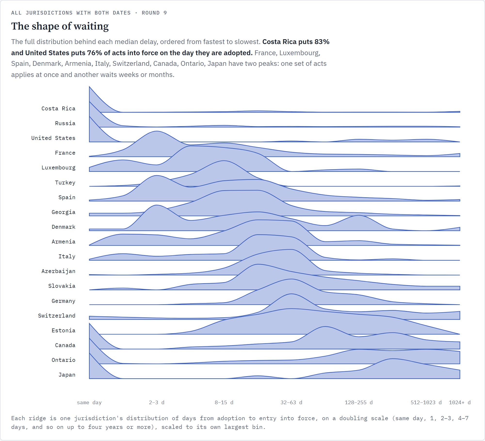

# Git for Global Law

**The world's law in one git history. Every word traced to the law that wrote it for any country and any date.**

An expansion of the same for the US Code, [#1 on Hacker News (28/10/26)](https://news.ycombinator.com/item?id=50268380).
Semantic, searchable law on a global scale.

https://github.com/user-attachments/assets/f24f3411-24d9-416a-8c45-9cebc817c64e

**Free to use: [CC0](LICENSE.md).** Fork it, build on it, ship it in a product: no permission or credit needed. The law text
sits in each country's repository, under that repository's own terms.

The law of many jurisdictions as one git history. Each jurisdiction's law is its own repository, where every commit
is one law taking effect, written by that law. This repository arranges those repositories by jurisdiction as
submodules, and each commit here moves them forward to their latest commits. The dates come from each repository's
own history: the tools read the `In-force` trailer of every commit there, so they can give the law of any country on
any date. Until 2 November 2026 this repository also interleaved those histories into one commit per law, in the order
the changes took force; that part of the history is still here, frozen, but it no longer grows, and some of the
commits it pins were later rebuilt and are gone.

```
global-law/
├── manifest.json            the first 107 corpora, as of 2 November 2026; .gitmodules lists them all
├── jurisdiction.json        the world, and its children: 193 UN members, other territories with their own ISO code, and the EU
├── germany/                 Germany (ISO code DE in its jurisdiction.json)
│   ├── SOURCES.md           where German law can be read, with what each source offers
│   └── bund/                federal law
│       └── acts/            submodule: the Grundgesetz since 1949 (grundgesetz/), every other federal act since 2019
├── estonia/                 Estonia
│   └── national/acts/       submodule: Estonia's law history, from its corpus.json
├── france/                  France
│   └── national/acts/       submodule: every consolidated text in LEGI, the database behind Légifrance
└── …                        every other country, the same way
```

Folders follow the jurisdictions: `<country>/<level>/<corpus>` for national or federal law and for a state or
province (`brazil/bahia/acts`), and `<country>/<state>/<city>/acts` for a city or regency within one
(`brazil/bahia/salvador/acts`). A corpus moved to a new folder keeps working under its old path in the tools
(`data/moved-paths.tsv`).

Each country's law lives in its own repository, `lexifina/<country>-law`, which says where it belongs here in a
`corpus.json` at its root. A country whose repository still holds only its sources (no law yet) has a folder with its
`jurisdiction.json` and `SOURCES.md`, and no submodule. Not every submodule holds a history of the law: some hold only
the current text, and some only a list of acts with no text, where the publisher's terms do not allow copying it. Each
corpus's own README says which. Laws adopted but not yet in force are kept on a future branch by most corpora; a few
keep them on `main`, dated ahead, and the tools show them only from that date.

Corpora differ widely in reach. Some hold a country's whole statute book (Czechia, Spain, Switzerland, Georgia, Malta);
others hold a few acts, or a sample: the US corpus is nine titles of the United States Code, and the UK corpus is the
special educational needs law. For the corpora in `manifest.json`, it gives each one's `coverage`; for the rest, their
own `corpus.json` or README does. `history` says how a corpus's past is known:
`in-force` (dated official versions), `replayed` (rebuilt by applying each amending act; its `verification` says which
dates were checked) or `current-only` (today's text only).

## Using it from an AI model (MCP)

`tools/mcp_server.py` is a Model Context Protocol server for this tree. It lets Claude or any other MCP client ask the
law what it said on a date, and every answer states where its record starts and ends. It uses only Python 3.9+ and
git, runs on your machine over stdio, reads the repository and changes nothing. It makes no network calls.

You can download one country's law instead of the whole tree, which is several GB. The clone itself is the shared
index of every country, about 650 MB; Romania then adds about 60 MB:

```sh
git clone https://github.com/lexifina/global-law && cd global-law
python3 tools/countries.py add romania      # git downloads Romania's history only
claude      # or open the folder in Cursor, VS Code or Codex: the server starts on its own
```

For every country, clone with `--recurse-submodules` instead. The server serves the countries in your clone and, when
asked about another, names the command that adds it. [MCP.md](MCP.md#only-some-countries) has the details.

The clone carries the setup for Claude Code (`.mcp.json`), Cursor (`.cursor/mcp.json`), VS Code (`.vscode/mcp.json`)
and Codex (`.codex/config.toml`, once you trust the project), and an `AGENTS.md` that tells agents to use the server.
Each starts `tools/mcp.sh` through git, which finds Python 3.9 or newer as `python3`, `python` or `py`, so the same
files work on macOS, Linux and Windows. For a client elsewhere (Claude Desktop and the like), add this to its MCP
settings:

```json
{ "mcpServers": { "global-law": { "command": "git", "args": ["-C", "/path/to/global-law", "-c", "alias.global-law-mcp=!sh tools/mcp.sh", "global-law-mcp"] } } }
```

Then ask in plain words, for example:

- "What did 11 U.S.C. §1182(1) say on 1 May 2022, and which law last changed it?"
- "A case was commenced on 2022-05-01 under §1182. Which text applies, period by period?"
- "Is the text of s. 42 Children and Families Act 2014 that the Court of Appeal applied in 2020 still in force?"
- "Which provisions rely on 11 U.S.C. §1182, and which judgments does the record hold for it?"
- "Check every citation in this brief against the law in force today."

It has 18 read-only tools, three prompts and a resource template. The tools cover finding a provision, reading it on a
date, who wrote each word, comparing dates, a provision's history, the laws between two dates, searching the text and
the change notes, when words entered or left the law, what else a change affects, checking precedent, resolving the
citations in a brief, and which text applies to a case. Old paths with ISO country codes (`us/federal/usc/...`, `de`)
are still read. MCP.md has the full tool list, the protocol versions, the security measures and how it compares with
other law MCP servers. The tests are `python -m unittest tests.test_mcp`.

## How it is built

- The first commit, dated 1 January 1970, holds the jurisdiction tree and the list of corpora, and no law.
- Every later commit moves exactly one corpus to its next commit. Its author is the law, as in the corpus, and its
  trailers name the corpus, the corpus commit, the law and the in-force date.
- The order is the in-force date, keeping each corpus's own order.
- The last commit adds this README, the tools and the tests.
- The build is deterministic. When a corpus is rebuilt, for example after a correction, this repository is rebuilt from
  scratch and force-pushed.

## Dates

Git cannot store dates before 1970, so changes to the Grundgesetz that took effect earlier carry 1970 commit dates, one
second apart, in the right order. The `In-force` trailer is authoritative and the tools use it, so
`law.py show 1956-03-19 …` works.

## What it does not show

- Each corpus covers only what its README says. A file missing on a date can mean the provision was not yet in force or
  that the corpus does not reach that far back.
- A later law that reaches back to earlier dates (retroactive application) is recorded in the corpus's commit messages
  but does not change the text shown on those earlier dates.
- `git blame` works by line, so a line changed in part is credited to the last law that touched it. `law.py words`
  credits each word instead, by comparing each version with the one before; text rewritten in place is credited to
  the law that rewrote it, even where a few of its words are the same as before. Both `law.py blame` and `words` take
  the versions in the order they took force, so an older act or a correction appended after newer ones is never
  credited with words that came later; plain `git blame` inside a corpus follows the order of the commits instead.
- Not every commit is a law taking effect. Corpora mark the others in `Kind:`, and the tools say what each is: a
  starting text (the text as a publisher gave it on the day it was read, with no law named, so it shows where the
  record starts, not when the law came into force), a correction, a court ruling, a treaty, or a change no law is
  named for. `law.py laws` lists only laws taking effect, and says how many of the others it left out. A `Kind:` the
  tools do not know is read as a law and named in the caveats.

## Visualisation suite



[See all global law cohort visualisations and bridges here](visualisations/)

## Reading it

```
git clone https://github.com/lexifina/global-law && cd global-law
git submodule update --init          # every country; or python3 tools/countries.py add <country> for some

python tools/law.py world 2022-05-01                       what every corpus looked like that day
python tools/law.py show 2022-05-01 united-states/federal/usc/title-11/1182.md
python tools/law.py blame 2022-07-01 united-states/federal/usc/title-11/1182.md
python tools/law.py words 2022-07-01 united-states/federal/usc/title-11/1182.md
python tools/law.py diff 2022-05-01 2022-07-01 united-states/federal/usc/title-11/1182.md
python tools/law.py laws 1990-01-01 1990-12-31 germany
```

Dates must be written YYYY-MM-DD. When a date falls before a record starts or after it ends, the tools say so on
stderr, because each country's record covers a different period (see `record_to` in `manifest.json`, or in the
corpus's own `corpus.json`). They also say when a record holds only current text, or a list of acts without their
text, and when a corpus's `main` holds changes not yet in force.

The first time `law.py` reads a corpus it indexes the corpus's history once, which takes from under a second to about
a minute and a half for France, and keeps the index in this clone's git folder (`.git/global-law-cache`, never
committed). Later reads load it in a second or two; when the tree moves a corpus's pin forward, only the new commits
are added. Deleting the folder is always safe. A corpus checkout that has not fetched the commit the tree pins stops
with `git submodule update --init -- <corpus>`, rather than answering from an older commit.

Plain git works too, with care:

- `git log --first-parent` lists when each corpus was moved forward here, not when laws took effect. Up to
  2 November 2026 it was a world chronology of laws taking effect, and those commits are still in the history.
- `git grep --recurse-submodules <term>` searches the latest text of every country checked out. For the law on a
  date, use the tools: a corpus's commits are not always in the order the changes took force, because older acts can
  be added after newer ones.
- `git diff --submodule=diff <commit> <commit>` shows every change between two commits here.
- Inside a corpus, `git blame` names the law that wrote each line, and `git log -p --word-diff -- <file>` shows each
  law's change word by word, which matters where a line is a whole paragraph. Blame and log do not cross from here
  into a corpus: run them in the corpus folder, or use `law.py`.
- To look around an older moment, use a separate worktree, not `git checkout` here:
  `git worktree add ../then <commit> && cd ../then && git submodule update --init`. Checking out an old commit here
  leaves the folders of corpora that did not exist yet, and the tools, which live in the last commit, disappear.
  Commits made here before 3 November 2026 may pin corpus commits that were later rebuilt and are no longer published;
  `git submodule update` then fails for those corpora.
- Git cannot store dates before 1970, so `git log --before=1960-01-01` gives a wrong answer without saying so. The
  tools read the `In-force` trailer instead.
- Don't clone with `--depth` (here, or with `--shallow-submodules`): every date is read from the whole history, so a
  shallow clone cannot answer. `law.py` and the MCP server stop and name the fix, `git fetch --unshallow` in the
  shallow clone. To save time, fetch fewer countries instead (above).
- The tags here (`germany/bund/acts/gg/36` and the like) are each corpus's own tags as they stood on 29 October 2026,
  copied under its path; they are not kept up to date. For current tags, look inside the corpus.
- After a corpus is rebuilt (its maintainers force-push), run `git submodule update --init` and, inside that corpus,
  `git fetch --force --tags`: a plain fetch keeps old tags with the same names.
- After a pull that moves corpora to new folders (`data/moved-paths.tsv` lists them), run `git submodule sync` and
  `git submodule update --init`, then delete the old folders the file names: git leaves them in place.
- The whole tree with every country is several GB (France alone is over 1 GB). Most uses need a few countries:
  `python3 tools/countries.py add <country>` fetches one country's history only.
- `manifest.json` and each folder's `jurisdiction.json` are written by `tools/describe.py` from the corpora pinned
  here, each described by its own repository; run it after adding or moving corpora.

- The most amended provisions of a corpus: inside its folder, `git log --format= --name-only | sort | uniq -c | sort -rn | head`.

## Tests

```
python -m unittest discover -s tests -v
```

`tests/test_law.py` checks the jurisdiction tree and the timeline, known readings in each country, and that the
answers here agree with each corpus read with its own tools; it needs the corpora it reads checked out.
`tests/test_law_fixtures.py` needs none: it builds small corpora in a temporary folder for each way a corpus records its
law (older acts appended after newer ones, corrections, a publisher's starting text, court rulings and treaties, a
list of acts without their text, laws not yet in force on main, unfinished, shallow and out-of-date checkouts, a pin
that moves forward) and checks what `law.py` reads from each.

## How it was made

Up to 2 November 2026, `tools/build.py` built this repository from the published corpus repositories,
deterministically, and REPRODUCE.md records that build: the command, the software, the commits pinned, the decisions
made by hand and what an AI model did and did not do. Since then the repository is not rebuilt: each commit only adds
corpora as submodules and moves their pins forward, so its history only grows.

## Videos

https://github.com/user-attachments/assets/6020acb1-53f3-4b65-94a4-fe132b867358

https://github.com/user-attachments/assets/3e3076d7-cfb4-4e0a-8552-2926a630fc8e

## License

This repository is [CC0](LICENSE.md). The law text is in each country's repository, under that repository's own terms.
