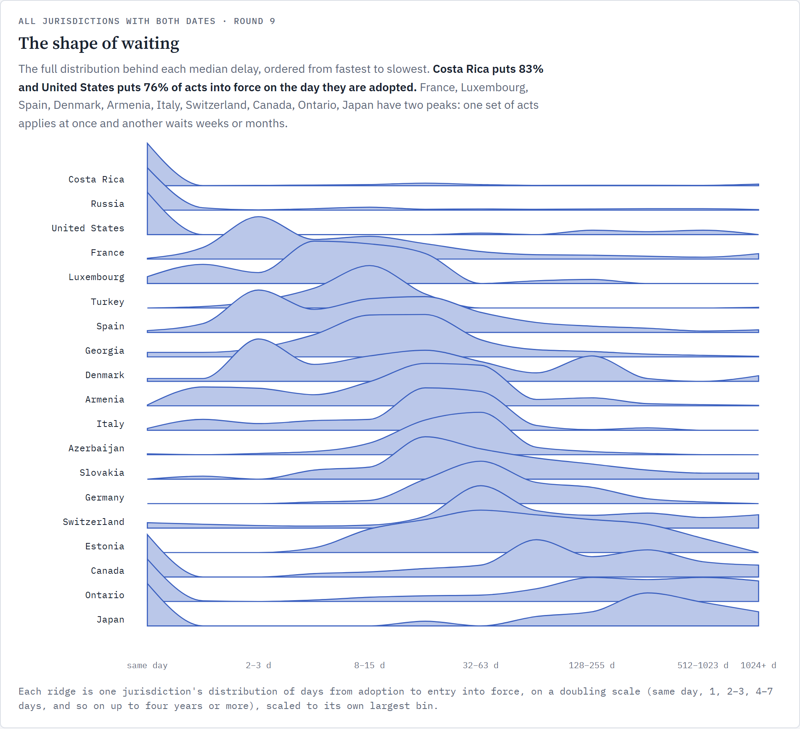

# Git for Global Law

> **Preview branch: work in progress.** Each country is pinned at its `wip` branch where that holds law which passes the preflight, and at its `main` otherwise. Text on `wip` has not passed its builder's final checks. Use `main` for the checked record. From `wip` here (27): `andorra/national/acts`, `australia/australian-capital-territory/acts`, `australia/federal/acts`, `australia/northern-territory/acts`, `australia/south-australia/acts`, `australia/tasmania/acts`, `australia/western-australia/acts`, `belize/national/acts`, `canada/newfoundland-and-labrador/acts`, `canada/northwest-territories/acts`, `costa-rica/national/acts`, `denmark/national/acts`, `faroe-islands/national/acts`, `finland/national/acts`, `hong-kong/national/acts`, `ireland/national/acts`, `kosovo/national/acts`, `madagascar/national/acts`, `mexico/national/acts`, `nauru/national/acts`, `pakistan/national/acts`, `russia/national/acts`, `san-marino/national/acts`, `south-africa/national/acts`, `trinidad-and-tobago/national/acts`, `united-states/guam/acts`, `united-states/northern-mariana-islands/acts`.

**The world's law in one git history. Every word traced to the law that wrote it for any country and any date.**

An expansion of the same for the US Code, [#1 on Hacker News (28/10/26)](https://news.ycombinator.com/item?id=50268380).
Semantic, searchable law on a global scale.

https://github.com/user-attachments/assets/f24f3411-24d9-416a-8c45-9cebc817c64e

**Free to use: [CC0](LICENSE.md).** Fork it, build on it, ship it in a product: no permission or credit needed. The law text
sits in each country's repository, under that repository's own terms.

The law of many jurisdictions as one git history. Each jurisdiction's law is its own repository, where every commit
is one law taking effect, written by that law. This repository arranges those repositories by jurisdiction and
interleaves their histories in the order the changes took force, so a single commit here is the state of all of them on
one day.

```
global-law/
├── manifest.json            every corpus: path, source repo, coverage, which trailer holds the in-force date
├── jurisdiction.json        the world, and its children: 193 UN members, other territories with their own ISO code, and the EU
├── germany/                 Germany (ISO code DE in its jurisdiction.json)
│   ├── SOURCES.md           where German law can be read, with what each source offers
│   └── bund/                federal law
│       └── acts/            submodule: the Grundgesetz since 1949 (grundgesetz/), every other federal act since 2019
├── estonia/                 Estonia
│   └── national/acts/       submodule: Estonia's law history, from its corpus.json
├── france/                  France: jurisdiction.json and SOURCES.md, no history yet
└── …                        every other country, the same way
```

Each country's law lives in its own repository, `lexifina/<country>-law`, which says where it belongs here in a
`corpus.json` at its root. A country whose repository still holds only its sources (no law yet) has a folder with its
`jurisdiction.json` and `SOURCES.md`, and no submodule: only real law is pinned. Laws adopted but not yet in force stay
on each corpus's future branch; `main` here holds only what is in force by the build date.

Corpora differ widely in reach. Some hold a country's whole statute book (Czechia, Spain, Switzerland, Georgia, Malta);
others hold a few acts, or a sample: the US corpus is nine titles of the United States Code, and the UK corpus is the
special educational needs law. `manifest.json` gives each corpus's `coverage`, and `history` says how its past is known:
`in-force` (dated official versions), `replayed` (rebuilt by applying each amending act; its `verification` says which
dates were checked) or `current-only` (today's text only).

## Using it from an AI model (MCP)

`tools/mcp_server.py` is a Model Context Protocol server for this tree. It lets Claude or any other MCP client ask the
law what it said on a date, and every answer states where its record starts and ends. It uses only Python 3.10+ and
git, runs on your machine over stdio, reads the repository and changes nothing. It makes no network calls.

```sh
git clone --recurse-submodules https://github.com/lexifina/global-law && cd global-law
claude mcp add global-law -- python tools/mcp_server.py      # Claude Code; or approve the project's .mcp.json
```

For other clients (Claude Desktop, Cursor and the like), add this to their MCP settings:

```json
{ "mcpServers": { "global-law": { "command": "python", "args": ["/path/to/global-law/tools/mcp_server.py"] } } }
```

Then ask in plain words, for example:

- "What did 11 U.S.C. §1182(1) say on 1 May 2022, and which law last changed it?"
- "A case was commenced on 2022-05-01 under §1182. Which text applies, period by period?"
- "Is the text of s. 42 Children and Families Act 2014 that the Court of Appeal applied in 2020 still in force?"
- "Which provisions rely on 11 U.S.C. §1182, and which judgments does the record hold for it?"
- "Check every citation in this brief against the law in force today."

It has 18 read-only tools, three prompts and a resource template. The tools cover finding a provision, reading it on a
date, who wrote each word, comparing dates, a provision's history, the laws between two dates, searching the text and
the change notes, when words entered or left the law, what else a change affects, checking precedent, resolving the
citations in a brief, and which text applies to a case. Old paths with ISO country codes (`us/federal/usc/...`, `de`)
are still read. MCP.md has the full tool list, the protocol versions, the security measures and how it compares with
other law MCP servers. The tests are `python -m unittest tests.test_mcp`.

## How it is built

- The first commit, dated 1 January 1970, holds the jurisdiction tree and the list of corpora, and no law.
- Every later commit moves exactly one corpus to its next commit. Its author is the law, as in the corpus, and its
  trailers name the corpus, the corpus commit, the law and the in-force date.
- The order is the in-force date, keeping each corpus's own order.
- The last commit adds this README, the tools and the tests.
- The build is deterministic. When a corpus is rebuilt, for example after a correction, this repository is rebuilt from
  scratch and force-pushed.

## Dates

Git cannot store dates before 1970, so changes to the Grundgesetz that took effect earlier carry 1970 commit dates, one
second apart, in the right order. The `In-force` trailer is authoritative and the tools use it, so
`law.py show 1956-03-19 …` works.

## What it does not show

- Each corpus covers only what its README says. A file missing on a date can mean the provision was not yet in force or
  that the corpus does not reach that far back.
- A later law that reaches back to earlier dates (retroactive application) is recorded in the corpus's commit messages
  but does not change the text shown on those earlier dates.
- `git blame` works by line, so a line changed in part is credited to the last law that touched it. `law.py words`
  credits each word instead, by comparing each version with the one before; text rewritten in place is credited to
  the law that rewrote it, even where a few of its words are the same as before.

## Visualisation suite



[See all global law cohort visualisations and bridges here](visualisations/)

## Reading it

```
git clone https://github.com/lexifina/global-law && cd global-law
git submodule update --init

python tools/law.py world 2022-05-01                       what every corpus looked like that day
python tools/law.py show 2022-05-01 united-states/federal/usc/title-11/1182.md
python tools/law.py blame 2022-07-01 united-states/federal/usc/title-11/1182.md
python tools/law.py words 2022-07-01 united-states/federal/usc/title-11/1182.md
python tools/law.py diff 2022-05-01 2022-07-01 united-states/federal/usc/title-11/1182.md
python tools/law.py laws 1990-01-01 1990-12-31 germany
```

Dates must be written YYYY-MM-DD. When a date falls before a record starts or after it ends, the tools say so on
stderr, because each country's record covers a different period (see `record_to` in `manifest.json`).

Plain git works too, with care:

- `git log --first-parent` is a world chronology of laws taking effect.
- `git grep --recurse-submodules <term> <commit>` searches all the law in force at that moment, in every country.
- `git diff --submodule=diff <commit> <commit>` shows every change in every country between two moments.
- Inside a corpus, `git blame` names the law that wrote each line, and `git log -p --word-diff -- <file>` shows each
  law's change word by word, which matters where a line is a whole paragraph. Blame and log do not cross from here
  into a corpus: run them in the corpus folder, or use `law.py`.
- To look around an older moment, use a separate worktree, not `git checkout` here:
  `git worktree add ../then <commit> && cd ../then && git submodule update --init`. Checking out an old commit here
  leaves the folders of corpora that did not exist yet, and the tools, which live in the last commit, disappear.
- Git cannot store dates before 1970, so `git log --before=1960-01-01` gives a wrong answer without saying so. The
  tools read the `In-force` trailer instead.
- Each corpus's own tags are copied here under its path, for example `germany/bund/acts/gg/36`.
- After a corpus is rebuilt (its maintainers force-push), run `git submodule update --init` and, inside that corpus,
  `git fetch --force --tags`: a plain fetch keeps old tags with the same names.

- The most amended provisions of a corpus: inside its folder, `git log --format= --name-only | sort | uniq -c | sort -rn | head`.

## Tests

```
python -m unittest discover -s tests -v
```

The 48 tests check the jurisdiction tree and the timeline, known readings in each country, and that the answers here
agree with each corpus read with its own tools. REPRODUCE.md lists them, with the exact build and a hash-for-hash
rebuild check.

## How it was made

`tools/build.py` builds this repository from the published corpus repositories, deterministically. REPRODUCE.md
records the command, the software, the commits pinned, the decisions made by hand and what an AI model did and did
not do.

## Videos

https://github.com/user-attachments/assets/6020acb1-53f3-4b65-94a4-fe132b867358

https://github.com/user-attachments/assets/3e3076d7-cfb4-4e0a-8552-2926a630fc8e

## License

This repository is [CC0](LICENSE.md). The law text is in each country's repository, under that repository's own terms.
