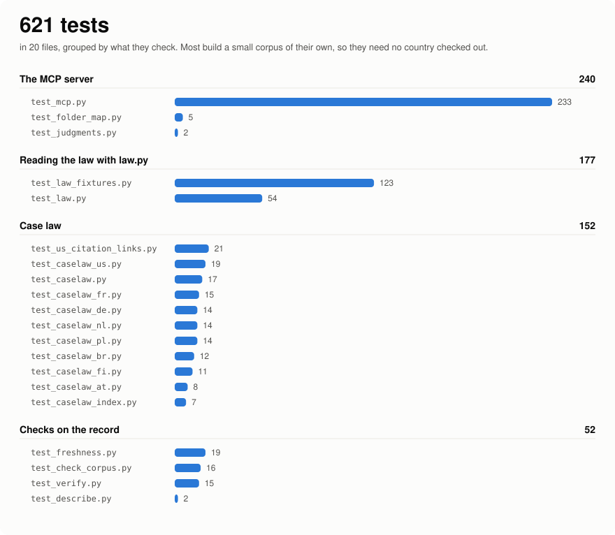

# Tests

<picture>
<source media="(prefers-color-scheme: dark)" srcset="chart-dark.svg">

</picture>

```sh
python -m unittest discover -s tests             # every test
python -m unittest tests.test_law_fixtures -v    # one file
```

Most tests build a small corpus of their own in a temporary folder, so they need no country checked out.
`test_law.py` reads the corpora a clone has checked out.

| What they check | Files |
|---|---|
| **The MCP server**, spoken to as a client does (JSON-RPC over stdio), its folder map and every recorded judgment `case_check` reads | `test_mcp.py`, `test_folder_map.py`, `test_judgments.py` |
| **Reading the law with `law.py`**: each way a real corpus records its law (older acts appended after newer ones, corrections over past dates, a publisher's starting text), and checks on the tree itself | `test_law_fixtures.py`, `test_law.py` |
| **Case law**: each country's court decisions read with the same tools as law (Austria, Brazil, Finland, France, Germany, the Netherlands, Poland, Switzerland, the United States), the case-law index, and how US decisions link to the US Code | `test_caselaw*.py`, `test_us_citation_links.py` |
| **Checks on the record**: freshness, a corpus's pin diff, `verify.py` on shallow clones, and `describe.py` | `test_freshness.py`, `test_check_corpus.py`, `test_verify.py`, `test_describe.py` |

The chart counts the tests in each file; `python performance/charts.py` redraws it.
