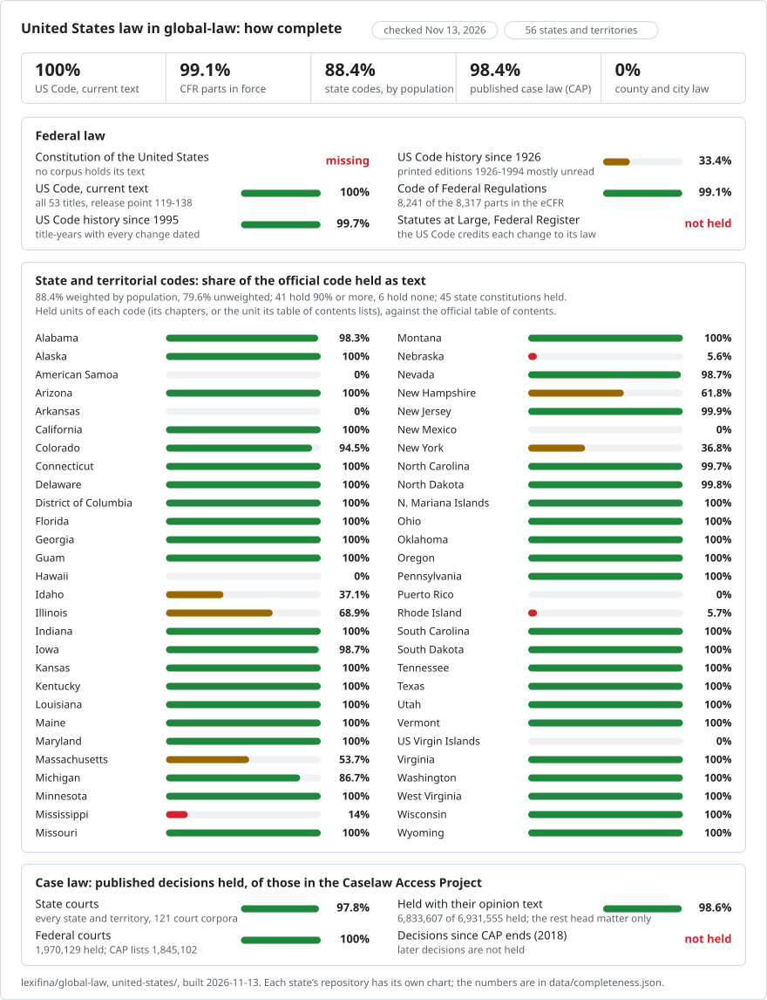

<!-- generated by tools/folder_readmes.py: edits here are overwritten -->
# United States

[global-law](../) / United States

208 repositories under this folder (1 legislation, whole country, 53 legislation, subdivisions, 2 regulations and guidance, 152 case law): see [REPOSITORIES.md](REPOSITORIES.md).

## Completeness of the whole country, checked 2026-11-13

<picture>
<source media="(prefers-color-scheme: dark)" srcset="completeness-dark.svg">

</picture>

56.0% of the plan (every source a US lawyer or citizen needs, 31 parts weighted by how binding each is and how often it is used) is in global-law. Strong: the US Code, the CFR, the state codes and the published case law to 2018. Missing: the Constitution's own text, session laws and the Statutes at Large, state administrative codes (two states), decisions since 2018, court rules, all county and city law (New York City collected, not yet in global-law), tribal codes, treaties and legislative history. Federal: the US Code is whole as current text (53 titles, release point 119-138; history 99.7% since 1995, 33.4% since 1926), the CFR holds 8,241 of the eCFR's 8,317 parts in force, and the Constitution, the Statutes at Large and the Federal Register are not held. States: 41 of 56 hold 90% or more of their code and 6 hold none; 88.4% weighted by population (79.6% unweighted). Case law: 98.4% of the 6,920,596 published decisions in the Caselaw Access Project are held (6,931,555 decisions in all, 98.6% of them with their opinion text); decisions after CAP's end (2018) are not held. No county or city law is held.

Each state's code: the units of the official table of contents (chapters, or the code's own unit) read from the publisher on the date shown, against the units with law text in the repository's tree (us/verified in eu-law-charts; one reviewer per state, spot checks against the official text). CFR: parts in force in the eCFR structure of each title against the part folders held. Case law: decisions held per jurisdiction against CAP's own case counts. Population: 2020 census. Every figure is in [data/completeness.json](../data/completeness.json).

### The plan: every source a lawyer or citizen needs

**56%** of the plan is in global-law, weighted by how binding each source is and how often it is used; **56.1%** counting sources collected but not yet in global-law. 9% of the weight is in parts whose official total is an estimate. Updated 2026-11-13.

| Part | Will be in | Weight | Progress | How | Status |
| --- | --- | ---: | --- | --- | --- |
| **Federal legislation** | | **20%** | **75%** | | |
| Constitution of the United States | `none yet` | 3% | 0 of 28 texts (the Constitution and 27 amendments) · 0% | constitution.congress.gov / GovInfo CONAN | not started |
| US Code, current text | `united-states/federal/usc` | 12% | 53 of 53 titles (release point 119-138) · 100% | the Office of the Law Revision Counsel's XML, every title | done |
| US Code, every change since 1995 | `united-states/federal/usc` | 3% | title-years with every change dated, 1995-2026 · 99.7% | GovInfo annual editions and release points, each change credited to its law | done |
| Statutes at Large (public and private laws) | `none yet` | 2% | 0 of about 47,000 public laws and 45,000 private laws (138 volumes) · 0% | GovInfo Statutes at Large and public-law XML; medium-confidence total | not started |
| **State legislation** | | **21%** | **71.9%** | | |
| State and territorial constitutions | `united-states/<state>/acts` | 3% | 45 of 53 (D.C., Guam and the Virgin Islands have none: their charters are held), weighted by population · 90.6% | each state's official text | collecting |
| State and territorial codes | `united-states/<state>/acts` | 13% | 41 of 56 hold 90% or more; weighted by population · 88.4% | each code's official table of contents against the units held (one reviewer per state) | collecting |
| State codes, every change dated | `united-states/<state>/acts` | 3% | 9 of 56 codes hold dated earlier versions; weighted by population · 27.3% | annual editions and session laws replayed onto the code | collecting |
| Session laws, 1995-2026 | `united-states/<state>/acts (session-law folders)` | 2% | 20,170 of about 603,000 laws enacted (10 states hold some) · 3.3% | each legislature's chaptered acts as enacted; low-confidence total | collecting |
| **Regulations and guidance** | | **21.5%** | **44.5%** | | |
| Code of Federal Regulations | `united-states/federal/cfr` | 8% | 8,241 of 8,317 parts listed in force (2026-11-10); of the 76 not held, about 8 carry text, the rest are headings or reserved · 99.9% | eCFR, every version since 2015 | collecting |
| Federal Register (rules, proposed rules, notices) | `none yet` | 2% | 0 of 976,037 documents since 1994 · 0% | FederalRegister.gov API | not started |
| Executive orders and proclamations | `none yet` | 1% | 0 of 14,438 executive orders and 11,080 proclamations · 0% | Federal Register presidential documents; earlier ones from the National Archives | not started |
| IRS guidance (Internal Revenue Bulletin) | `united-states/federal/irs-guidance` | 1.5% | 10,111 of about 10,205 items published, 1996-2026 (48 gaps confirmed) · 99.1% | every bulletin, item by item; medium-confidence total | collecting |
| Other federal agency guidance and decisions | `none yet` | 1% | 0 of 473 agencies' guidance documents · 0% | each agency's guidance portal; low-confidence total | not started |
| State administrative codes | `united-states/ohio, south-carolina, guam` | 7% | Ohio 4,051 of about 21,000 rules; South Carolina 94 of 108 chapters (41% of its words); Guam some; none for 53 others; by words, weighted by population · 1.3% | each state's official administrative code; medium-confidence total | collecting |
| State registers | `none yet` | 1% | 0 of 56 registers · 0% | each state's official register | not started |
| **Case law** | | **22.5%** | **70.3%** | | |
| Federal courts, to 2018 (CAP) | `united-states/<court>/caselaw` | 7% | 1,970,129 decisions; CAP lists 1,845,102 · 100% | the Caselaw Access Project's published decisions | done |
| State courts, to 2018 (CAP) | `united-states/<state>/caselaw` | 9% | every state and territory, 121 court corpora, against CAP's counts (less 11,109 federal D.C. Circuit cases CAP files under D.C.) · 98% | the Caselaw Access Project's published decisions | done |
| Published decisions since 2018 | `none yet` | 5% | 0 of about 280,000 (federal appeals 30,000, Supreme Court 529, district 32,000, state appellate 215,000) · 0% | each court's own opinion pages; low-confidence total | not started |
| Unpublished and district-court decisions | `none yet` | 1% | 0 of about 485,000 unpublished appellate (federal 185,000) and 1.45M district-court documents since 2019 · 0% | each court's own opinion pages; medium-confidence total | not started |
| State attorney general opinions | `none yet` | 0.5% | 0 of about 100,000 (45 of 56 publish) · 0% | each attorney general's site; low-confidence total | not started |
| **Court rules** | | **3%** | **0.1%** | | |
| Federal rules (civil, criminal, appellate, evidence, bankruptcy) and local rules | `none yet` | 1% | 0 of 5 national rule sets and 94 districts' local rules · 0% | uscourts.gov and each court | not started |
| State rules of court | `united-states/guam, kentucky` | 2% | Guam 6 rule sets, Kentucky Rules of Evidence; none for 54 others · 0.2% | each state judiciary; medium-confidence total | collecting |
| **Local law** | | **6%** | **0%** | | |
| County, city and township codes | `none in global-law (united-states-new-york-city-law collected)` | 6% | 0 of 38,736 counties, municipalities and townships (about 10,500 codes online); New York City collected · 0% (1.6% collected) | each code's official or codifier's publication; medium-confidence total | collecting |
| **Tribal law** | | **1.5%** | **32.1%** | | |
| Tribal constitutions and codes | `none yet` | 1% | 0 of 574 tribes (NILL holds 400+ constitutions, 240+ codes) · 0% | each nation's own publication; medium-confidence total | not started |
| Tribal court decisions | `united-states/tribal/caselaw` | 0.5% | 2,277 of CAP's 2,368 (American Tribal Law, Navajo Reporter) · 96.2% | the Caselaw Access Project | done |
| **Treaties** | | **1.5%** | **0%** | | |
| Treaties and international agreements | `none yet` | 1.5% | 0 of about 1,100 treaties and 17,300 executive agreements · 0% | the State Department's treaty texts; Senate treaty documents; medium-confidence total | not started |
| **Legislative history** | | **1.5%** | **0%** | | |
| Congressional bills, reports and Record | `none yet` | 1% | 0 of about 390,000 bills (93rd-119th Congress), 172 Record volumes · 0% | congress.gov and GovInfo; medium-confidence total | not started |
| State bills | `none yet` | 0.5% | 0 of about 128,000 bills a year · 0% | each legislature; medium-confidence total | not started |
| **Historical law** | | **1.5%** | **1.3%** | | |
| US Code before 1995 (printed editions 1926-1994) | `united-states/federal/usc` | 1% | 11 of 542 title-editions read · 2% | Library of Congress scans, by OCR | collecting |
| Earlier state codes and compilations | `none yet` | 0.5% | 0 of 56 · 0% | state archives and law libraries; low-confidence total | not started |

### What is missing, and how long it would take

44 points of the plan are missing. By what stands in the way: **31.4** reachable from open sources, **8.6** need a licence or permission (vendor-hosted official texts, terms that bar copying), **3.9** blocked from here (403s, bot checks; not worked around), **0.2** behind fees, **0** with no online source. From open sources alone the plan can reach **87.4%**: about 1,129 builder-days and 2,482 hours of fetching, **28.2 weeks** with 8 builders working in parallel (all parts, open or not: 1,449 builder-days).

| Next, by plan points per builder-day | Points | Builder-days |
| --- | ---: | ---: |
| Constitution of the United States | +3 | 0.5 |
| Published decisions since 2018 | +5 | 6 |
| Statutes at Large (public and private laws) | +2 | 8 |
| Federal rules (civil, criminal, appellate, evidence, bankruptcy) and local rules | +1 | 7 |
| Executive orders and proclamations | +1 | 10 |
| State and territorial constitutions | +0.2 | 2.1 |
| Congressional bills, reports and Record | +1 | 12 |
| Federal Register (rules, proposed rules, notices) | +2 | 25 |
| Unpublished and district-court decisions | +1 | 14 |
| US Code before 1995 (printed editions 1926-1994) | +0.98 | 20 |
| State rules of court | +2 | 45 |
| State administrative codes | +4.44 | 102.5 |

Every part: what is missing, its size, access and effort

| Part | Missing | Size | Access | Effort | Blockers | History obtainable |
| --- | --- | --- | --- | --- | --- | --- |
| Constitution of the United States | 28 texts (Constitution + 27 amendments) | 20 pages, 0.0M words | reachable 100% | 0.5 builder-days, 0.2 h fetch (manual (28 texts) + dated commits per ratification) | – | Yes. Every amendment has a certified ratification date, so a 1788-1992 history of 28 commits is exact. |
| US Code, every change since 1995 | – | – | reachable 100% | 0 builder-days, 0 h fetch | – | – |
| Statutes at Large (public and private laws) | 117.2k granules (laws, resolutions, treaties, proclamations) in 138 volumes | 330,000 pages, 4.4 GB | reachable 100% | 8 builder-days, 2 h fetch (bulk download + parse) | api.govinfo.gov package/granule metadata needs a real api.data.gov key (DEMO_KEY rate-limited); vols 1-64 are vendor-digitized: expect OCR errors in the XML | Statutes are point-in-time enactments, so each law is dated by its approval date. This is the source for crediting pre-1995 US Code changes to their laws. |
| State and territorial constitutions | 8 jurisdictions or sub-parts | 468 pages, 0.5M words | reachable 72%, permission 28% | 2.4 builder-days, 0.8 h fetch (single page/PDF parse) | state copyright claim (Arkansas); nmonesource 403 | amendment history in notes; earlier texts via state archives |
| State and territorial codes | 22 jurisdictions or sub-parts | 193,331 pages, 128.9M words, 1.3 GB | reachable 44%, permission 37%, blocked 19% | 55.4 builder-days, 122.9 h fetch (3 chapter PDFs; API crawl of the 25 missing chapters; API crawl with a key (the 50 held laws already came from it)) | state claims copyright in the Code; only official online text is a Lexis app behind click-through terms (non-commercial, no bulk copying); content.leg.colorado.gov returns an empty 202 challenge to automated fetches; olls.info zip is directly reachable; Cloudflare challenge 403 on capitol.hawaii.gov | none online officially; Justia yearly copies 2006+ |
| State codes, every change dated | 56 jurisdictions or sub-parts | 9,054,525 pages, 55.1 GB | reachable 82%, permission 6%, blocked 12%, no source 0% | 542 builder-days, 763.5 h fetch (OGP PDFs as revised; Public.Resource releases as dated editions; bulk zips per year) | site refused or timed out from this machine; no online source; official code via LexisNexis under terms; 403/WAF on the official site | no official dated editions; only session laws (as enacted) and archive.org captures |
| Session laws, 1995-2026 | 56 jurisdictions or sub-parts | 3,496,260 pages, 1,456.8M words, 175.1 GB | reachable 100%, no source 0% | 228.5 builder-days, 323.4 h fetch (HTML/PDF per act; PDF text per act) | Cloudflare 403; site did not answer from this machine; ECONNREFUSED; 403; nmonesource 403; API key required | as-enacted texts are inherently dated (approval/effective dates); the gap before the earliest online year needs state library scans or HeinOnline (subscription) |
| Code of Federal Regulations | 76 eCFR part nodes (most are empty or group headings) | 300 pages | reachable 100% | 15 builder-days, 6 h fetch (bulk download + parse; diff consecutive annual editions; date changes from FR amendatory instructions) | – | Annual snapshots 1996-2015 (XML for all years; 1996 partial). Exact effective dates between snapshots come from FR rule documents (1994+) and the LSA. |
| Federal Register (rules, proposed rules, notices) | 976k documents since 1994 (plus about 14,600 un-indexed scanned issues 1936-1993) | 4,000,000 pages, 171 GB | reachable 100% | 25 builder-days, 40 h fetch (bulk download + parse (2000+); API crawl (1994-1999); PDF text + segmentation (1936-1993)) | 1936-1993: issue-level PDFs only, so documents must be split out from OCR text (headings, FR Doc. numbers); FR statistics page is captcha-gated, so pre-1994 page counts are secondary-source estimates | The FR is itself the dated change record: every rule document gives the CFR sections it amends and its effective date. It is the source for CFR history before 2015. |
| Executive orders and proclamations | 25.5k numbered EOs (14,438) + numbered proclamations (11,080) | 60,000 pages, 2 GB | reachable 100% | 10 builder-days, 4 h fetch (API crawl (1994+) + PDF text segmentation (1936-1993) + Statutes XML extraction (old proclamations) + manual/HathiTrust for pre-1936 EOs) | pre-1936 EOs: no official full-text bulk source; the main compilations are commercial (CIS microfiche, HeinOnline) or UCSB (terms bar republication); 1936-1993 texts must be cut from scanned FR PDFs | Yes for 1937+: the disposition tables give amended/revoked-by links, so each EO's status over time can be dated. |
| IRS guidance (Internal Revenue Bulletin) | 291 sequence-number gaps (Rev. Rul./Rev. Proc./Notice/Announcement); plus up to 119 T.D. numbers | 3,000 pages, 0.1 GB | reachable 100% | 2 builder-days, 1 h fetch (fetch the 48 confirmed PDFs + check the IRB tables of contents for the rest; Cumulative Bulletin OCR as a separate sub-part) | IRS does not host the pre-1996 Cumulative Bulletins; scans only (HathiTrust/Google), so OCR is needed | Items are dated by IRB issue. Supersession/modification is stated in each item, so a status history is derivable. |
| Other federal agency guidance and decisions | – | – | reachable 100% | 0 builder-days, 0 h fetch | – | – |
| State administrative codes | 55 jurisdictions or sub-parts | 983,715 pages, 491.9M words, 16.8 GB | reachable 64%, permission 11%, fee 2%, blocked 23% | 163.5 builder-days, 240.1 h fetch (API crawl; API crawl (GraphQL) of chapters/rules; Appian portal crawl; Register from UNT) | asbar.org and new.asbar.org return 403 to scripted clients (not worked around); azsos.gov returned 403 to both curl and WebFetch (WAF; not worked around); sos-rules-reg.ark.org returns 405 to GET from scripted clients (not worked around); Mercatus has no Arkansas data (not analysed in RegData 2.0 or | Register issues give dated changes; the code site shows history notes per rule but no prior full-text versions were seen |
| State registers | 56 jurisdictions or sub-parts | 983,715 pages, 491.9M words, 16.8 GB | reachable 64%, permission 11%, fee 2%, blocked 23% | 28 builder-days, 56 h fetch | asbar.org and new.asbar.org return 403 to scripted clients (not worked around); azsos.gov returned 403 to both curl and WebFetch (WAF; not worked around); sos-rules-reg.ark.org returns 405 to GET from scripted clients (not worked around); Mercatus has no Arkansas data (not analysed in RegData 2.0 or | Register issues give dated changes; the code site shows history notes per rule but no prior full-text versions were seen |
| Federal courts, to 2018 (CAP) | 99.7k decisions held with CAP head matter only | 0.5 GB | reachable 100% | 2 builder-days, 0 h fetch (bulk join: match held head-matter cases to CourtListener clusters by citation/harvard id and take CL opinion text where CL has a non-CAP source) | Most of these are table or memorandum dispositions (SCOTUS cert denials/summary orders, Pa./N.C. 'table' decisions) where the reporter printed no opinion; for pre-1990s ones no text exists anywhere; CourtListener's CAP merge reuses CAP's own text, so it adds text only where CL independently scraped | n/a |
| State courts, to 2018 (CAP) | – | – | reachable 100% | 0 builder-days, 0 h fetch | – | – |
| Published decisions since 2018 | 282k published (precedential) decisions, 2019-2026 | 3,400,000 pages, 1,100.0M words, 8 GB | reachable 100% | 6 builder-days, 3 h fetch (bulk download + parse (CourtListener opinions + clusters + dockets + courts, filter date_filed >= 2019-01-01, precedential_status = Published)) | CourtListener API caps (125 requests/day) make an API crawl impossible; the bulk file is the only practical route; Per-court counts in CourtListener could not be taken: API needs a token and the coverage pages moved to wiki.free.law without per-court numbers; GovInfo API needs a personal api.data.go | Decisions are dated by date_filed; later corrections and withdrawn/amended opinions appear as separate rows or updated text between quarterly snapshots, so revisions are only visible by diffing snapsh |
| Unpublished and district-court decisions | 3 jurisdictions or sub-parts | 14,740,000 pages, 5,200.0M words, 228 GB | reachable 100% | 14 builder-days, 252 h fetch (API crawl (GovInfo packages/granules) + PDF text; PACER written-opinions report for the ~19 missing districts; bulk download + parse; bulk download + parse (same pass as published), GovInfo API to fill gaps) | Summary orders that are only docket text entries (no PDF) are reachable only through PACER dockets ($0.10/page) or RECAP; Several states take unpublished opinions offline after 60 days to a few years (California nonpublished list is a rolling window), so only CourtListener's captured copies exist fo | Filed date only. |
| State attorney general opinions | 80k formal (and published informal) AG opinions available online, cumulative | 400,000 pages, 160.0M words, 25 GB | reachable 100% | 25 builder-days, 40 h fetch (HTML scrape + PDF text (OCR for pre-1995)) | MA, RI, UT (and stale MO, NJ, NC, PA, VT) not online; some AG sites behind bot walls (not to be bypassed); older archives are image scans needing OCR | Opinions are dated; withdrawn/overruled lists exist for TX and GA; no versioning. |
| Federal rules (civil, criminal, appellate, evidence, bankruptcy) and local rules | 2 jurisdictions or sub-parts | 26,200 pages, 10.9M words, 0.5 GB | reachable 100% | 7 builder-days, 2.1 h fetch (PDF text (per-court link discovery); bulk download + parse (USLM, reuse the US Code parser)) | no central index; each court's page differs; past versions rarely kept | Each rule's USLM notes list every amendment date (e.g. 'As amended ... eff. Dec. 1, 2007'), from 1938 (FRCP) / 1946 (FRCrP) / 1968 (FRAP) / 1975 (FRE) / 1983 (FRBP); full prior texts via OLRC release |
| State rules of court | 54 jurisdictions (of 56; Guam and part of Kentucky held) | 60,000 pages, 25.0M words, 0.3 GB | reachable 100% | 45 builder-days, 15 h fetch (HTML scrape + PDF text) | Westlaw-hosted official rules (AZ, MD, NY 22 NYCRR) under vendor terms barring scraping; rule sets as amendment-order PDFs in some states, no consolidated text; PR rules in Spanish | Mostly current only; amendment orders posted by many supreme courts (e.g. Arizona rules forum, Colorado rule-change PDFs, Pa. Bulletin) allow dated changes from ~2000s; full past versions rare. |
| County, city and township codes | 2 jurisdictions or sub-parts | 8,030,000 pages, 3,500.0M words, 30.5 GB | permission 100%, blocked 0% | 63 builder-days, 2 h fetch (One human browser download of the official XML bulk files (the page offers them; that is a manual, permitted route, not a workaround), then parse; Local Laws via Legistar API with a free token; Per-city agreements or city-provided exports (many cities can export their own code from the codifier's admin tools), plus self-published PDFs; scraping the codifier sites is not an option under current blocks) | All three big codifiers (Municode, American Legal, eCode360) plus municipal.codes return 403 to automated clients; together they host about 82% of codes; Municode ToS bars copying/reproducing/republishing the site except as permitted; robots.txt Content-Signal ai-train=no, use=reference and named-bo | Codifiers keep supplement histories and some offer dated archived versions (Municode 'compare versions'/archive, eCode360 'previous versions' for some clients), but only through the blocked sites. Ord |
| Tribal constitutions and codes | 574 federally recognized tribes (constitution + code each); about 270 have something free online | 120,000 pages, 3 GB | permission 100% | 15 builder-days, 5 h fetch (Permission requests per nation (start with the ~240 with online codes), then PDF text/HTML parse; constitutions first (short, many already public federal records)) | NILL requires separate permission from each Tribal Nation to reuse materials in another collection; tribal sovereignty: reuse terms set by ~574 separate governments; about 300 tribes have no code online at all; Municode-hosted tribal codes 403 | Constitutions: original IRA-era texts and amendments are dated (BIA approval dates; OU/LoC historical copies). Codes: mostly current-only; Navajo and Cherokee publish resolutions/legislation via Legis |
| Tribal court decisions | 4k published tribal court opinions not in CAP (rough) | 40,000 pages, 0.5 GB | reachable 100% | 5 builder-days, 4 h fetch (HTML scrape of NICS reporter + PDF text from ~50 tribal court sites) | most post-2017 American Tribal Law content is Westlaw-only (fee); 123 tribes state opinions are not online; tribal-institute.org rejects automated clients (mod_security 406) | Opinions are dated; NICS back to the 1990s. |
| Treaties and international agreements | 18.4k treaties and executive agreements (about 1,100 Article II treaties + 17,300+ executive agreements) | 260,000 pages, 40 GB | blocked 100% | 15 builder-days, 20 h fetch (LoC PDF scans + OCR for 1776-1984 (once loc.gov access is resolved, e.g. via the official loc.gov JSON API from an allowed client), state.gov PDFs for 1996+ (after access), congress.gov API for Senate treaty documents) | state.gov 403 (TIAS, TIF, 112b texts); loc.gov Cloudflare challenge 403 for Bevans/UST scans; 1985-1995 TIAS texts only in HeinOnline (fee); UST/Bevans are scans needing OCR | Agreements are dated by signature and entry into force; TIF snapshots back to 1981 give in-force status by year; amendments/protocols are separate agreements. |
| Congressional bills, reports and Record | 390k measures introduced 93rd-119th Congress (texts exist online only for the 103rd+) | 9,000,000 pages, 200 GB | reachable 100% | 12 builder-days, 120 h fetch (bulk download (BILLS/BILLSTATUS XML ~8.3 GB) + API crawl (CREC/CRECB/CRPT/older BILLS) + PDF text for bound Record) | no free texts for 93rd-102nd Congress bills; needs a real api.data.gov key (free) | Yes: every bill version is dated (ih, rh, eh, enr), BILLSTATUS has dated actions from 108th, CR is daily-dated. This is itself history. |
| State bills | 130k bills introduced per year across 50 states (about 3.5-4.5 million 1995-2026) | 300 GB | reachable 100% | 20 builder-days, 600 h fetch (Open States JSON per session (2017+) + LegiScan datasets (2010+) for metadata, then fetch version texts from state sites by the version URLs) | LegiScan full-text corpus is subscription; free tier capped at 30k API queries/month; Open States bulk needs login; coverage mostly 2017+; pre-2009 bills only on state sites, uneven | Yes, bill versions are dated; 2010+ well covered, 1995-2009 depends on each state's archive. |
| US Code before 1995 (printed editions 1926-1994) | 531 title-editions (main editions 1926-1988) | 95,000 pages, 40 GB | reachable 100% | 20 builder-days, 30 h fetch (PDF text (existing text layer) with OCR fallback) | loc.gov Cloudflare challenge for scripted JSON access (do not bypass; use a browser-paced or LoC-sanctioned route); OCR quality of 1920s-1950s scans | Main editions give a 6-year snapshot cadence; annual cumulative supplements tighten it to yearly. Exact dates per change come from the Statutes at Large XML cited in each section's credits. |
| Earlier state codes and compilations | 56 jurisdictions | 2,900,000 pages, 600 GB | reachable 100% | 120 builder-days, 200 h fetch (official archives first (IA, MN, WA, WI, OR, FL scans, TX scans: ~7 states, ~150 editions, ~300k pages) then HathiTrust full-view volumes + OCR) | the only complete set (HeinOnline) is subscription-only; post-1929 state compilations on HathiTrust are often search-only; OCR of 19th-century typefaces and annotations | this part is itself history; pre-1995 editions |

Totals are the publishers' own counts where they exist (eCFR, the Federal Register API, CAP, the Census of Governments, the BIA list), otherwise the best public estimate, marked.

Federal law, part by part

| Part | Held | Confidence | Basis |
| --- | --- | --- | --- |
| Constitution of the United States | 0% | high | not held: no corpus holds its text |
| United States Code, current text | 100% | high | all 53 titles, release point 119-138 |
| United States Code, history since 1995 | 99.7% | high | title-years with every change dated (repository's completeness.json) |
| United States Code, history since 1926 | 33.4% | high | printed editions 1926-1994: 11 of 542 title-editions read |
| Code of Federal Regulations | 99.1% | high | 8,241 of 8,317 eCFR parts in force (2026-11-10) |
| Statutes at Large and Federal Register | 0% | high | not held as text |
| Federal court decisions (of CAP) | 100% | high | 1,970,129 held; CAP lists 1,845,102 |

The 56 states, territories and D.C., one by one

| Jurisdiction | Code held | Basis | Constitution | Case law (of CAP) |
| --- | --- | --- | --- | --- |
| Alabama | 98.3% | 1,482 of 1,507 chapters of the Code of Alabama 1975 | held | 98.4% |
| Alaska | 100% | 697 of 697 chapters of the Alaska Statutes | held | 94.9% |
| American Samoa | 0% | 0 of 328 chapters of the American Samoa Code Annotated | held | 99.8% |
| Arizona | 100% | 47 of 47 titles of the Arizona Revised Statutes | held | 100% |
| Arkansas | 0% | 0 of 28 titles of the Arkansas Code of 1987 Annotated | not held | 99.7% |
| California | 100% | 29 of 29 codes of the California Codes (29 codes) | held | 100% |
| Colorado | 94.5% | 1,324 of 1,401 articles of the Colorado Revised Statutes | held | 99.4% |
| Connecticut | 100% | 72 of 72 titles of the General Statutes of Connecticut | not held | 99.4% |
| Delaware | 100% | 31 of 31 titles of the Delaware Code | held | 99.1% |
| District of Columbia | 100% | 1,151 of 1,151 chapters of the Code of the District of Columbia | not held | 65% |
| Florida | 100% | 49 of 49 titles of the Florida Statutes (2026) | held | 99.9% |
| Georgia | 100% | 53 of 53 titles of the Official Code of Georgia Annotated (O.C.G.A.) | held | 100% |
| Guam | 100% | 787 of 787 chapters of the Guam Code Annotated | not held | 100% |
| Hawaii | 0% | 0 of 776 chapters of the Hawaii Revised Statutes | held | 100% |
| Idaho | 37.1% | 414 of 1,115 chapters of the Idaho Statutes (Idaho Code) | held | 100% |
| Illinois | 68.9% | 1,970 of 2,859 acts of the Illinois Compiled Statutes (ILCS) | held | 100% |
| Indiana | 100% | 7,368 of 7,368 chapters of the Indiana Code | not held | 99% |
| Iowa | 98.7% | 1,282 of 1,299 chapters of the Iowa Code (2026) | held | 99.8% |
| Kansas | 100% | 88 of 88 chapters of the Kansas Statutes Annotated (K.S.A.) | held | 100% |
| Kentucky | 100% | 459 of 459 chapters of the Kentucky Revised Statutes (KRS) | held | 99.8% |
| Louisiana | 100% | 59 of 59 titles of the Louisiana Revised Statutes and Codes (Civil, Children's, Civil Procedure, Criminal Procedure, Evidence) | held | 95.8% |
| Maine | 100% | 53 of 53 titles of the Maine Revised Statutes | held | 99.8% |
| Maryland | 100% | 36 of 36 articles of the Annotated Code of Maryland | held | 100% |
| Massachusetts | 53.7% | 380 of 707 chapters of the General Laws of Massachusetts | held | 99.9% |
| Michigan | 86.7% | 196 of 226 chapters of the Michigan Compiled Laws | held | 99.8% |
| Minnesota | 100% | 808 of 808 chapters of the Minnesota Statutes (2026 edition) | held | 99.8% |
| Mississippi | 14% | 7 of 50 titles of the Mississippi Code of 1972 | held | 99.8% |
| Missouri | 100% | 458 of 458 chapters of the Revised Statutes of Missouri (RSMo) | held | 99.9% |
| Montana | 100% | 53 of 53 titles of the Montana Code Annotated 2025 | held | 99.9% |
| Nebraska | 5.6% | 5 of 90 chapters of the Nebraska Revised Statutes | held | 100% |
| Nevada | 98.7% | 824 of 835 chapters of the Nevada Revised Statutes | held | 100% |
| New Hampshire | 61.8% | 1,099 of 1,778 chapters of the New Hampshire Revised Statutes Annotated (RSA) | held | 99.9% |
| New Jersey | 99.9% | 1,898 of 1,900 chapters of the New Jersey Statutes (Revised Statutes, N.J.S. and Appendix A, the Legislature's general and permanent statutes file) | not held | 98.9% |
| New Mexico | 0% | global-law holds no New Mexico statute law and no constitution (only case law); the official NMSA 1978 table of contents on NMOneSource refused automated access (403), so the official unit count is not established. | not held | 100% |
| New York | 36.8% | 50 of 136 laws of the Laws of New York (Consolidated, Unconsolidated, Court Acts, Rules and Misc. in NYS Open Legislation) | held | 95.7% |
| North Carolina | 99.7% | 332 of 333 chapters of the General Statutes of North Carolina | held | 98.9% |
| North Dakota | 99.8% | 1,740 of 1,743 chapters of the North Dakota Century Code | held | 99.9% |
| N. Mariana Islands | 100% | 10 of 10 titles of the Commonwealth Code of the Northern Mariana Islands (CMC) | not held | 91.6% |
| Ohio | 100% | 973 of 973 chapters of the Ohio Revised Code | held | 97.2% |
| Oklahoma | 100% | 84 of 84 titles of the Oklahoma Statutes | held | 99.4% |
| Oregon | 100% | 60 of 60 titles of the Oregon Revised Statutes (2025 Edition) | held | 100% |
| Pennsylvania | 100% | 52 of 52 titles of the Pennsylvania Consolidated Statutes (Pa.C.S.) | held | 97.8% |
| Puerto Rico | 0% | 0 of 34 titles of the Leyes de Puerto Rico Anotadas (L.P.R.A.) | not held | 92.2% |
| Rhode Island | 5.7% | 144 of 2,519 chapters of the General Laws of Rhode Island | held | 100% |
| South Carolina | 100% | 63 of 63 titles of the Code of Laws of South Carolina 1976 | held | 99.4% |
| South Dakota | 100% | 68 of 68 titles of the South Dakota Codified Laws (SDCL) | held | 100% |
| Tennessee | 100% | 1,168 of 1,168 chapters of the Tennessee Code Annotated | held | 99% |
| Texas | 100% | 30 of 30 codes of the Texas Statutes (codes and Vernon's Civil Statutes) | held | 92.7% |
| Utah | 100% | 96 of 96 titles of the Utah Code | not held | 99.7% |
| Vermont | 100% | 42 of 42 titles of the Vermont Statutes Annotated (V.S.A.) | held | 99.7% |
| US Virgin Islands | 0% | global-law holds no Virgin Islands Code legislation and no Revised Organic Act (0%); only case law is held. The official size of the code could not be established because the Legislature's site did not answer. | not held | 99.8% |
| Virginia | 100% | 76 of 76 titles of the Code of Virginia | held | 99.5% |
| Washington | 100% | 101 of 101 titles of the Revised Code of Washington | held | 100% |
| West Virginia | 100% | 139 of 139 chapters of the West Virginia Code | held | 100% |
| Wisconsin | 100% | 470 of 470 chapters of the Wisconsin Statutes | held | 99.7% |
| Wyoming | 100% | 44 of 44 titles of the Wyoming Statutes | held | 99.7% |

## More

- [REPOSITORIES.md](REPOSITORIES.md): all 208 repositories by kind (1 legislation, whole country, 53 legislation, subdivisions, 2 regulations and guidance, 152 case law), with coverage, history, how far each record runs, freshness and a link to its `main`
- [JURISDICTIONS.md](JURISDICTIONS.md): the 153 jurisdictions in this folder, each with its own page
