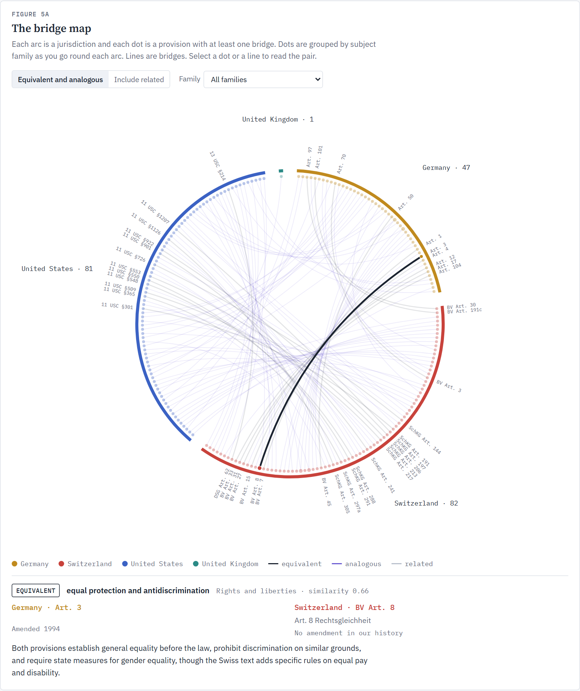
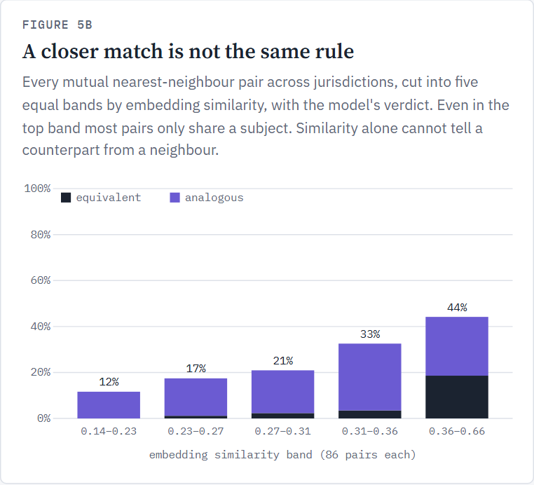
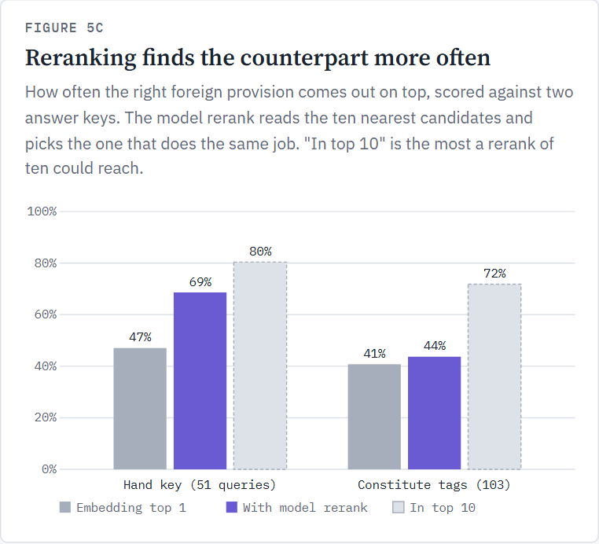
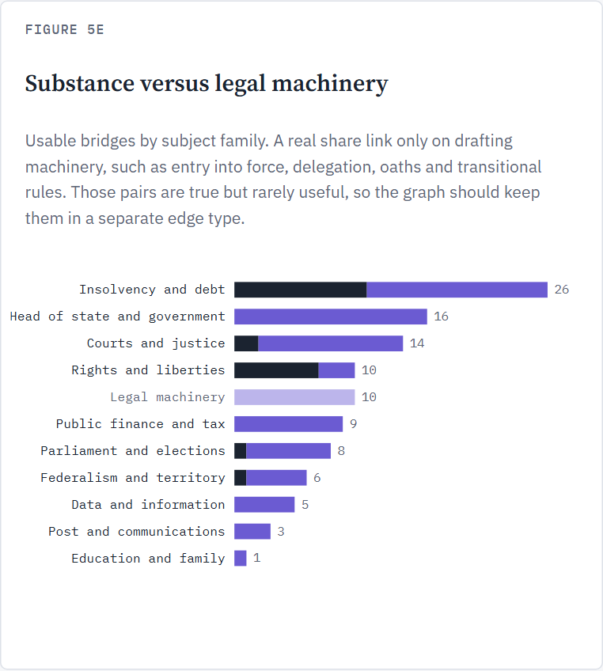

# Legal system bridges

[Visualisations](../README.md) · Provisions that do the same legal job in different jurisdictions (German, Swiss, UK and US law), matched and judged.

Open a page in a browser; each is one file with its data inside, and loads only its fonts and the d3 library from the web.

## Legal system bridges ([`legal-system-bridges.html`](legal-system-bridges.html), 4 charts)

