# Constitutions

[Visualisations](../README.md) · How constitutions grow, how fast they change, how they are amended and how long their wording lasts.

Open a page in a browser; each is one file with its data inside, and loads only its fonts and the d3 library from the web.

## Constitutions ([`constitutions.html`](constitutions.html), 15 charts)

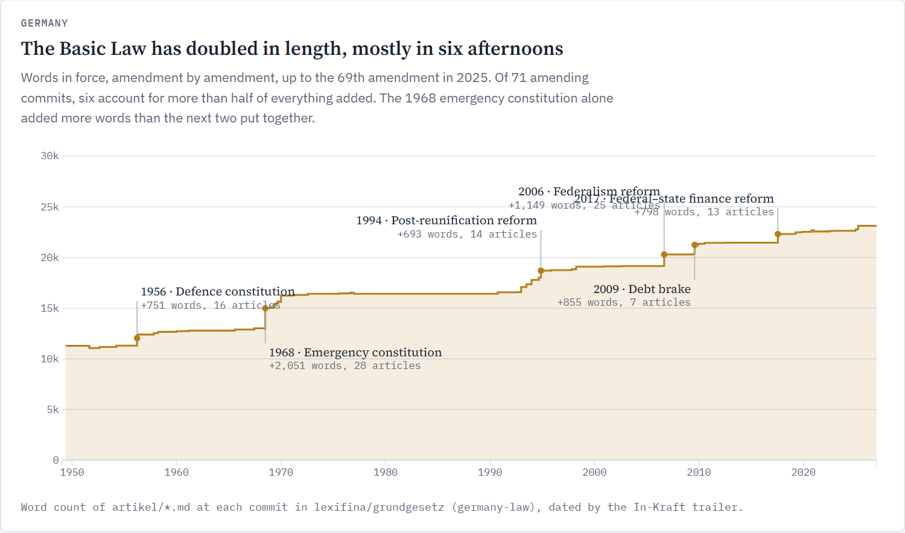

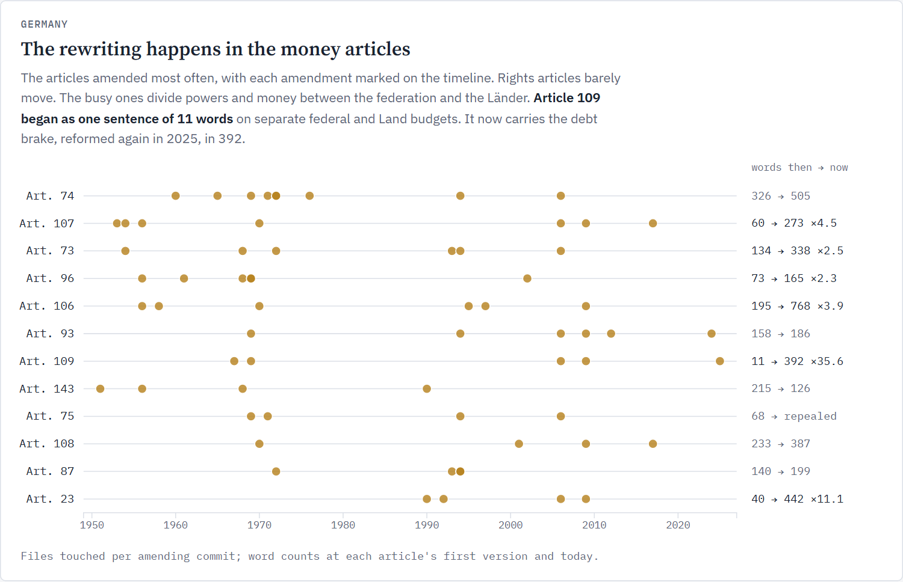

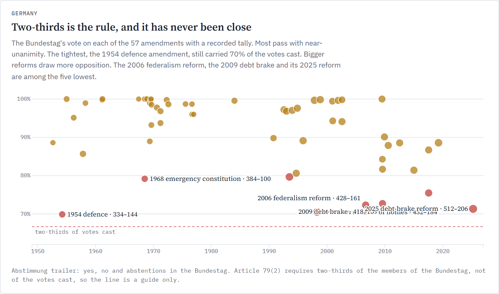

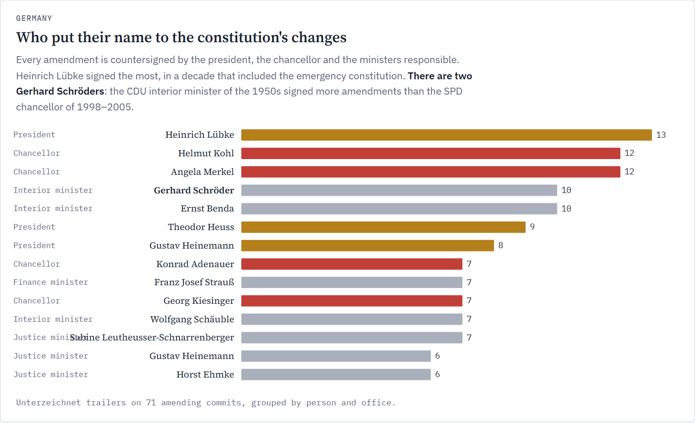

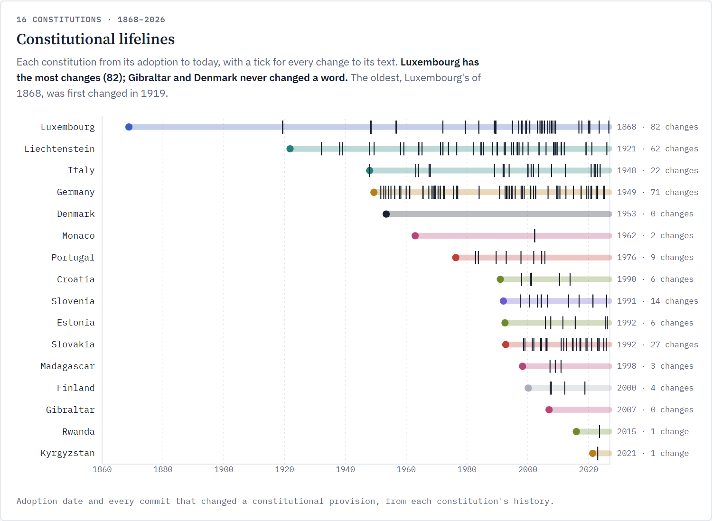

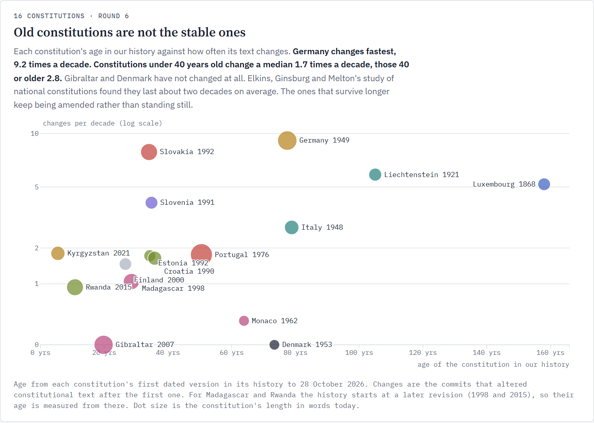

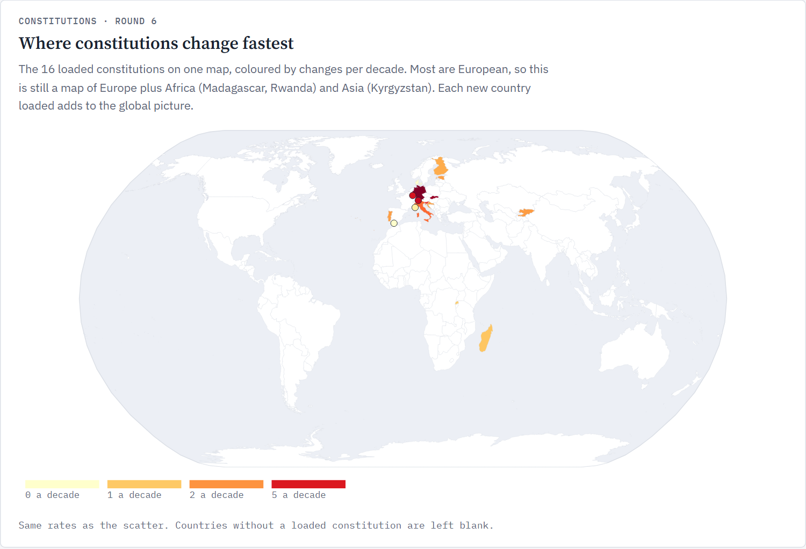

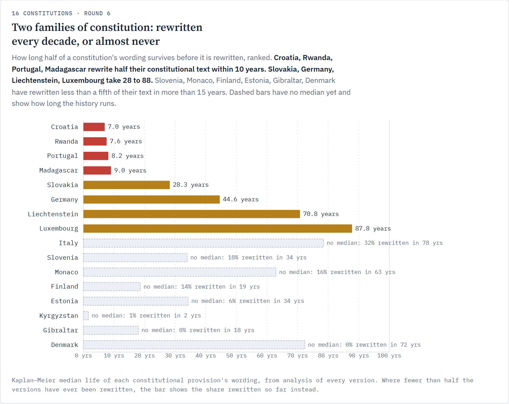

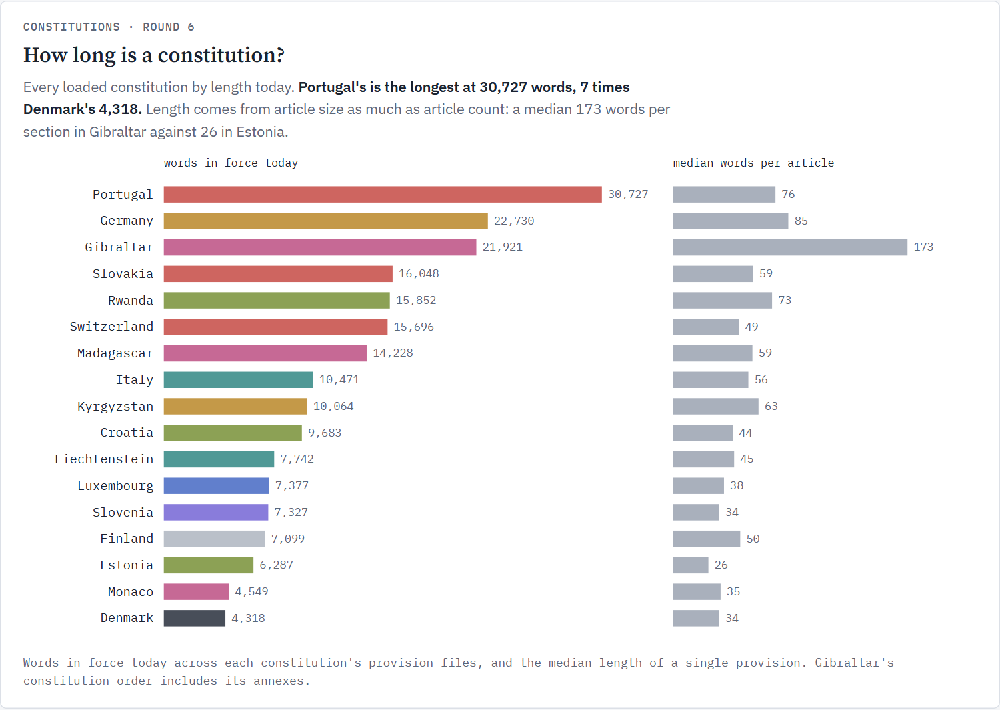

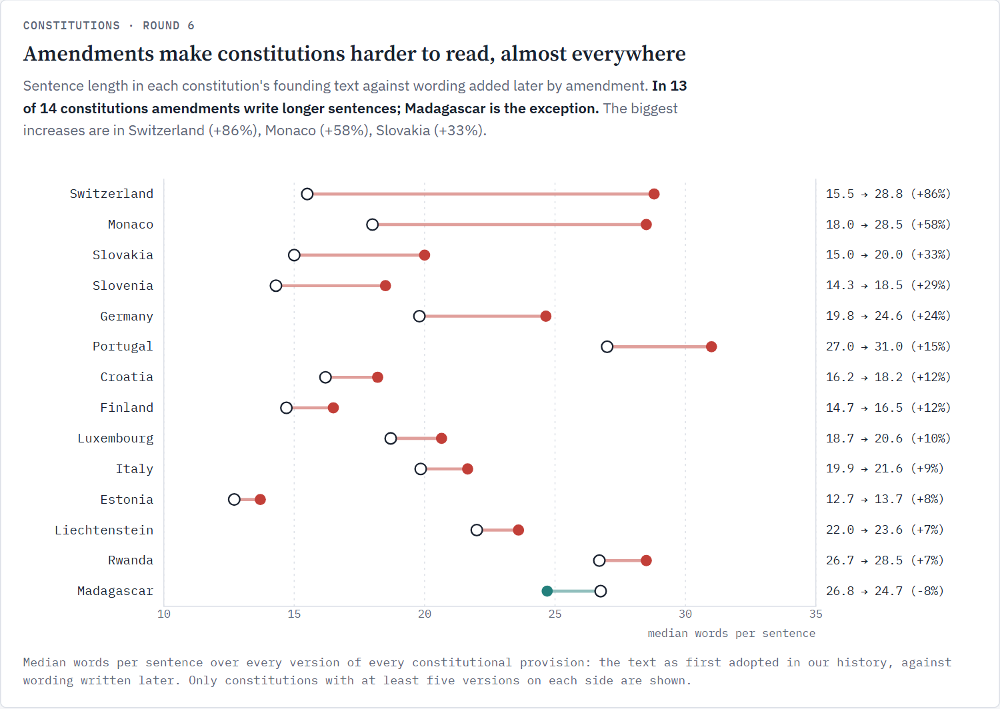

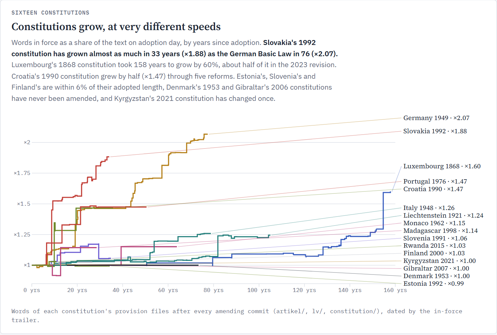

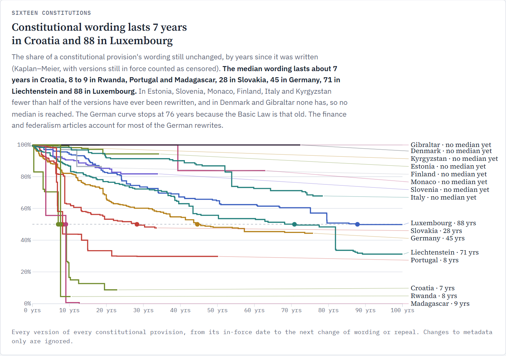

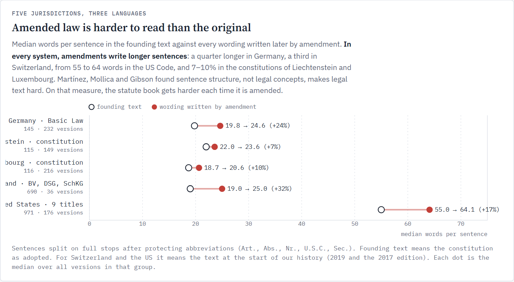

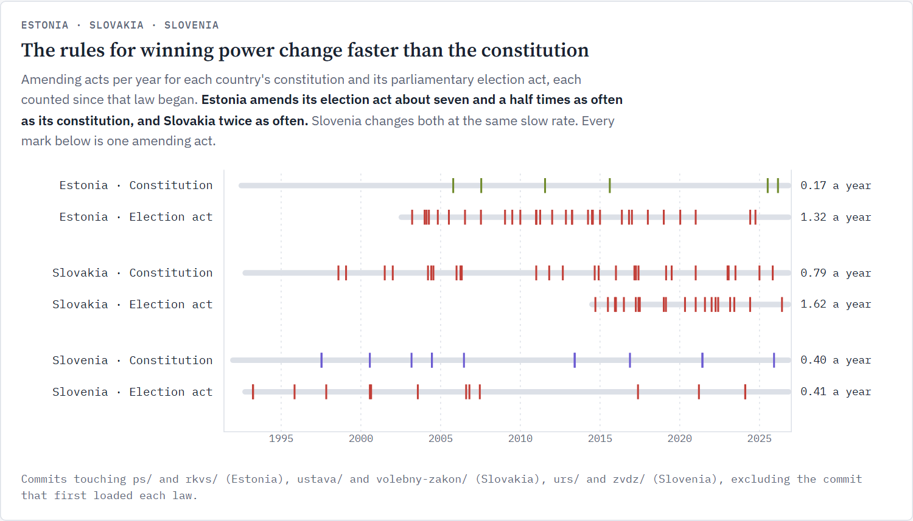

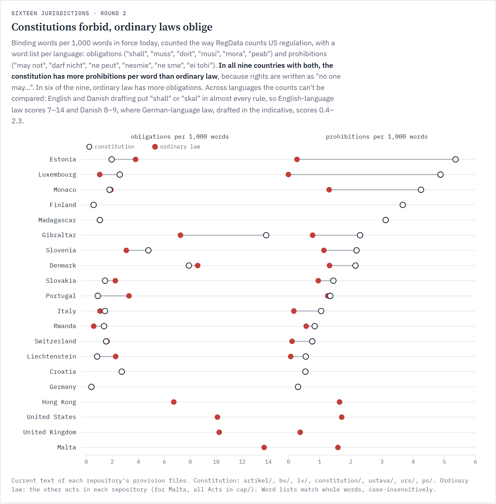
