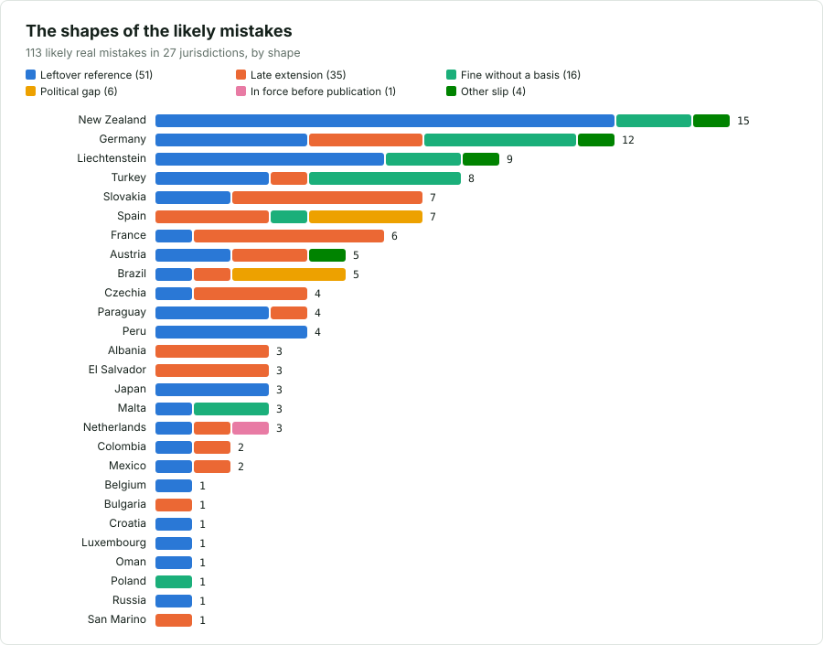
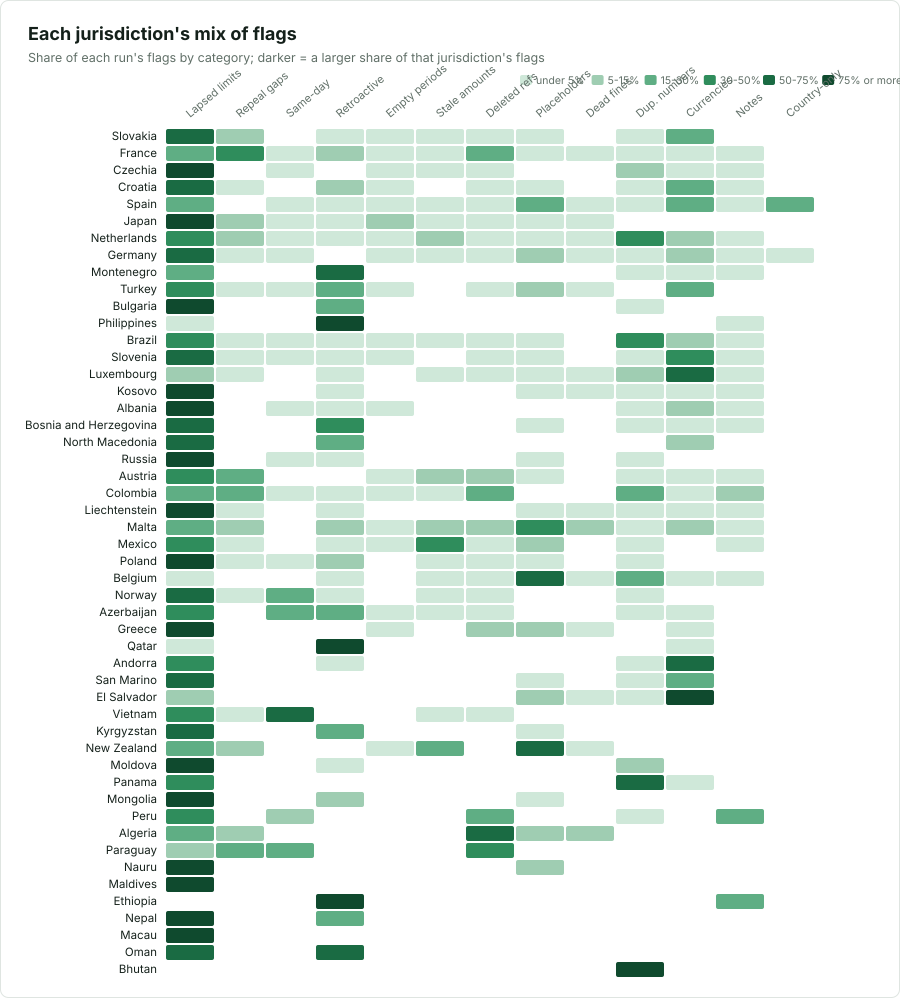
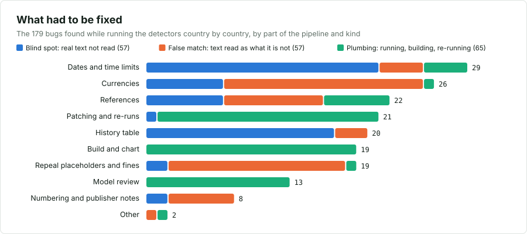
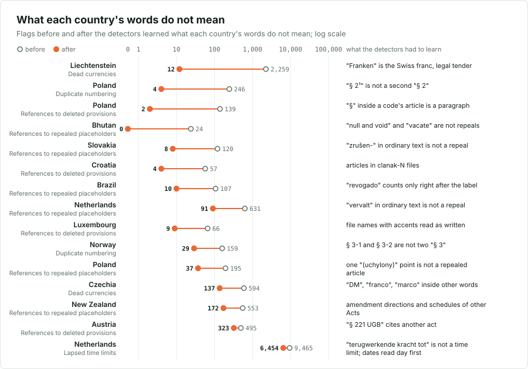
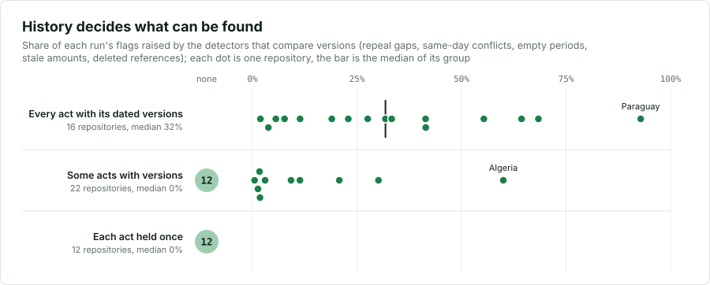
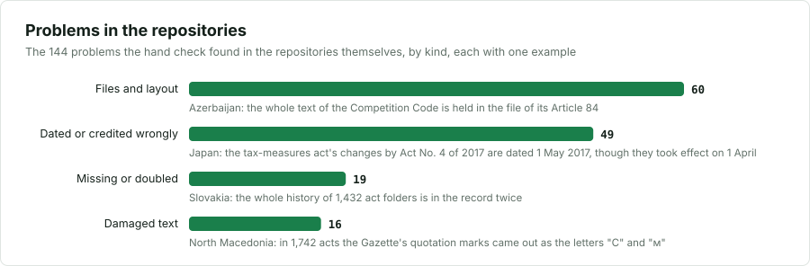

# Country by country

Global-law's [vulnerability detectors](scripts/) were also run on **50 country repositories one at a time**: each country's own commits as the history, its own language taught to the date and reference readers, a language model's review with a rebuttal pass, and every surviving flag read by hand in the repository's texts and, where it mattered, against the official gazette. Each country's results are in its own `vulnerabilities/` folder, in its language and in English, linked in the table below. This page puts together what those 50 runs found and what running them taught us. Counts are as of 16 November 2026.

## In numbers

| | |
| --- | ---: |
| Jurisdictions run one at a time | 50 |
| Languages of the READMEs | 30 |
| Flags raised | 285,589 |
| ... of them in law texts (not court decisions, drafts or notes) | 250,212 |
| Reviewed by a language model, arguing for and against | 6,535 |
| Survived the model's own rebuttal | 1,304 |
| Likely real mistakes, checked by hand | **113** |
| Cases left open, needing an official source | 60 |
| Problems found in the repositories themselves | 144 |
| Bugs found in the detectors and the pipeline | 179 (143 fixed) |
| Language and layout patches added to the detectors | 39 |

## What we learned

### 1. A flag is not a finding

The detectors raised 285,589 flags. A language model reviewed 6,535 of them, argued for each and then against it, and 1,304 survived its rebuttal. Every one of those was then read by hand in the repository's text and history, and only 54 held up as likely real mistakes; 77 more need the official gazette to decide.

What the other 1,173 were matters as much as the 54. The largest group, 400, came from how a repository is built or dated, not from the law (see point 7). Then 295 were lawful: a cut-off date the legislature meant, a gap it cured with retroactive wording. 243 were spent rules that ran out as planned, such as transitional periods and one-off programmes. 102 were detector misreadings, and 126 were mostly the same amount turning up in an unrelated rule. A model can argue its way past a mistake as easily as into one, so it filters the flags and the hand check decides.

The model also does not see everything. Another 59 likely real mistakes came from the categories it does not review: fines that punish breaches of repealed articles, and references to provisions that no longer exist. These were found by reading the flags by hand, which brings the total to 113.

<picture>
<source media="(prefers-color-scheme: dark)" srcset="data/countries/funnel-dark.svg">

</picture>

### 2. Each country's forms had to be taught before anything could be seen

A detector reads text through patterns: how a date is written, what a deadline sounds like, how a currency is named. Out of the box, they read the forms of the languages they were written for. Run on one country at a time, they first found almost nothing in many places. That was not because those countries' law had no lapsed time limits or dead currencies. The detectors could not yet read the way those were written.

The chart shows 27 such cases, each the count in one category before and after the detectors learned that country's forms. Together they added 35,866 flags that had been invisible. Slovakia's dead currencies went from none to 9,697 once "Sk" and "slovenských korún" were read; Turkey's lapsed time limits went from 1 to 4,091 once the date before "kadar" was. Vietnam and the Maldives went from none to their first, in Vietnamese and in Thaana.

<picture>
<source media="(prefers-color-scheme: dark)" srcset="data/countries/depth-dark.svg">

</picture>

Each country needed at least one thing no other did:

<details><summary><b>What only each jurisdiction needed</b></summary>

| Jurisdiction | What only it needed |
| --- | --- |
| Albania | Dates written with spaces or Roman-numeral months; decrees and court rulings counted as changes to the law. |
| Algeria | The Algerian dinar is current, so it is not a dead currency; the French noun "abrogation" is not a repeal mark. |
| Andorra | Every law held as enacted, with later changes only listed; Catalan dates ("fins al", "d'agost") and the Catalan peseta. |
| Austria | The months "Jänner" and "Feber"; sections cited with another act's abbreviation after them ("§ 221 Abs. 1 Z 2 UGB"); the schilling. |
| Azerbaijan | "Until" written as a suffix on the date ("31-dək", "tarixinədək"); 1,041 changes credited to several amending acts at once. |
| Belgium | Article numbers such as 259bis-9; the Belgian franc. |
| Bhutan | Acts held as enacted, in English; "null and void" and "vacate" are not repeal marks. |
| Bosnia and Herzegovina | The months "januara" and "jula", dates written with spaces, "do dana"; 3,633 decrees counted as law. |
| Brazil | Ordinal days ("1º de janeiro"), articles such as 3º-A, § 2º as a paragraph; cruzeiros written Cr$, Cz$ and NCz$. |
| Bulgaria | Bulgarian months and "до края на"; about 350,000 files, more than one detector could hold in memory at once. |
| Colombia | Days and years written in words with the figure in brackets; Constitutional Court rulings that strike out text count as changes to the law. |
| Croatia | "Listopada" is October here but November in Polish; "studenog"; articles in clanak-N files. |
| Czechia | One file per act; "a" between section numbers means "and", not a range; dates written "31. 12. 2020". |
| El Salvador | Dates written wholly in words; the colón, dead in El Salvador but current in Costa Rica. |
| Ethiopia | Proclamations held as first published; a proclamation that "is hereby repealed" is not a placeholder. |
| France | 187,161 commits; notices and circulars alongside law; CFP francs still in use; the verb "lire" is not the lira. |
| Germany | Changes dated by In-Kraft trailers; Germany-only checks for fines and missing paragraphs; an "S" after an amount is not a schilling. |
| Greece | «έως» and «μέχρι» with an article before the date; ordinal days such as «31η.12.2020». |
| Japan | Era-year dates in kanji (令和二年三月三十一日まで) and fiscal years; earlier versions appended out of order, so the history was rebuilt in date order. |
| Kosovo | Scanning errors in "deri" ("deri m€"); 179 international agreements counted as law. |
| Kyrgyzstan | Russian legal text with statya-N files and numbers such as 131-1; "за исключением" is not "excluded". |
| Liechtenstein | "Franken" is the Swiss franc, legal tender there (2,192 false flags before the fix); "Bst." cited like Austria's "lit.". |
| Luxembourg | Francs written "fr.", "frs" or "LUF"; 486 file names with accents. |
| Macau | European Portuguese "até ao dia"; the Portuguese "do" (of) is not the Slavic "do" (until); the Basic Law in Chinese. |
| Maldives | Dhivehi in Thaana, right to left, with several spellings of each month; charts drawn mirrored. |
| Malta | The Maltese lira as "Lm" before an amount (but not Lm as a length); "Cabernet Franc" is a grape. |
| Mexico | The Chamber of Deputies' "(sic DOF ...)" notes; Supreme Court invalidations counted as changes to the law. |
| Moldova | The older Romanian spelling "pînă la"; Constitutional Court changes counted as law. |
| Mongolia | Dates written year first with "хүртэл" after; zuil-N files; "хүчингүй болсонд тооцсон" (deemed repealed). |
| Montenegro | Latin and Cyrillic month names; clan-N files; "brisan" in a deletion clause is not a repeal mark. |
| Nauru | RONLAW history notes ("formerly section 15"); dates such as "1st January 1978". |
| Nepal | Bikram Sambat dates (15 "until" phrases left unread); "date expired" is not a repeal mark. |
| Netherlands | Hyphenated dates read day first ("t/m 31-12-2025"); "terugwerkende kracht tot" is not a time limit; Antillean guilders are current. |
| New Zealand | Section letters such as 312O; schedules of consequential amendments; "$10 million". |
| North Macedonia | The months јануари, мај, јуни and јули; "по" means "after", not "until"; dinars and marks in Cyrillic. |
| Norway | Sections numbered by chapter (§ 14-9, § 1a-1); "til utgangen av 2027". |
| Oman | Arabic "حتى" and "لغاية", Arabic-Indic digits, rials and baisas; charts drawn right to left. |
| Panama | Dates with the figure in brackets ("treinta (30) de junio"); treaty lines that open with a reference. |
| Paraguay | "Marco penal" (sentencing range) is not the Deutsche Mark; a constitutional amendment adopted by referendum. |
| Peru | "Sin efecto suspensivo" is not a repeal; the sol de oro; references at the end of a line. |
| Philippines | 18,417 commits of acts held as made; 1986 executive orders in force on approval; amending Acts that "hereby delete" sections. |
| Poland | Superscript articles (art. 4¹) and art. 47o; § as a paragraph inside a code's article; "do końca 2035 r.". |
| Qatar | Periods "ending on" a date (تنتهي في); rupees written after amounts in words. |
| Russia | 1,785 of 1,790 acts kept as one file; inserted articles (статья 12¹, 12.1). |
| San Marino | Italian "entro il" and "prorogato al"; lire written "L.5.000.000" or in words. |
| Slovakia | "Do konca roka"; Slovak and Czechoslovak korunas; the histories of 1,432 acts written twice. |
| Slovenia | "(črtan)" and "(prenehal veljati)" as repeal marks; "463.a člena"; articles lettered č, š and ž. |
| Spain | "Hasta el día"; restatement commits credited to the act they restate; a Spain-only check of citations of acts no longer in force. |
| Turkey | Dates written before "kadar" ("31/12/2020 tarihine kadar"); the lira with Turkish endings; folders renamed mid-history. |
| Vietnam | Dates and references (Điều, khoản, điểm) taught from scratch; amounts in đồng; folders renamed mid-history. |

</details>

### 3. Real mistakes come in a few shapes

The 113 likely real mistakes are spread over 27 jurisdictions. Read by hand, almost all of them are one of a few mechanical slips (sorted from each case's one-line description, so the counts are approximate):

- **A reference left pointing at a repealed or moved provision**: 51
- **A time limit extended only after it had run out**: 35
- **A fine or penalty pointing at a repealed or missing provision**: 16
- **A gap left by a political choice (a decree-law not validated, a veto)**: 6
- **Other slips (a placeholder never filled in, a provision printed twice)**: 4
- **A rule in force before it was published**: 1

<picture>
<source media="(prefers-color-scheme: dark)" srcset="data/countries/shapes-dark.svg">

</picture>

One example of each:

- **Leftover reference.** Brazil's Law 4,595/1964 still makes controllers subject to Article 44(8), but Law 13,506/2017 repealed all of Article 44 from 14 November 2017, and nothing redirects the reference.
- **Late extension.** Spain's 21% corporate withholding rate ran until 31 December 2013. Royal Decree-law 1/2014 extended it only from 26 January 2014, with no retroactive wording, so from 1 to 25 January the rate was back at 19%.
- **Fine without a basis.** Turkey's Law 1219 on medical practice, Article 68, was rewritten in 2008 and still fines nurses who go beyond the scope of practice in Article 64, which was repealed in 1954.
- **Political gap.** After Spain's Congress declined to validate Royal Decree-laws 9/2024 and 16/2025, no new suspension of evictions could be ordered from 23 to 29 January 2025 or from 28 January to 4 February 2026. This gap was chosen, not overlooked.
- **In force before publication.** A Dutch order in council raised the maximum fines in art. 23(4) of the Penal Code from 1 January 2022. It was published on 5 January 2022, and the Constitution does not let it take effect before publication.
- **Other slips.** Austria's Green Electricity Act, § 57g, still cites the amending act as "BGBl. I Nr. x/y", a drafting placeholder that was never filled in, four times in two paragraphs.

The late extension is the easiest to miss. Each act is correct when read alone. Only the dates side by side show that the old deadline had passed before the new one was made. Albania's has the usual timeline:

<picture>
<source media="(prefers-color-scheme: dark)" srcset="data/countries/late-extension-dark.svg">

</picture>

### 4. Each legal system leaves its own fingerprint

The same detectors produce a different mix of flags in every country. Lapsed time limits are the largest category in 32 of the 50, because every legal system sets deadlines and extends them. The other 18 each lead with something that says where their law comes from:

- **Retroactive or pre-publication dates** (Ethiopia, Montenegro, Philippines, Qatar): repositories that hold acts as published, where an act dated by the day it was signed seems to take effect before it was published.
- **Dead currencies** (Andorra, El Salvador, Luxembourg): El Salvador's colón, replaced by the dollar in 2001, and the francs and pesetas still named in acts that were never amended.
- **References to repealed placeholders** (Belgium, Malta, New Zealand, Spain): systems that keep a repealed article as a numbered placeholder ("[Repealed]", "derogado") rather than deleting it, so later text can still point at it.
- **Duplicate numbering** (Bhutan, Brazil, Panama): the same number used twice, often where articles were inserted between others (art. 4-A, 4¹) or a provision was printed twice.
- **References to deleted provisions** (Algeria, Paraguay), **repeal gaps** (France) and **same-day conflicts** (Vietnam): where the history itself is the main source of flags.

Some of these differences come from the repository, not the law. A repository that dates acts by signature produces retroactive flags, and one that keeps a whole act in one file produces reference flags. Point 7 covers those.

<picture>
<source media="(prefers-color-scheme: dark)" srcset="data/countries/mix-dark.svg">

</picture>

### 5. Every new language broke something, and every fix helped the next

Running the detectors country by country turned up 179 bugs; 143 are fixed and 36 are still open (each country's README states the ones that affect its numbers). Read one by one, they split almost evenly: 57 blind spots, where real text was not read; 57 false matches, where text was read as something it is not; and 65 in the machinery of running, building and re-running.

<picture>
<source media="(prefers-color-scheme: dark)" srcset="data/countries/bugs-dark.svg">

</picture>

The false matches matter as much as the blind spots. Unfixed, they filled the results with noise. In 15 cases, teaching the detectors what a country's words do *not* mean removed 7,818 false flags. Liechtenstein's "Franken" is the Swiss franc, still legal tender, and that one fix took its dead-currency count from 2,259 to 12. Every Belgian "dead currency" was the word "intitulé" read as the Peruvian inti. "Lira" matched inside "liraglutid", and Poland's "§ 2¹" looked like a second "§ 2".

<picture>
<source media="(prefers-color-scheme: dark)" srcset="data/countries/false-matches-dark.svg">

</picture>

Each fix is a small patch to the detectors, and there are now 39, applied in order. Each one also applies to every country run after it.

### 6. History decides what can be found

Five of the detector categories compare versions rather than read one text: an article repealed while others still cite it, two changes on the same day, an amount left behind by an update. Those need a history. Of the 50 repositories, 16 hold every act with its dated versions, 22 hold versions for some acts, and 12 hold each act once, as enacted.

Where the history is full, the version-comparing detectors raise a median of 32% of a run's flags (and 93% in Paraguay). Where it is partial, they raise none at all in 12 of the 22. Where each act is held once, they have nothing to compare and none raise anything. Those runs can only find what is visible in a single text. Their READMEs say so, and a country with few flags may simply have a short record.

<picture>
<source media="(prefers-color-scheme: dark)" srcset="data/countries/history-dark.svg">

</picture>

### 7. The repositories need checking as much as the law

The hand check found 144 problems in the repositories themselves. They explain a large share of the flags that looked like mistakes: 400 of the survivors in point 1. By kind: 60 are files and layout (text in the wrong file, a whole act in one article's file, stray files read as law), 49 are dating (acts dated by signature instead of entry into force, changes credited to the wrong amending act), 19 are text missing or held twice, and 16 are damaged text (HTML entities, replacement characters, quotation marks turned into letters).

<picture>
<source media="(prefers-color-scheme: dark)" srcset="data/countries/repositories-dark.svg">

</picture>

How these are being handled:

- **Listed where they were found.** Each problem is in that country's README, under the problems found in the repository, with the files and dates it affects.
- **Gathered into one worklist.** All 144 are in [data/countries/repository_problems.csv](data/countries/repository_problems.csv), one row per problem with its jurisdiction and a status; each is a fix for that repository's builder, and its status changes to fixed once the corrected history is published.
- **Worked around in the detectors meanwhile**, where a fix on the reading side was safe, so the findings are not distorted while the repositories wait: act folders renamed in the middle of a history are mapped back to one folder per act; identical rows from histories written twice are counted once; file names with accents are read as written; Japan's versions, appended out of order, are put back in date order before the detectors read them.
- **Re-run after each fix.** When a repository's builder publishes a corrected history, that country's detectors are run again with the same scripts (`redo.py`, which keeps the reviews already made) and its README is updated.

## From findings to proofs: a formal model of each country

Everything above is empirical. Detectors find candidates by matching patterns, a model argues about them, and a person decides by reading the text. The next step is a formal model of each country in [Lean 4](../lean-proofs/README.md). It would state the legal rules a finding rests on and prove that the mistake follows from the dated record. Global-law already has the start of this for the global run, in [lean-proofs/](../lean-proofs/), and the Dutch fine ceilings in point 3 are already one of its cases ([NLFines.lean](../lean-proofs/LegalProofs/Cases/NLFines.lean)). This section sets out what the country runs give that model, what the model adds, and how each country's findings would be encoded.

### What each approach can and cannot do

| | Country runs (this page) | A Lean model per country |
| --- | --- | --- |
| Finds candidates | Yes, in any of 30 languages, once its forms are taught (point 2) | No: it checks facts it is given and finds none itself |
| Decides whether a flag is a mistake | By hand, one flag at a time; the reasons are written in prose | By proof, once for every flag of a kind, under rules written out as definitions |
| Shows its reasoning | In each README's notes | As a theorem anyone can re-check with `lake build` |
| Handles legal judgment (was the gap chosen? does analogy apply?) | By reading, with the reason written down | Only as an explicit premise, with the counterargument proved too |
| Depends on the repository being right | Yes; point 7 lists where it was not | Yes, just as much: a certificate is about the record, not the law |

Neither replaces the other. The runs supply the facts and the judgment calls. The model turns them into statements that can be checked, and keeps them checked as the repositories change. In the global run, Lean already certifies 14,689 of the 14,900 flags it is given; its [README](../lean-proofs/README.md) lists them by kind.

### How each finding would be encoded

Each of the seven points above becomes a distinct part of a country's model:

| What the country runs learned | Where it goes in the model | There today |
| --- | --- | --- |
| **The shapes of real mistakes** (point 3) | A schema theorem for each shape, instantiated once per likely mistake with the official text quoted in the file: a leftover reference or a fine without a basis is `dead_reference`; a late extension or a political gap is `empty_period`; a rule in force before publication is `prepublication_window`; a placeholder never filled in ("BGBl. I Nr. x/y") is `phantom_reference` | All four schemas, in [Basic.lean](../lean-proofs/LegalProofs/Basic.lean); six worked cases in [Cases/](../lean-proofs/LegalProofs/Cases/) |
| **Why a survivor is not a mistake** (point 1) | Each reason for rejecting a flag becomes a hypothesis the theorem has to rule out, with the reason proved as well. A retroactive extension closes the gap; a gap the legislature chose is still a gap, but the case is labelled as chosen, not overlooked | `GMOGap.retroactive_closes_gap` and `AWaffV.analogy_would_rescue` in [Cases/](../lean-proofs/LegalProofs/Cases/) |
| **Each country's forms** (point 2): dates, currencies, numbering | Data that the fact generator reads: the date forms and calendars (Japanese era years, Bikram Sambat), each currency with the day it stopped being legal tender, and the numbering scheme (art. 4¹, § 3-1). A calendar conversion comes with a proof that it keeps dates in order | Real calendar dates in [Calendar.lean](../lean-proofs/LegalProofs/Calendar.lean); the forms are in the detectors' patches, not yet in Lean |
| **Each legal system's fingerprint** (point 4) | The country's own rules, each one a definition citing its source: when a rule binds (publication, or a set number of days after it), whether an extension can reach back, and how a repeal is recorded (a numbered placeholder or deletion) | One shared rule set for all countries, in Basic.lean |
| **What the history allows** (point 6) | Which certificates a country can have at all. Reference and repeal certificates need dated versions; a repository that holds each act once can only certify facts visible in a single text (pre-publication dates, references to provisions that never existed) | Certificates for references in [History.lean](../lean-proofs/LegalProofs/History.lean); for empty periods, pre-publication dates and missing paragraphs in [Certificates.lean](../lean-proofs/LegalProofs/Certificates.lean) |
| **How the record is built** (points 5 and 7) | A model of amending acts: a day's instructions, applied in order. It says when two changes on one day conflict and when an instruction aimed at a missing provision does nothing. Each repository problem becomes a record excluded or corrected before facts are generated; its row in repository_problems.csv is the switch | [Amendments.lean](../lean-proofs/LegalProofs/Amendments.lean) (`same_key_conflict`, `replace_missing_noop`); exclusions not yet |
| **What the detectors got wrong** (point 5) | Not provable: Lean checks that the facts imply the mistake, not that a detector read the facts correctly. The bug log stays the record of that, and a certificate rebuilt from the history (rather than from the flag) catches part of it | Reference certificates already rebuild each provision's history instead of trusting the flag |

### A folder for each country

The plan is one folder per country beside the shared model, built from that country's repository and the data published here:

```
lean-proofs/LegalProofs/Countries/<Country>/
  Forms.lean       date forms, calendars, currencies and their end dates, numbering (point 2)
  Rules.lean       the country's own rules of commencement, publication, retroactivity and repeal, each with its source (point 4)
  Cases/           one file per likely real mistake, quoting the official text, with its counterargument where there is one (points 1 and 3)
  Generated/       certificates for the country's flags, written from its history and checked on every build (point 6)
  Exclusions.lean  records left out until the repository is fixed, one per row of repository_problems.csv (point 7)
```

The shared schemas stay in one place, so a theorem proved once covers every country. What differs between countries is data and rules, and each of those carries its source. A natural order is to start with the 16 countries whose repositories hold full histories, where the most can be certified. The data files below ([likely_mistakes.csv](data/countries/likely_mistakes.csv), [repository_problems.csv](data/countries/repository_problems.csv)) are the inputs they start from.

## The 50 jurisdictions

| Jurisdiction | Flags | Reviewed | Survived | Likely real | Open | Folder |
| --- | ---: | ---: | ---: | ---: | ---: | --- |
| Albania | 2,953 | 267 | 31 | 3 | 4 | [albania-law](https://github.com/lexifina/albania-law/tree/main/vulnerabilities) |
| Algeria | 20 | 16 | 1 | 0 | 3 | [algeria-law](https://github.com/lexifina/algeria-law/tree/main/vulnerabilities) |
| Andorra | 588 | 47 | 3 | 0 | 0 | [andorra-law](https://github.com/lexifina/andorra-law/tree/main/vulnerabilities) |
| Austria | 2,181 | 200 | 32 | 5 | 0 | [austria-law](https://github.com/lexifina/austria-law/tree/main/vulnerabilities) |
| Azerbaijan | 934 | 165 | 25 | 0 | 0 | [azerbaijan-law](https://github.com/lexifina/azerbaijan-law/tree/main/vulnerabilities) |
| Belgium | 994 | 57 | 6 | 1 | 0 | [belgium-law](https://github.com/lexifina/belgium-law/tree/main/vulnerabilities) |
| Bhutan | 1 | 0 | 0 | 0 | 0 | [bhutan-law](https://github.com/lexifina/bhutan-law/tree/main/vulnerabilities) |
| Bosnia and Herzegovina | 2,766 | 180 | 14 | 0 | 1 | [bosnia-and-herzegovina-law](https://github.com/lexifina/bosnia-and-herzegovina-law/tree/main/vulnerabilities) |
| Brazil | 4,900 | 238 | 44 | 5 | 0 | [brazil-law](https://github.com/lexifina/brazil-law/tree/main/vulnerabilities) |
| Bulgaria | 6,475 | 196 | 13 | 1 | 0 | [bulgaria-law](https://github.com/lexifina/bulgaria-law/tree/main/vulnerabilities) |
| Colombia | 1,811 | 226 | 44 | 2 | 0 | [colombia-law](https://github.com/lexifina/colombia-law/tree/main/vulnerabilities) |
| Croatia | 31,047 | 184 | 7 | 1 | 2 | [croatia-law](https://github.com/lexifina/croatia-law/tree/main/vulnerabilities) |
| Czechia | 33,557 | 212 | 61 | 4 | 0 | [czechia-law](https://github.com/lexifina/czechia-law/tree/main/vulnerabilities) |
| El Salvador | 450 | 40 | 0 | 3 | 7 | [el-salvador-law](https://github.com/lexifina/el-salvador-law/tree/main/vulnerabilities) |
| Ethiopia | 6 | 5 | 1 | 0 | 0 | [ethiopia-law](https://github.com/lexifina/ethiopia-law/tree/main/vulnerabilities) |
| France | 35,971 | 612 | 254 | 6 | 0 | [france-law](https://github.com/lexifina/france-law/tree/main/vulnerabilities) |
| Germany | 15,737 | 391 | 160 | 12 | 3 | [germany-law](https://github.com/lexifina/germany-law/tree/main/vulnerabilities) |
| Greece | 933 | 129 | 29 | 0 | 0 | [greece-law](https://github.com/lexifina/greece-law/tree/main/vulnerabilities) |
| Japan | 17,940 | 358 | 126 | 3 | 10 | [japan-law](https://github.com/lexifina/japan-law/tree/main/vulnerabilities) |
| Kosovo | 3,359 | 111 | 22 | 0 | 0 | [kosovo-law](https://github.com/lexifina/kosovo-law/tree/main/vulnerabilities) |
| Kyrgyzstan | 362 | 80 | 5 | 0 | 0 | [kyrgyzstan-law](https://github.com/lexifina/kyrgyzstan-law/tree/main/vulnerabilities) |
| Liechtenstein | 1,313 | 43 | 2 | 9 | 0 | [liechtenstein-law](https://github.com/lexifina/liechtenstein-law/tree/main/vulnerabilities) |
| Luxembourg | 4,389 | 104 | 14 | 1 | 0 | [luxembourg-law](https://github.com/lexifina/luxembourg-law/tree/main/vulnerabilities) |
| Macau | 4 | 4 | 0 | 0 | 0 | [macau-law](https://github.com/lexifina/macau-law/tree/main/vulnerabilities) |
| Maldives | 11 | 11 | 2 | 0 | 0 | [maldives-law](https://github.com/lexifina/maldives-law/tree/main/vulnerabilities) |
| Malta | 1,309 | 223 | 76 | 3 | 2 | [malta-law](https://github.com/lexifina/malta-law/tree/main/vulnerabilities) |
| Mexico | 1,177 | 132 | 13 | 2 | 0 | [mexico-law](https://github.com/lexifina/mexico-law/tree/main/vulnerabilities) |
| Moldova | 222 | 52 | 0 | 0 | 0 | [moldova-law](https://github.com/lexifina/moldova-law/tree/main/vulnerabilities) |
| Mongolia | 140 | 56 | 2 | 0 | 1 | [mongolia-law](https://github.com/lexifina/mongolia-law/tree/main/vulnerabilities) |
| Montenegro | 9,956 | 187 | 7 | 0 | 3 | [montenegro-law](https://github.com/lexifina/montenegro-law/tree/main/vulnerabilities) |
| Nauru | 11 | 10 | 0 | 0 | 1 | [nauru-law](https://github.com/lexifina/nauru-law/tree/main/vulnerabilities) |
| Nepal | 6 | 6 | 1 | 0 | 0 | [nepal-law](https://github.com/lexifina/nepal-law/tree/main/vulnerabilities) |
| Netherlands | 16,772 | 265 | 46 | 3 | 2 | [netherlands-law](https://github.com/lexifina/netherlands-law/tree/main/vulnerabilities) |
| New Zealand | 312 | 111 | 11 | 15 | 1 | [new-zealand-law](https://github.com/lexifina/new-zealand-law/tree/main/vulnerabilities) |
| North Macedonia | 2,476 | 80 | 15 | 0 | 5 | [north-macedonia-law](https://github.com/lexifina/north-macedonia-law/tree/main/vulnerabilities) |
| Norway | 945 | 101 | 5 | 0 | 0 | [norway-law](https://github.com/lexifina/norway-law/tree/main/vulnerabilities) |
| Oman | 4 | 4 | 0 | 1 | 0 | [oman-law](https://github.com/lexifina/oman-law/tree/main/vulnerabilities) |
| Panama | 168 | 40 | 4 | 0 | 0 | [panama-law](https://github.com/lexifina/panama-law/tree/main/vulnerabilities) |
| Paraguay | 14 | 14 | 0 | 4 | 0 | [paraguay-law](https://github.com/lexifina/paraguay-law/tree/main/vulnerabilities) |
| Peru | 66 | 49 | 1 | 4 | 0 | [peru-law](https://github.com/lexifina/peru-law/tree/main/vulnerabilities) |
| Philippines | 5,734 | 80 | 13 | 0 | 0 | [philippines-law](https://github.com/lexifina/philippines-law/tree/main/vulnerabilities) |
| Poland | 1,028 | 116 | 18 | 1 | 1 | [poland-law](https://github.com/lexifina/poland-law/tree/main/vulnerabilities) |
| Qatar | 809 | 52 | 7 | 0 | 0 | [qatar-law](https://github.com/lexifina/qatar-law/tree/main/vulnerabilities) |
| Russia | 2,437 | 46 | 2 | 1 | 2 | [russia-law](https://github.com/lexifina/russia-law/tree/main/vulnerabilities) |
| San Marino | 461 | 40 | 6 | 1 | 1 | [san-marino-law](https://github.com/lexifina/san-marino-law/tree/main/vulnerabilities) |
| Slovakia | 38,744 | 203 | 63 | 7 | 3 | [slovakia-law](https://github.com/lexifina/slovakia-law/tree/main/vulnerabilities) |
| Slovenia | 4,774 | 132 | 13 | 0 | 4 | [slovenia-law](https://github.com/lexifina/slovenia-law/tree/main/vulnerabilities) |
| Spain | 19,957 | 249 | 71 | 7 | 0 | [spain-law](https://github.com/lexifina/spain-law/tree/main/vulnerabilities) |
| Turkey | 8,998 | 319 | 28 | 8 | 1 | [turkey-law](https://github.com/lexifina/turkey-law/tree/main/vulnerabilities) |
| Vietnam | 367 | 92 | 6 | 0 | 3 | [vietnam-law](https://github.com/lexifina/vietnam-law/tree/main/vulnerabilities) |

## What each run found

<details><summary><b>Albania</b>: 2,953 flags, 3 likely real</summary>

Albania's run found real lapses where the Council of Ministers or the Assembly extended a deadline only after it had run out, twice for the electricity state of emergency of VKM 584/2021; many other open cases turn on whether an act takes effect on adoption or on publication in the Fletorja Zyrtare.

Likely real mistakes:

- **Vendimi i Këshillit të Ministrave nr. 584, datë 8.10.2021 (state of emergency in electricity supply), pika 5**: The state of emergency ran out on 15 April 2022 and again on 30 June 2023 and was each time extended by a decision adopted after the end date (VKM 256/2022 and VKM 449/2023), so it had ended from 16 to 28 April 2022 and from 1 to 27 July 2023 (two flags).
- **Vendimi i Këshillit të Ministrave nr. 98, datë 27.1.2009 (sale of the land of privatised state enterprises and properties), pika 3**: The deadline to buy the land, 31 May 2009, was extended to 30 June 2010 by VKM nr. 923, datë 2.9.2009, which took effect only on publication on 6 October 2009, so from 1 June to 5 October 2009 the deadline had passed.
- **Ligji nr. 10418, datë 21.4.2011 (legalisation of capital and forgiveness of part of tax and customs debts), neni 35**: The right ended on 31 March 2012 and was extended to 31 March 2013 by Ligji nr. 154/2013, which took effect only on 22 June 2013, after its own new date had also passed.

Left open:

- **Vendimi i Këshillit të Ministrave nr. 633, datë 26.10.2018 (air pollution from motor vehicles), pika 9**: The registration deadline of 1 March 2019 was extended by VKM nr. 154, datë 27.2.2019, adopted two days before it but published only on 25 March 2019, so from 2 to 24 March 2019 the deadline had passed if dated by publication.
- **Udhëzimi nr. 34, datë 30.9.2014 (selection and registration of blind, paraplegic and tetraplegic candidates, orphans, Roma and Balkan-Egyptians in public higher education, 2014-2015), pika 1**: The application window ending 6 October 2014 was extended by Udhëzimi nr. 40, datë 13.10.2014, adopted a week after it closed, and both instructions were published on 24 November 2014, after every date they set.
- **Udhëzimi nr. 39, datë 6.10.2011 (admission and registration in master's programmes, 2011-2012), pika 8**: The registration window of 24 to 28 October 2011 was moved to 7 to 10 November 2011 by Udhëzimi nr. 42, datë 13.10.2011, but both instructions were published on 7 December 2011, after every date they set.
- **Urdhri nr. 682, datë 21.12.2020 of the Minister of Health and Social Protection (passenger flights with Great Britain), pika 1**: Each extending order was adopted by the end date it replaced but published eight days later, so dated by publication the suspension lapsed from 7 to 12 and from 19 to 25 January 2021, and dated by adoption there was no gap (two flags).

In the repository:

- 38 laws of the earlier build have a first version in force on the day the Assembly adopted them, before they were published, and 35 of them are still in the current folders; they make up 38 of the 40 retroactive-date flags.
- The README dates a change by a normative act with the force of law from its adoption, though Kushtetuta neni 117 pika 1 says such acts take legal force only once published; two acts are affected, Akti normativ nr. 2/2023 and nr. 7/2023.
- An annex is one file (zz-shtojca.md), so when an amending decision rewrites an annex the detectors pair an old date with a new one from an unrelated sentence (3 of the 31 survivors and 4 more flags the model did not keep).
- A file can hold more than its point: udhezim/2019/0820-18/pika-009.md holds pika 9 of section I.1 and the rest of the instruction with it (1 of the 31 survivors).

Detector work: add_root.py built Albania's history rows from the repository's own commits, counting the kinds decree, as-enacted and court as changes to the law and leaving out publisher (755 changes no act is named for) and caselaw. The detectors were taught Albanian date phrasing ("deri në datën ...", "deri në fund të vitit ...", "jo më vonë se ...", dates written with spaces or Roman-numeral months), which took lapsed time limits from 1,567 to 2,640 flags and empty periods from 16 to 25. Currency names were fixed so that "DM" counts only in capitals or right after an amount, "lire" only as a whole word and "lireta" as the Italian lira, removing "dm 3" and "DM" inside abbreviations (dead currencies 247 to 229). The Latvian lats is now read only as the words "lati" and "latu", which removed 22 "pallati" (dead currencies 229 to 207). map_moved.py rewrote the history table to the new act folders after the move of 4 November 2026 (770 folders, 45,343 paths), so an act's history is no longer split in two at the move. build_vulns.py links a retroactive-date flag to the commit that made the act's version on the day flagged, and matches lapsed-limit reviews on 400 characters of context instead of 80. The sharded scans were fixed to use a stable checksum and ordered rows, and a further pass reviewed 29 more lapsed time limits tied on score, none of which survived.

[Full results](https://github.com/lexifina/albania-law/tree/main/vulnerabilities)

</details>

<details><summary><b>Algeria</b>: 20 flags, 0 likely real</summary>

The one survivor, Article 23 of the Code pénal, is an article number used again in 2024 for a new rule, its old rule having moved to Article 16 bis in 2006; the more telling finds are four Code pénal articles that still cite articles removed in 2006 or reading only as repealed, which only the official text in force can settle.

Left open:

- **Code pénal, Articles 204 and 213**: Both still require "la confiscation prévue à l'article 25", an article Law No. 06-23 removed in 2006 (confiscation of objects is now in Article 16); whether the references have since been corrected needs the official text in force.
- **Code pénal, Article 160 octies**: It still refers to "l'article 8 du code pénal", which Law No. 06-23 removed in 2006 (Article 9 bis 1 now defines the ban on exercising civic, civil and family rights); whether it has been corrected needs the official text in force.
- **Code pénal, Article 435**: It still cites Articles 427 and 428, which read only as repealed in the 2005 edition (Articles 429 and 430 remain in force, so the offence still has an object), and it has not changed in this repository since the 2005 edition.

In the repository:

- The last article of five texts also holds the start of the text printed after it in the Journal officiel: Law No. 04-06's files art-005.md to art-109.md are Articles 5 to 109 of Law No. 04-07, Law No. 04-09's files art-019.md to art-114.md are Articles 19 to 114 of Law No. 04-10, and Laws No. 07-01, 07-02 and 24-02 each run on into the next text.
- The README of Ordinance No. 21-01 on the electoral system gives one version, of 10 March 2021, and no changes, while the history applies Organic Law No. 26-05, in force on 4 April 2026, to 39 of its articles.

Detector work: The dead-currency detector no longer counts the dinar as a dead currency in French text, as the Algerian dinar is current: dead currencies went from 39 flags, all fines and fees in dinars, to 0. The placeholder detector no longer reads the French noun "abrogation(s)" as a repeal marker: references to repealed placeholders went from 3 to 2. The history rows were built from the repository's own commits, also counting the kinds decree (the Constitution) and publisher (the Code pénal's 2005 edition) as law, 172 commits; counting the 2005 edition took references to deleted provisions from 3 to 10. pins.json names the corpus language as French, so the detectors use French month names and currency exceptions.

[Full results](https://github.com/lexifina/algeria-law/tree/main/vulnerabilities)

</details>

<details><summary><b>Andorra</b>: 588 flags, 0 likely real</summary>

None of the 3 survivors is a mistake (two lawful, one spent); the real findings were in how the repository splits laws into files, with articles missing from their own files in at least 17 laws and closing provisions stuffed into the last article's file in at least 19.

In the repository:

- In at least 17 laws some articles are not in their own file: in 15 the article files do not start at Article 1 and the missing articles stand in preamble.md or another article's file, and in two more the articles are in the wrong files; 11 rows of data/amendments.csv amend or repeal an article for which the law's folder has no file.
- In at least 19 laws the additional, transitional, repealing or final provisions, and sometimes the last articles, are inside the last article's file, as in article-102.md of the Justice Act of 1993.

Detector work: add_root.py now counts Kind: enacted, which this repository gives every law, as law; without it the first run had no law rows and the reference scan read no file. The time-limit search was taught Catalan month names, "d'agost", "fins al", "fins a l'", "fins el" and the deadlines "abans del", "no més tard del", "com a màxim" and "com a molt tard", taking lapsed time limits from 2 to 224. The dead-currency search now knows the Catalan peseta ("pessetes") and no longer reads "Sucre" (sugar) as the Ecuadorian sucre, taking dead currencies from 7 to 329.

[Full results](https://github.com/lexifina/andorra-law/tree/main/vulnerabilities)

</details>

<details><summary><b>Austria</b>: 2,181 flags, 5 likely real</summary>

Two COVID-19 time limits (§ 37 Abs. 4a AWG 2002 and § 323c Abs. 4 BAO) were extended only after they had run out, and reading around the flags found three drafting mistakes, including BGBl. placeholders "x/y" and "xx/2019" never filled in. The 14 stale amounts that are the same figure in an unrelated provision were put in other; the EDGE-CASES heading for the two gaps says "Open" but the README calls them real gaps, so they are counted as likely_real.

Likely real mistakes:

- **Abfallwirtschaftsgesetz 2002, § 37 Abs. 4a**: The COVID-19 notification route for increases in the capacity of waste storage sites covered increases "until 30.09.2020" and was extended to 30 April 2021 only from 8 January 2021 (BGBl. I Nr. 8/2021), with no retroactive wording; long spent.
- **Bundesabgabenordnung, § 323c Abs. 4**: The special COVID-19 rules for hearings and taking evidence in tax proceedings applied until the end of 31 December 2020 and were extended to 31 March 2021 only from 8 January 2021 (BGBl. I Nr. 3/2021), leaving 1 to 7 January 2021 without a basis; long spent.
- **Ökostromgesetz 2012, § 8 Abs. 2**: The Landeshauptmann still sends supply concepts "for the report under § 52 Abs. 1", which BGBl. I Nr. 150/2021 repealed from 28 July 2021 (a reference to a repealed placeholder, not reviewed by the model).
- **Ökostromgesetz 2012, § 57g Abs. 2 and 3**: The in-force rule of BGBl. I Nr. 150/2021 cites the amendment and the Erneuerbaren-Ausbau-Gesetz as "BGBl. I Nr. x/y", a drafting placeholder never replaced, four times in two paragraphs (found by reading).
- **Einkommensteuergesetz 1988, § 124b Z 346**: § 47 Abs. 1 lit. d is repealed "with the entry into force of the Finanz-Organisationsreformgesetz BGBl. I Nr. xx/2019", an act published as BGBl. I Nr. 104/2019 with several commencement dates; the RIS notes that 1 July 2020 is "obviously" meant (found by reading).

In the repository:

- The RIS gives the transitional and final articles of amending acts as articles of the act they amend and the repository names each file by that designation, so 65 of the 512 Artikel files hold the Artikel of more than one amending act, 296 in all; asvg/art-002.md holds the Article II of 23 amending acts from 1956 to 1988, and eight of the surviving empty periods compare dates from two such acts.

Detector work: The time-limit search was taught the Austrian month names "Jänner" and "Feber" and the words "bis zum Ablauf des" and "bis einschließlich"; lapsed time limits went from 541 to 701 and empty periods from 88 to 102. The reference search takes a section followed by another act's abbreviation or name ("§ 221 Abs. 1 Z 2 UGB", "Artikel 73 der Wechselordnung") as a reference to that act, reads "§§ 70 bis 75" as a range and "S. 28" after an Official Journal citation as a page, and skips the RIS's "(Anm.: ...)" notes; references to deleted provisions went from 495 to 323. The dead-currency search was taught the schilling, as "Schilling" or "S" after an amount; dead currencies went from 1 to 105. The publisher-note search reads the RIS's own corrections "(Anm.: richtig ...)"; publisher notes went from 37 to 74.

[Full results](https://github.com/lexifina/austria-law/tree/main/vulnerabilities)

</details>

<details><summary><b>Azerbaijan</b>: 934 flags, 0 likely real</summary>

Of 934 flags, 25 survived the model review and none is a drafting mistake; the most notable survivor is an empty period that is no gap, because Law No. 348-VIIQD extending the inspections moratorium says itself it applies from 1 January 2026. The three flags 'dated by the source' (e-qanun's in-force date for 1994-1995 laws that name no day) were put under repository as dating, although the README says the record cannot tell whether those laws took effect on signing or on publication.

In the repository:

- In the Competition Code (2023) the files of Articles 1 to 83 hold only headings and madde-84.md holds the Code's whole text, so every article and every amendment of the Code lands in Article 84.
- Where e-qanun spaces out the heading ("M a d d ə 40."), 387 articles in 19 acts are in another article's file, and a note mark next to the heading has the same effect for 16 more articles in 8 acts; every one of the 17 references to deleted provisions points at such an article.
- 173 files begin with the remains of the source page's <body> tag as their first line.
- 1,041 Kind: several commits are credited to none of the acts they name and dated by the latest of them, and 77 of them are dated later than every act they name (for example Article 85.9 of the Tax Code changes on 1 January 2025 instead of 1 January 2024).
- Law No. 140-VIQD repealed Articles 418.2.3 and 418.4 of the Code of Criminal Procedure and struck them from Article 421.1.1, but the text here still has both points and both numbers, though e-qanun's notes record the amendment.

Detector work: The time-limit search learned Azerbaijani date-first forms with "until" as a suffix or following word ("2020-ci il dekabrın 31-dək", "tarixinədək", "tarixinə qədər", "ilin sonunadək") and the deadlines "ən geci" and "tarixdən gec olmayaraq", giving 495 time limits where there had been none and 450 flags. e-qanun's notes at the end of each file, which quote earlier wording, are no longer read as provision text for time limits, amounts or references. The reference search reads "Bu Qanunun 12.3-cü maddəsi" as Article 12 of the same law, "... Məcəlləsinin 5-ci maddəsi" as another act, and gazette entries ("Qanunvericilik Toplusu ..., maddə 123") as not articles. Dead-currency search no longer reads "inti" inside "intizam", "intihar" and "tikinti" (20 of global-law's 21 dead currencies), "lira" or the dinar, and no longer reads the plural "2625-ları" as the Georgian lari. placeholder_ref.py now sets the language refscan's refs() reads, so notes and gazette entries are skipped; references to repealed placeholders went to none. add_root.py was replaced so that Kind: several (1,041) and Kind: repeal (76) commits count as law (8,029 commits), raising same-day conflicts from 42 to 274, retroactive dates from 161 to 165 and stale amounts from 7 to 19.

[Full results](https://github.com/lexifina/azerbaijan-law/tree/main/vulnerabilities)

</details>

<details><summary><b>Belgium</b>: 994 flags, 1 likely real</summary>

None of Belgium's 6 survivors is a confirmed defect: four are caps on directors' liability in art. 2:57 of the Code des sociétés et des associations that keep their own figures after the 2024 size criteria changed. The only real leftover came from reading by hand a category the model does not review: art. 1362 of the Code judiciaire still cites art. 738, repealed since 1993.

Likely real mistakes:

- **Code judiciaire, art. 1362**: Art. 1362 still cites art. 738, repealed by L 1992-08-03/31 from 1 January 1993, a real reference to an article repealed long ago found among the references to repealed placeholders, which the model does not review.

In the repository:

- Articles 259bis-1 and following of the Code judiciaire have no file, though 13 of its articles cite 259bis-6, 259bis-8, 259bis-9, 259bis-13 or 259bis-19 as provisions in force, and the history held the earlier art. 259bis until a change without an amendment note removed it on 1 June 2025.
- Art. 31 of the loi du 16 mai 2024 amending the Code belge de la Navigation has no file of its own: its text is at the end of art-030.md and the act's README lists no art. 31.

Detector work: add_root.py built Belgium's history rows from the repository's own commits, counting the kinds law, decree, court and local-regulation as changes to the law and leaving out publisher, correction, caselaw and commits without an In-force trailer. The reference scan reads "259bis-9" as one article number, not 259bis, which took references to deleted provisions from 16 to 4. The currency scan knows the Belgian franc and takes "inti" only as a whole word, which took dead currencies from 38, all "intitulé(e)" read as the Peruvian inti, to 29 amounts in francs. run.sh takes LE_WORKERS and LE_GREP_THREADS from the environment so the run could use fewer processes on a shared machine.

[Full results](https://github.com/lexifina/belgium-law/tree/main/vulnerabilities)

</details>

<details><summary><b>Bhutan</b>: 1 flags, 0 likely real</summary>

The detectors found no mistake in Bhutanese law: the only flag was four references to Article 45 in the penalty lines of Article 46 of the Mines and Minerals Management Act of Bhutan 1995, and 24 earlier flags were English words like "vacate" and "null and void" read as repeal marks. The real finds were in how the repository splits some Acts into sections.

In the repository:

- In three Acts the split into sections took the numbers of a list or form for sections: the Bhutan Citizenship Act 1985's files sec-007.md to sec-017.md are items of Form KA-1, the Medical and Health Council Act of the Kingdom of Bhutan 2002's files sec-001.md to sec-010.md are items 1 to 10 of a list in Section 3, and the Income Tax Act of the Kingdom of Bhutan 2001's files sec-001.md to sec-053.md are only the General Provisions.
- Sections are cut where the PDF prints their number, so after the number the first line of 323 of the 371 section files of the Financial Services Act 2011, 147 of the 188 of the Royal Monetary Authority Act and 65 of the 83 of the Water Act begins with a lower-case word.
- 115 files of the Anti Corruption Act 2011 carry the print file's page marks (such as "Content.indd 24" and a time) in 197 lines.

Detector work: The placeholder detector no longer reads "vacation", "vacate" or "null and void" as the mark of a repealed section, and treats a section saying another section "is repealed" as the repealing provision: references to repealed placeholders went from 24 to 0. pins.json names the corpus language as English, so the detectors use English month names and currency exceptions. build_vulns.py writes no second category column and flags_chart.py draws one English set of charts with a singular title ("1 flag in one category").

[Full results](https://github.com/lexifina/bhutan-law/tree/main/vulnerabilities)

</details>

<details><summary><b>Bosnia and Herzegovina</b>: 2,766 flags, 0 likely real</summary>

None of Bosnia and Herzegovina's 14 survivors is a confirmed drafting mistake; the one open case is a compensatory-interest decision that enters into force months before it was made, and the run mostly exposed how the repository dates acts and keeps annual decisions as enacted after the next one ended them.

Left open:

- **Odluka o visini stope kompenzatorne kamate za period od 01. jula 2026. godine do 31. decembra 2026. godine ("Službeni glasnik BiH" 79/26), Article 3**: The Indirect Taxation Authority's decision was made on 26 October 2026 but says it enters into force on 1 July 2026, 117 days before it was made, as the decisions for the second half of 2024 and 2025 also did; whether that is allowed needs Article 372(2) of the Decision on the implementation of the Law on Customs Policy ("Službeni glasnik BiH" 13/19), which the repository does not hold.

In the repository:

- The root README is out of date: it counts 1,875 acts and lists case law as planned elsewhere, but the commit read also holds 1,443 decisions, 109 orders, 53,975 Constitutional Court decisions, 105 decisions in sudska-praksa, 233 bills, 388 Competition Council rulings and 7 Central Bank decisions.
- The README says a Gazette act takes effect almost always on the eighth day after publication, but of 3,517 acts with a publication date only 1,846 do and 1,210 are dated before publication, and the 2016 local-elections timetable is dated 4 April 2016 although its preamble says it was adopted on 4 May 2016.
- Annual cigarette excise decisions ended by the next year's decision are held as enacted: 15 of the 17 are ended in this way yet held with no repeal, registry/data/acts.json lists no decisions at all, and 133 lapsed-time-limit flags are in these 17 files.
- The misljenja (opinions) folder holds four acts of the Indirect Taxation Authority, two rulebooks and two instructions, each marked as law, not opinions.
- 527 replacement characters (�) in 144 law-text files stand where the source had °, ‰, β, superscripts or accented letters.
- LICENSE describes only the Constitution's English text, not the Gazette acts, the Criminal Code or the decisions the repository now holds.

Detector work: add_root.py counts as law the commits of kind decree (3,633 commits), treaty, regulation, instruction and publisher as well as law; without them the history detectors would read 215 law commits instead of 3,889. Lapsed time limits were taught the Bosnian month names "januara", "februara", "marta", "juna" and "jula", numeric dates with spaces, "do dana" and "zaključno sa" before a date and "do kraja" before a year, with "najkasnije" ranked as a deadline, which raised the flags from 1,134 to 1,547 and left none of the 178 previously missed "do <date>" phrases unread. "DM" counts as a currency only in capitals, which removed two "dm²" and a link id ending in "3dM" (dead currencies 19 to 16). After the sharded scans were fixed and "lira" matched only at the start of a word, "kontrolira 1%" was removed (16 to 15). The Latvian lats is read only as a word, which removed "isplatu 65.200,00 eura" and "latiničnim" (15 to 13). "brisan" counts only as a whole word, which removed two of the three references to repealed placeholders that had come from "Brisanje" (erasure).

[Full results](https://github.com/lexifina/bosnia-and-herzegovina-law/tree/main/vulnerabilities)

</details>

<details><summary><b>Brazil</b>: 4,900 flags, 5 likely real</summary>

Two survivors look like real mistakes: a reference to a repealed sanctions article in the National Financial System law and a Proinfa deadline extended only after it ran out; three more are real gaps chosen by veto, lapsed provisional measures or the constitutional ninety-day rule, which have no exact key and are counted under other.

Likely real mistakes:

- **Law 4,595/1964, Article 11(1)**: Controllers are still made subject to Article 44(8) of the law, but Article 71(IV) of Law 13,506/2017 repealed the whole of Article 44 from 14 November 2017 with no rule redirecting the reference.
- **Law 10,438/2002 (Proinfa), Article 3(I)(a)**: Provisional Measure 181/2004 moved Eletrobras's deadline to 31 May 2004 and the conversion law, Law 10,889/2004, extended it to 30 June only from 28 June with no retroactive wording, so from 1 to 27 June 2004 the deadline had passed.
- **Law 9,991/2000, Article 1(I)**: A real gap chosen rather than overlooked: the new paragraph was vetoed and took effect only once the veto was overridden in July 2023, so from 1 January to 18 July 2023 it was not in force.
- **Law 9,430/1996, Article 64(9)**: A real gap chosen rather than overlooked: the exemption from withholding on air tickets bought with the Federal Government Payment Card expired at the end of 2017 and the two provisional measures that restored it lost effect.
- **Law 10,865/2004, Article 8(21)**: A real gap chosen rather than overlooked: the one-point Cofins-Importação surcharge expired in 2020 and Law 14,288/2021 restored it only from 1 April 2022, as Article 195(6) of the Constitution requires.

In the repository:

- The overridden veto of Article 1(I) of Law 9,991/2000 is dated 22 May 2024, the second promulgation, instead of 18 July 2023, so the paragraph is missing ten months longer than it was.
- Changes first made by a provisional measure are dated by the conversion law or the last reissue where Planalto names only those, as in Article 3 of Law 10,438/2002 and Article 2-A of Law 9,717/1998; three empty periods come from this.
- Where Planalto leaves out the opening quotation mark of a quoted article, the article becomes a file of the amending act, as in Law 14,112/2020 (seven articles but extra files art-050-a.md, art-006-b.md and art-011.md) and Law 10,421/2002.
- Article 1,636 of the Civil Code sits inside the file of Article 1,635 because the label "Art 1.636." was not recognised, so there is no art-1636.md.

Detector work: pins.json names the corpus language as pt so the detectors use Portuguese month names and the Portuguese rules. The time-limit search was taught ordinal first days ("até 1º de janeiro de 2021"), "31 de dezembro do ano de 2020" and "até a data de", taking lapsed time limits from 1,631 to 1,692. The reference scan no longer reads "§ 2º" as Article 2 or references to other acts as the act's own articles, and reads "art. 3º-A" as Article 3-A, taking references to deleted provisions from 269 to 195. The repealed-placeholder search counts "revogado" only right after the article's label, taking that category from 107 to 10. The dead-currency search now reads the symbols Cr$, Cz$, NCz$ and CR$ and no longer reads a survey "marco" as the German mark, taking dead currencies from 11 to 677. Duplicate numbering no longer splits "§ 1º A não observância" into separate labels or reads "Art. 1.635" as "art 1", taking it from 1,409 to 1,955.

[Full results](https://github.com/lexifina/brazil-law/tree/main/vulnerabilities)

</details>

<details><summary><b>Bulgaria</b>: 6,475 flags, 1 likely real</summary>

The 30 retroactive dates the model called dating errors were not borne out: in 1,542 of the 1,582 flagged acts the act itself names the earlier day.

Likely real mistakes:

- **Инструкция № 8121з-282 от 15 март 2018 г. (service cards in the Ministry of the Interior, ДВ бр. 26/2018), § 4, ал. 2**: It let the 2016 hologram stickers be used until 30 June 2018, but the instruction it replaced allowed them only until 31 December 2017 and the new one took effect on 23 March 2018, so for 81 days no rule allowed them.

In the repository:

- 49 laws whose final provisions say the law takes effect from a named day "с изключение на" some provisions are dated three days after their State Gazette day instead of the day they name: 39 shown in force before they were, and 10 dated later than their day, among them the state budget acts for 2022, 2023, 2025 and 2026, which are therefore missing from the retroactive-date flags.
- In 12 laws the provisions after one article stay in that article's file, for example art-014.md of the 2026 budget act holds чл. 14 to чл. 115 and §§ 1 to 48, and art-123.md of the Закон за виното и спиртните напитки holds чл. 123 to чл. 225.

Detector work: add_root.py had to count as law the commit kinds decree, as-enacted, court and publisher that this repository uses for decrees, Gazette acts, the Constitutional Court's 2024 decision and the Constitution's versions. placeholder_ref.py read all of about 350,000 files into memory at once and ran out of memory; it now reads them one at a time. Lapsed time limits now read Bulgarian month names and "до края на" before a year (355 flags became 4,340), then "не по-късно от" and "изтича на" before a date and months in Roman numerals (4,871). The currency scan now takes "DM" only in capitals and "franco" only as a whole word, removing the 4 false matches ("2 dm" decimetres and the plant "Francoa ramosa"). The sharded scans now split the acts by a stable checksum instead of Python's per-process hash(), and ties in score are broken the same way on every run; the flags did not change.

[Full results](https://github.com/lexifina/bulgaria-law/tree/main/vulnerabilities)

</details>

<details><summary><b>Colombia</b>: 1,811 flags, 2 likely real</summary>

Of 44 survivors, only one is a likely slip (Article 74-1 of the Tax Statute citing the repealed Article 158-1) and one a real gap the extending law itself acknowledged; half the survivors come from how the repository builds and dates its record, including whole articles removed where the Court struck out only part. The Law 1438 gap is counted as likely_real although the text also calls it known and cured, and the one reference that the repealing act itself replaces (Law 789 of 2002, Article 6) was put in other.

Likely real mistakes:

- **Tax Statute (Estatuto Tributario, Decree 624 of 1989), Article 74-1, paragraph 3**: The paragraph still excludes projects "that opt for what Articles 158-1 and 256 provide", although Law 2277 of 2022 (Art. 96) repealed Article 158-1 from 13 December 2022 without amending Article 74-1; a minor slip, as the reference to Article 256 still stands.
- **Law 1438 of 2011, Article 100, paragraph**: Health providers seeking accreditation could draw on the university-hospital stamp levy "until 31 December 2021", and Law 2333 of 2023 moved the date to 2026 only from 25 September 2023; a real gap that the extending act acknowledged by guaranteeing the "retroactivity" of the funds not paid while it lapsed.

In the repository:

- Where a Constitutional Court ruling struck out only part of an article later amended by a law, the record removes the whole file from the ruling until the amending law, as in all five cases checked in the Code of Criminal Procedure (Law 906 of 2004, Articles 2, 102, 230, 314 and 331); 52 repeal gaps begin with a ruling and end with a law, and 46 of them have not been checked.
- The folder move of 10 November 2026 read backwards the id of 322 laws whose number looks like a year, putting them in ley/<number>/<year>/, and filed twelve others under a kind of act (six National Development Plans, five extensions of Law 418 of 1997 and Law 1949 of 2019).
- Decree 1819 of 1964, whose Article 6 rewrote Article 12 of the Code of Labour Procedure, applies from 1 July 1965 under its Article 18, but the record applies it from its issue on 17 July 1964 and leaves the amending instruction in the article's text until 1977.

Detector work: patch_co.py taught the time-limit search days as ordinals ("1o de enero", "1o. de julio"), the day or year in words with the figure in brackets, and "a más tardar" deadlines; lapsed time limits went from 311 to 533 (154 of them deadlines) and empty periods from 2 to 4. add_root.py counts as law the Kind values the repository gives decrees, the oldest available text (publisher) and Constitutional Court rulings that struck out text (court), 4,936 of the 4,955 commits; without court, an article the Court struck out would look as if it had never been removed. map_moved.py maps paths from before the folder move of 10 November 2026 to each act's folder today, so an act's history is not split at the move.

[Full results](https://github.com/lexifina/colombia-law/tree/main/vulnerabilities)

</details>

<details><summary><b>Croatia</b>: 31,047 flags, 1 likely real</summary>

Of 31,047 flags, 7 survived the model review and none is a confirmed drafting mistake in national law: the two open cases are local acts (Tribunj municipality, Hvarski vodovod) that took effect before they were printed in Narodne novine. The one leftover found was by reading the unreviewed references to repealed placeholders: Article 79 of the 2005 Zakon o sudovima cited the deleted Article 102 from 2010 until the act was replaced in 2013.

Likely real mistakes:

- **Zakon o sudovima (NN 150/2005), čl. 79, in the official consolidated text NN 122/2010**: Point 13 still cited Article 102 after Article 22 of NN 116/2010 deleted it from 21 October 2010, a reference left behind by the amendment until a new Zakon o sudovima (NN 28/2013) replaced the act.

Left open:

- **Odluka o općinskim porezima i o prirezu porezu na dohodak Općine Tribunj (NN 52/2011), čl. 33**: The municipal tax decision took effect on the day it was adopted, 7 April 2010, and was printed in Narodne novine on 6 May 2011; the county gazette is not in the repository, so whether it was published before it took effect cannot be checked.
- **Odluka o naknadi za razvoj komunalnih vodnih građevina društva Hvarski vodovod d.o.o., Jelsa (NN 141/2021), čl. 13**: The fee applied from 1 July 2021 but the decision was printed on 22 December 2021, so unless the company published it elsewhere first it applied before publication.

In the repository:

- The root README is out of date: it says there are no local acts, but local/ holds 119 acts of 2026 from twelve towns and municipalities, and it omits the 7,683 Supreme Court decisions and the 1,909 records without text in ustavni-sud/; corpus.json still describes the Constitution alone and LICENSE says the repository is private.
- Wrong years in some dates of adoption: Odluka o inozemnim uredima Republike Hrvatske (NN 21/1991) is dated 18 January 1981 and the Turkish embassy decision (NN 9/1993) 18 January 1983, and two Government decisions in NN 42/2025 are dated 7 March 2024 instead of 7 March 2025.
- Several articles share one file in 2 acts: pravilnik/2014/801/clanak-009.md holds Articles 9, 11 and 12, and uredba/2018/1843/clanak-028.md holds Article 28 and Articles 30 to 48.
- Ten top-level folders named naputak-<year>-<number> sit outside the layout; five repeat an act also held in naputak/ and five are held only there.
- Each act's README says decisions about named people are left out, but odluka/ holds 329 decisions of 2013 to 2026 appointing named ambassadors, honorary consuls and representatives.

Detector work: add_root.py had to count as law the kinds decree, as-enacted, Zakon, Uredba sa zakonskom snagom, treaty, publisher and the Constitution's version kinds; without them the history detectors would read 3,304 of the 37,976 commits that change law. Croatian dates were added: "studenog", dates written with spaces, "do kraja <year>. godine", "zaključno s <date>", "do dana <date>", "listopada" read as October, and "najkasnije" as a deadline (lapsed time limits went from 16,689 to 18,210; empty periods from 2 to 1). References now know an article by its clanak-N file name and by an article heading after a chapter heading, which took references to deleted provisions from 57 to 4. The reference scan's split into parallel parts used Python's per-process hash() and left some acts unread (it found 2 of the 4 references); it now splits by a fixed checksum. The placeholder detector was rerun with clanak-N file names and "brisan" read only as a whole word not followed by "iz", finding 9 references. Currency fixes: Belgian franc added, "DM" only in capitals, "lira" only at the start of a word, "lati"/"latu" only as words, "BEF" only in capitals and "marco" only in lower case, taking dead currencies from 9,252 to 9,040.

[Full results](https://github.com/lexifina/croatia-law/tree/main/vulnerabilities)

</details>

<details><summary><b>Czechia</b>: 33,557 flags, 4 likely real</summary>

Four likely real mistakes survived, three of them extensions that came days or weeks after the period they extended had ended; a re-read turned the feed-additive rows, first put down to unrelated dates, into one real gap.

Likely real mistakes:

- **Zákon o advokacii (85/1996 Sb.), § 9a, § 32, § 35a, § 35b, § 35ea and § 44**: Act No. 73/2025 Coll. repealed §§ 56 to 56b and moved their content to §§ 52e to 52n, but seven places still cite § 56 or § 56a.
- **Zákon č. 382/2021 Sb., čl. II bod 18**: Act No. 19/2023 Coll. extended a transitional deadline of 31 December 2022 only from 24 January 2023, so for 23 days the rule had lapsed.
- **Vyhláška č. 451/2000 Sb., the annexes listing permitted feed additives**: Decree No. 343/2001 Coll. extended additives permitted until 30 September 2001 only from 4 October 2001, so for three days they were not permitted (11 flags).
- **Zákon o investičních společnostech a investičních fondech (248/1992 Sb.), § 35l(2)**: Act No. 39/2004 Coll. moved the end of 2003, the latest date to which the Securities Commission could extend a fund's conversion, to the end of 2004 only from 5 February 2004.

In the repository:

- One file per act puts a whole act in front of detectors written for one file per provision, which accounts for 28 of the 61 survivors.
- Where e-Sbírka's links do not name the amending act, a change is committed under e-Sbírka on the date of e-Sbírka's version, so the record does not show when the text was changed.
- Metadata at the top of local ordinances and bills is part of each file, so 3 "Belgian franc" flags are "bef" in a checksum and 6 "Deutsche Mark" flags are "DM" in a file name.

Detector work: Lapsed time limits had to read numeric dates written with spaces ("31. 12. 2020") and the end of a year ("do konce roku 2020"): 21,380 flags became 29,582. "nejpozději do" now counts as a deadline, which the empty-period detector leaves out (empty periods went from 352 to 386). References read the Czech "a" between section numbers as "and", not a range: references to deleted provisions went from 494 to 397. Currency matching was tightened ("DM" only in capitals, "franco", "lire", "marco" only as whole words): dead currencies went from 594 to 137. refscan.py --fileact had to use a set for removed sections to scale to about 100,000 files, and an empty refs table is written for the one-file-per-act layout. Score ties are broken by a hash of the row so the reviewed set is the same in every run.

[Full results](https://github.com/lexifina/czechia-law/tree/main/vulnerabilities)

</details>

<details><summary><b>El Salvador</b>: 450 flags, 3 likely real</summary>

None of the 40 reviewed flags survived the model, yet the hand check found four, in three extension decrees, that are real gaps: extensions that took effect after the time limit had run out with no retroactive wording, unlike Decree No. 771 of 1994, which made its effects run back. Reading the categories the model does not review also turned up 31 references to repealed articles, among them Art. 78(e) of the Medicines Act.

Likely real mistakes:

- **Legislative Decree No. 53 of 1994, Art. 1**: It extended Legislative Decree No. 605 of 1993 (former combatants' capacity under the housing programme) to 30 September 1994 after the previous extension ran out on 30 June, but took effect only on publication on 16 August 1994 with no retroactive wording, so from 1 July to 15 August 1994 Decree No. 605 had no effect.
- **Legislative Decree No. 54 of 1994, Art. 1 and recital III**: It extended Legislative Decree No. 403 of 1992 (former combatants' capacity under the land transfer programme) to 30 September 1994 after it expired on 30 June, but took effect on publication on 17 August 1994 with no retroactive wording, so from 1 July to 16 August 1994 the former combatants lacked that capacity (2 flags).
- **Legislative Decree No. 891 of 2000, Art. 1**: It extended the time limit in Article 107 of the Environment Act, which expired on 13 May 2000, but took effect on publication on 16 May 2000 with no retroactive wording, leaving a two-day gap on 14 and 15 May.

Left open:

- **Medicines Act (Legislative Decree No. 1008 of 2012), Art. 78(e)**: It still makes a serious offence of "breach of Article 5", but Art. 5 reads only "DEROGADO", and whether the incompatibility is now governed elsewhere was not checked.
- **General Tariff of Municipal Charges of San Francisco Gotera (Decree No. 200 of 1983), Arts. 5 to 23**: Ten references cite Arts. 1 and 2, the tariffs, which now read only "DEROGADO"; whether another rule fills them was not examined.
- **Civil Code**: Ten references cite articles that read only as repealed, nine to articles "DEROGADO POR D. L. No. 677/93" (such as Art. 1166 citing Art. 394) and one to Art. 836 (Art. 945); whether another rule fills them was not examined.
- **Organic Act of the Consular Service, Arts. 219 and 244**: Both cite an article of the same act that reads only "DEROGADO"; whether another rule fills them was not examined.
- **Organic Act of the Central Reserve Bank, Art. 3(a)**: It provides for issuing currency "in accordance with the delegation referred to in Art. 35", which is now repealed.
- **National Reconciliation Act, Art. 3**: It cites Art. 6, repealed by Legislative Decree No. 486 of 1993.
- **Labour Code Art. 189; Agrarian Act Art. 25; Commercial Register Act Art. 105; Act on Replacing Civil Register Books and Entries Art. 13; Real Property Transfer Tax Act Art. 9; Special Act on Rural Land in Excess of 245 Hectares Art. 2**: Each cites an article of the same act that reads only "DEROGADO" (Art. 189 of the Labour Code cites Art. 186); whether another rule fills them was not examined.

In the repository:

- At least 54 decrees that apply from publication (33 saying "el día de su publicación" and 21 "a partir del día de su publicación") are dated eight days after publication, while the 229 saying "desde el día de su publicación" carry the right day.
- "º" is read as "1" in many acts: "N1" for "N°" appears 223 times in 91 acts, and in the codes "inciso", "número" or "ordinal" is followed 38 times by a figure from 11 to 91 ending in 1; three references to repealed placeholders come from this.

Detector work: The time-limit search now reads dates written wholly in words, as Salvadoran decrees write them: lapsed time limits went from 32 to 46. The dead-currency search now reads colones and "¢" next to an amount, for El Salvador only since Costa Rica's colón is still in use: dead currencies went from 5 (German marks) to 357. pins.json's corpus language, which was null, was set to Spanish, and the Spanish date forms of patch_es.py also apply here.

[Full results](https://github.com/lexifina/el-salvador-law/tree/main/vulnerabilities)

</details>

<details><summary><b>Ethiopia</b>: 6 flags, 0 likely real</summary>

Only 6 flags and none is a mistake: the five pre-publication dates are proclamations that take effect, by their own terms, on the day the House adopted them or on a stated income date; the run's real finding was 16 article headings cut at the PDF's line break.

In the repository:

- Where the Gazette prints an article heading on two lines, the second line becomes the article's first line of text: a scan found 16, five in the Legal Metrology Proclamation No. 1344/2024 alone, and one heading in Proclamation No. 1362/2024 repeats each word four times.

Detector work: pins.json names the corpus language as en so the detectors read English month names and currency exceptions. placeholder_ref.py no longer takes a repeal article that repeals a whole earlier proclamation ("is hereby repealed", "is here by repealed") or "shall be deleted by line" for an article marked repealed, taking references to repealed placeholders from 3 to 0.

[Full results](https://github.com/lexifina/ethiopia-law/tree/main/vulnerabilities)

</details>

<details><summary><b>France</b>: 35,971 flags, 6 likely real</summary>

Empty periods dominated: 220 of the 254 survivors, of which 154 are real gaps where an extension took effect after the old date had passed, eight of them in five rules still in force (titres-restaurant, regional press aid, energy products, Paris gaming clubs, two State guarantees). The 146 real gaps that have long since closed were put in spent, and the 9 "other texts and other subjects" survivors were split as 1 misread and 8 other (2 citing another text's articles, 6 the same figure in an unrelated text).

Likely real mistakes:

- **Loi n° 2022-1158 of 16 August 2022, Article 6**: The derogation letting titres-restaurant pay for any food ran until 31 December 2024 and was extended by Law No. 2025-56 only from 23 January 2025, leaving 1 to 22 January 2025 uncovered.
- **Décret n° 2004-1312 of 26 November 2004, Article 5**: The aid for the regional and local periodical press lapsed three times, from 1 January to 5 December 2019, from 1 January to 6 May 2023 and from 1 January to 9 August 2026, before each late extension.
- **Décret n° 92-1466 of 31 December 1992, Article 1**: The control and distribution regime for energy and petroleum products ran until 31 December 2017 and was revived by Decree No. 2022-409 only from 25 March 2022.
- **Décret n° 2017-913 of 9 May 2017, Article 22, and the arrêté of 13 September 2017, Article 46**: Chapter III of the decree on the Paris gaming clubs experiment lapsed from 1 January 2021 to 8 November 2022 and from 1 January to 26 February 2025, and the implementing arrêté from 1 January 2023 to 26 February 2025.
- **Loi n° 2005-1720, Article 119, II, and Loi n° 2025-127, Article 150**: Two State guarantees that could be granted until 31 December 2025 were extended by the finance law for 2026 only from 21 February 2026, so neither could be granted from 1 January to 20 February 2026.
- **Arrêté of 1 April 2026 approving the règlement of the invalidity and death insurance scheme for the self-employed, Article 33 of the règlement**: Article 33 requires the conditions of Articles 36 and 37, but Article 37 has read only "Abrogé." since the règlement took effect on 5 April 2026 (found among references to repealed placeholders, not reviewed by the model).

In the repository:

- A change is credited to the linked text signed last on or before the day the version took effect, so a retroactive amendment goes to an older text: the version of Article L. 14-10-4 of the Code de l'action sociale et des familles from 1 January 2021, made applicable by Law No. 2021-1754, is credited to Law No. 2002-2 (4 same-day conflicts arise this way).
- Where a LEGI version ends with no successor and the next starts years later, the article has no text in between: Article 19 of Ordinance No. 45-2138 from 1970 to 1994 and Article 328 D quater of Annex III to the Code général des impôts from 1982 to 1985 (2 repeal gaps).
- 478 files still hold &laquo;, &raquo; or other HTML entities in place of the characters.
- 35 empty periods come from changes credited to "Légifrance (DILA), version consolidée" with no named text, and 10 from dates in Légifrance's notes or a date moved to another sentence.

Detector work: The detectors already carried the fixes in patch_detectors.py when run, so redo.py was not needed; add_root.py, unchanged, counts 187,161 commits as law. config.json counts as not law only notices, circulars and decisions under textes/, with data/ and tools/. build_vulns.py gives each retroactive-date flag the path of the first file the text's commit wrote that day, so notices and circulars count as not law. late_ext_select.py takes every empty period whose old and new date open the same sentence, so all 372 such flags were reviewed, and late_ext_check.py was added to help the hand check. After the sixth round of currency-name fixes the currency scan was rerun: dead currencies went from 600 to 587.

[Full results](https://github.com/lexifina/france-law/tree/main/vulnerabilities)

</details>

<details><summary><b>Germany</b>: 15,737 flags, 12 likely real</summary>

Of 160 survivors, 93 were artefacts of dating commits by the day Gesetze im Internet showed a change, and 43 more cannot be judged without the Bundesgesetzblatt; the richest finds were eight penalty provisions, in categories the model does not review, that point to a repealed or wrong provision. The 3 stale amounts that turned out to be the same figure in a separate rule are put in other.

Likely real mistakes:

- **Gesetz zur Verbesserung der personellen Struktur beim Bundeseisenbahnvermögen und in den Postnachfolgeunternehmen (BEDBPStruktG), § 4 Abs. 1**: Retirement on application for civil servants of the postal successor companies ran "until 31 December 2024" and was extended to 2026 only by an act of 22 December 2025, with no retroactive wording in the texts this repository holds, so for almost all of 2025 there was no retirement on application under § 4.
- **Energiewirtschaftsgesetz (EnWG), § 118 Abs. 34 Sätze 3 and 4**: The deemed approval of charging points of distribution system operators ended on 31 December 2024 and was extended to 31 December 2026 by an act of 21 February 2025, after it had ended.
- **Verordnung zur Verlängerung des Zeitraums für Vereinbarungen zur wirtschaftlichen Sicherung der Vorsorge- und Rehabilitationseinrichtungen, §§ 1 and 2 (two flags)**: Two periods for preventive and rehabilitation facilities ran to 19 March 2022 and were extended by an ordinance promulgated on 11 April 2022, taking effect the day after promulgation, so from 20 March to at least 11 April 2022 the period did not run.
- **Netzwerkdurchsetzungsgesetz (NetzDG), § 1 Abs. 2a**: Since Art. 29 G v. 6.5.2024 repealed §§ 2 to 3f, paragraph 2a was left standing and deals only with repealed provisions; without effect, but not cleaned up.
- **Allgemeine Waffengesetz-Verordnung (AWaffV), § 34 Nr. 11; not reviewed by the model**: The administrative offence still points to § 12 Abs. 2 Satz 2 AWaffV, which reads "(weggefallen)" since 1 September 2020 when its content moved to § 27a WaffG, so the prohibition no longer carries a fine.
- **Börsengesetz, § 50 Abs. 2 Nr. 22; not reviewed by the model**: Art. 21 G v. 4.2.2026 repealed § 26e and in the same change renumbered § 50 Abs. 2, carrying over unchanged an offence that cites § 26e Satz 1.
- **Verordnung über die Erteilung von Inbetriebnahmegenehmigungen für das Eisenbahnsystem (EIGV), § 41 Abs. 2 Nr. 5; not reviewed by the model**: The offence cites § 38 Absatz 3 Satz 1, but § 38 (the national vehicle register) has read "(weggefallen)" since 16 June 2021.
- **Energiesteuer-Durchführungsverordnung (EnergieStV), § 111 Abs. 1 Nr. 2 and 17; not reviewed by the model**: The offences still point to § 101 Absatz 4, although § 101 has read "(weggefallen)" since 1 January 2025 and § 111 was amended in other items on 1 January 2026.
- **Futtermittelverordnung, § 40 Abs. 1 Nr. 1; not reviewed by the model**: V v. 11.4.2024 repealed § 4 (labelling of certain feeds) and amended § 40 in the same change, but left "§ 4" in the offence.
- **Verordnung über die Schutz- und Sicherheitshäfen, die Häfen der Deutschen Marine und der Bundespolizei (SchSiHafV), § 42 Nr. 13, 21, 31, 33, 34 and 35; not reviewed by the model**: Six offence items point wholly or partly to §§ 26 to 30, which already read "(weggefallen)" in this repository's first copy of 10 June 2019.
- **Tierschutz-Nutztierhaltungsverordnung (TierSchNutztV), § 44 Abs. 1 Nr. 44b; not reviewed by the model**: The offence cites "§ 35 Absatz 7" although § 35 has only five paragraphs and the duty described is in § 35a Abs. 7, so under Art. 103 Abs. 2 GG the reference as it stands cannot carry the fine.
- **Weinverordnung (WeinV), § 52 Abs. 2 Nr. 2; not reviewed by the model**: The change of 2 September 2026 repealed § 47 and amended § 52 Abs. 1 but not Abs. 2 Nr. 2, so a criminal provision points to a repealed provision.

Left open:

- **Empty periods (43), mostly in SGB V, for example GEG § 102, SGB VI § 255e, BauGB § 246b, SGB II § 68 and SGB XII § 142**: A time limit was extended with a date after it ended, but Gesetze im Internet names no act for these changes, so whether the extension took effect in time can only be checked in the Bundesgesetzblatt.
- **LuftVZO, Anlage 2**: Anlage 2 is still headed "(zu § 48c)" although § 48c left the record on 1 January 2025; this was not checked further.
- **§ 70 EEG 2023, § 77 EEG 2023, § 16 UmwStG, § 25a AtG, § 51 PfandBG, Anlage XXIII StVZO**: Six provisions refer to a "(weggefallen)" provision of the same act (§ 62, § 59, § 10, § 36, § 9, § 47a) for no visible reason; these were not checked further.

In the repository:

- The commit of 5 May 2026 deletes 1,480 files from 206 acts (139 from the Energiewirtschaftsgesetz) and all are back by 7 May 2026, so for 5 and 6 May 2026 the repository shows these provisions as absent.
- A commit carries the day Gesetze im Internet first showed a change, not the day it took effect, so 92 extensions made in time look late (93 survivors explained by how the repository is built and dated).
- Gesetze im Internet lists the 2018 amending treaty with the Zentralrat der Juden as an act of its own and the repository gives it its own folder, so the old amount of 13 000 000 euro shows as a stale amount (1 flag).
- 670 flags are in files that are not law, 641 of them in the tables of contents the repository adds to each act as index.md.

Detector work: add_root.py found no history rows at first because germany-law dates its commits with In-Kraft: and In-Kraft-laut-Fussnote:, not In-force:; it now reads all three, and all 3,304 dated commits count as law. owi_de.py wrote the same file as dead_fine.py, so whichever ran last replaced the other; it now writes dead_fine_de.jsonl, read as its own category (Fines citing a missing provision). The currency scan read an "S" after a number as the schilling for every German-language repository; it is now read only for Austria, which removed 54 false flags (dead currencies went from 1,954 to 1,900). patch_de.py brought the German-language fixes from the Austria run: "Jänner", "bis zum Ablauf des", another act named after the section, "§§ 70 bis 75" as a range and "S. 28" as a page. run.sh runs global-law's two Germany-only detectors, owi_de.py and subref_de.py, after the other detectors.

[Full results](https://github.com/lexifina/germany-law/tree/main/vulnerabilities)

</details>

<details><summary><b>Greece</b>: 933 flags, 0 likely real</summary>

None of the 29 survivors is a defect in Greek law: 23 are another act's articles cited inside omnibus amending laws, and the three late extensions each reach back to the old date.

In the repository:

- The README describes an earlier repository: it says the Penal Code, the Code of Criminal Procedure, case law and other municipalities' acts are not here, but the commit holds both codes, 8,849 Areios Pagos decisions, the acts of 26 other municipalities and 2 regions, and ministerial regulatory acts.
- Each act's folder has a README.md beside its articles, so tools that scan the text read it too (5 references to repealed placeholders and one lapsed time limit in ACTS.md).

Detector work: Lapsed time limits had to read «έως» and «μέχρι» with «και» and an article before the date and an ordinal day before a month name, taking flags from 49 to 385. A further round reads an ordinal day before a month in figures («31η.12.2020», 323) and the ending «-ή» before a month name (67), so all 774 such phrases in law texts are read (775 flags). «το αργότερο» (at the latest) now ranks a time limit as a deadline. The reference scan split acts between workers by Python's hash(), and the first run left out ν. 4735/2020 (71 references where there are 82); it now splits by a CRC32 checksum. add_root.py counts decree, as-enacted and publisher commits as law; without them the history detectors would read 208 of the 920 commits that change law.

[Full results](https://github.com/lexifina/greece-law/tree/main/vulnerabilities)

</details>

<details><summary><b>Japan</b>: 17,940 flags, 3 likely real</summary>

The 14 survivors that were the same amount appearing by coincidence in another act have no matching key and are counted in other.

Likely real mistakes:

- **予防接種法施行令 (Cabinet Order No. 197 of 1948), supplementary provisions of Cabinet Order No. 17 of 1977, Article 2**: The reading-in rule still quotes "四千四百二十万円" in Article 17(4)(ii), although since 1 April 2023 that article has read 45,300,000 yen (49,500,000 yen today) and none of the later orders changed the quotation.
- **国民年金法施行規則 (Ordinance of the Ministry of Health and Welfare No. 12 of 1960), Article 69**: Article 69 still suspends payment when "the documents under Article 51-5" are not submitted, an article removed from 1 April 2024 (by Ministerial Ordinance No. 30 of 2024 according to e-Gov).
- **温室効果ガス算定排出量等の集計の方法等を定める省令, Article 7**: Article 7 still rewrites words in Article 3, which has read only "削除" (deleted) since 1 April 2022, a leftover found among the references to repealed placeholders, which the model does not review.

Left open:

- **構造改革特別区域法 (Act No. 189 of 2002), supplementary provisions, Articles 3 and 4**: The deadlines for proposals and applications lapsed twice, from 1 April to 22 June 2017 and from 1 April to 31 May 2022, because the extending acts took effect only on promulgation (two flags).
- **医療法, supplementary provisions of Act No. 84 of 2006, Article 10-3(5)**: Certification of transition plans of medical corporations could be given only until 30 September 2020 and Act No. 49 of 2021 extended it from 28 May 2021, so from 1 October 2020 to 27 May 2021 no certification could be given.
- **特定Ｂ型肝炎ウイルス感染者給付金等の支給に関する特別措置法, supplementary provisions, Article 4**: The fund's long-term borrowing ran to fiscal 2020 and Act No. 78 of 2021 extended it from 18 June 2021, so from 1 April to 17 June 2021 the fund had no power to borrow.
- **電波法, supplementary provisions, paragraph 16**: A reading of Article 103-2(4) applied until 31 March 2020 and Act No. 23 of 2020 extended it from 24 April 2020, so from 1 to 23 April 2020 the reading had lapsed.
- **社会保険労務士法施行規則, supplementary provisions of Ministerial Ordinance No. 10 of 2012, Article 2**: Earlier provisions kept for long-term care medical facilities until 31 March 2018 were extended by Ministerial Ordinance No. 83 of 2018 only from 6 July 2018, so from 1 April to 5 July 2018 the saved provisions had lapsed.
- **予防接種法施行規則, supplementary provisions, Article 16**: A reading of Article 2 applied until 31 March 2022 and was extended by the version of 9 December 2022 credited to Ministerial Ordinance No. 165 of 2022, with no retroactive words, so from 1 April to 8 December 2022 the reading had lapsed.
- **租税特別措置法施行規則, Article 19-11**: Shares had to be issued by 31 March 2020 and the date was moved to 31 March 2024 only from 1 April 2022, so shares issued from 1 April 2020 to 31 March 2022 did not qualify under the text in force; whether the Act and the Cabinet Order lapsed the same way was not read.
- **租税特別措置法, Articles 62-3 and 68-68**: The surtax relief on corporations' land transfers "until 31 December" was extended from the next 1 April, and a business year may end before the extension took effect; the amending acts' supplementary provisions say nothing about these articles (five flags).
- **租税特別措置法, Article 59-2**: Plans approved "until 31 March 2014" were extended to 31 March 2020 from 1 October 2017; whether the relief lapsed for three and a half years or e-Gov's earliest text misses an extension needs the earlier amending acts.
- **租税特別措置法, Article 68-43-2**: Certifications "until 31 March 2018" were extended to 31 March 2019 from 9 July 2018, and a business year ending in those months was assessed before the extension.

In the repository:

- Where e-Gov records several amendments taking effect on one day, the history keeps only the last, credited to that law: on 1 April 2024 six ordinances amended the National Pension Act ordinance and the removal of Article 51-5 is credited to No. 62 of 2024 instead of No. 30, and same-day conflicts show only in the eight acts with ordinary dated commits (36 flags, all in three of them).
- The Act on Special Measures Concerning Taxation has its changes by Act No. 4 of 2017 dated 1 May 2017 although the main part took effect on 1 April 2017, so reliefs ending on 31 March 2017 seem to lapse for a month (25 flags).
- From 11 December 2019 Act No. 87 of 2005 has no Articles 64 to 526, though its table of contents still lists them and Articles 47, 52, 53 and 61 still cite Article 66; e-Gov's current text has none of them either.
- 152 act folders hold an undocumented order.txt (240 acts have one in some version), which tools reading every text file read as a provision (12 repeal gaps).
- Earlier versions were appended after each act's current text as correction commits and the folders were renamed on 10 November 2026, so detectors reading history in commit order see every first earlier version as a reversal of every later change.

Detector work: linearize_jp.py rebuilds the history table in In-force date order and under today's folders, crediting each version to the amending law and the restored current text to the law in its Revision: trailer. patch_ja.py taught the time-limit searches Japanese era-year dates in kanji numerals with "until" after the date (令和二年三月三十一日まで, …までの間, …限り), fiscal years (令和五年度まで), …月末日まで and 元年, and treats …までに as a deadline. Amounts in yen written in kanji numerals (五十万円) are now read. References were taught that 第十六条の二 is Article 16-2, that a reference in a list beginning with another act's name, in a quotation or after 附則 is not to the act's own article, that range files such as art-029-to-031.md hold several articles and that a toc.md cites chapter spans. "第十条　削除" and ranges so marked are read as repeal placeholders, and the retroactive-date detector reads the Promulgated: trailer as the day a law was made. build_vulns.py links a provision no longer in today's text to the last version of its act that held it, and flags_chart.py measures the Japanese legend at a full em per character.

[Full results](https://github.com/lexifina/japan-law/tree/main/vulnerabilities)

</details>

<details><summary><b>Kosovo</b>: 3,359 flags, 0 likely real</summary>

None of the 22 survivors looks like a mistake in Kosovo law: most are sub-legal acts that set their own day and reached the Official Gazette 60 days to almost nine years later, or acts this repository dates by another date in their text.

In the repository:

- At least 16 acts are in force from a day their own in-force rule does not give, such as Law No. 08/L-093 dated by its signature and four budget laws dated 1 January, so the README's 13 acts of the list of laws in force before publication are really 8; 6 of the 22 survivors come from this.
- 324 Constitutional Court decisions are filed in vendim/ beside 321 decisions of the Assembly, the Government and other bodies, rregullore/2026/117563/ is a ruling of the Court and urdher/ holds only a Court decision, so the folder of a kind does not tell law from case law.
- ligje/07-l-014/neni-012.md, the last article of Law No. 07/L-014, holds its in-force clause and all the budget tables and their explanation, about 1.4 MB (1 of the 22 survivors).

Detector work: The time-limit search was taught the forms of "deri" the texts use ("deri me" without diacritic, "deri mé", "deri m€", "deri" right before a date, and "datë" or "dt." before the date): lapsed time limits went from 1,179 to 2,847 and then 3,009, and it now reads 338 of the 349 past "deri" dates in law texts (225 before). add_root.py counts the kind treaty (the 179 international agreements) as a change to the law, while court judgments keep their own kind and the 325 Constitutional Court decisions filed among the acts are set apart in config.json. build_vulns.py now gives a retroactive-date flag the path of a law file its act's commit wrote, moving 13 acts of the list of laws into the law texts (151 of the 153 retroactive dates).

[Full results](https://github.com/lexifina/kosovo-law/tree/main/vulnerabilities)

</details>

<details><summary><b>Kyrgyzstan</b>: 362 flags, 0 likely real</summary>

None of the 5 survivors is a drafting mistake (three spent schedule steps and deadlines, two dating artefacts); the hand check instead found that the repository misdates hundreds of acts because commencement days were not read or set periods after publication were ignored.

In the repository:

- 425 codes and laws are dated by the date they bear because no commencement day was read, 59 of them against a day their own text or commit gives (29 name an earlier day, 30 a later one).
- 112 laws that take effect a set time after publication are dated on the day of publication.
- Three laws are dated by a database entry-into-force day that falls before they were signed, such as Law No. 62 of 17 March 2023 dated 8 April 2022.
- Four laws are held twice in two folders from two database entries, and the two copies are not always dated alike.

Detector work: add_root.py counts the kinds Закон and Конституция (the Constitutions' history) as law beside law and publisher: 2,949 commits. The time-limit search now reads "не позднее" before a date (11 flags). The reference scan now reads the repository's statya-012.md and statya-131-1.md files, the cases of "статья" and numbers such as 131-1, and no longer takes a reference to another named act for the act's own article. The repealed-placeholder search no longer takes "за исключением" (except) for "исключена" (deleted), which removed 6 of its 7 flags.

[Full results](https://github.com/lexifina/kyrgyzstan-law/tree/main/vulnerabilities)

</details>

<details><summary><b>Liechtenstein</b>: 1,313 flags, 9 likely real</summary>

Both survivors of the model review were long-spent EEA deadlines; all nine likely mistakes came from reading a category the model does not review, references to repealed placeholders, where an amendment repealed an article and left another article of the same act citing it.

Likely real mistakes:

- **Stipendiengesetz (StipG), LR 416.0, Art. 21 Abs. 3, Art. 24 Abs. 2 and Art. 37 (3 flags)**: LGBl. 2012 Nr. 263 repealed Art. 23 and Art. 32 Abs. 2, but the three provisions that cite them were not changed.
- **Bezügegesetz, LR 174.60, Art. 6g Abs. 1 Bst. b**: LGBl. 2025 Nr. 25 abolished the presidents' flat allowance of Art. 6e from 1 January 2026, but Art. 6g still sets when that allowance is settled.
- **Verordnung über die fachliche Eignung des Gefahrgutbeauftragten, LR 741.622, Art. 19b Abs. 1**: Art. 19b still names Art. 9, which was repealed by LGBl. 2023 Nr. 32.
- **Aussenlandeverordnung (AuLaV), LR 748.011, Art. 6 Abs. 1**: Art. 6 still names Art. 14, repealed by LGBl. 2024 Nr. 227, as one of the three articles that apply.
- **Betäubungsmittelgesetz (BMG), LR 812.120, Art. 24 Abs. 1 Bst. b**: A criminal provision still cites Art. 11, repealed by LGBl. 2015 Nr. 25.
- **Gesetz über die Invalidenversicherung (IVG), LR 831.20, Art. 60bis Abs. 3**: Abs. 3 still refers to the reduction of children's pensions under Art. 63bis, repealed by LGBl. 2016 Nr. 231.
- **Feuerbrandverordnung (FBV), LR 916.231, Art. 7 Abs. 1**: Art. 7 still refers to tasks under Art. 5, repealed by LGBl. 2016 Nr. 222, although LGBl. 2026 Nr. 223 changed Art. 7 and left the reference.
- **Staatsschutzgesetz, LR 130, Art. 26**: Six of the eight articles Art. 26 names were repealed by the Strafrechtsanpassungsgesetz (LGBl. 1988 Nr. 38); harmless, as the list only names offences that no longer exist.
- **Übernahmegesetz (ÜbG), LR 954.4, Art. 23 Abs. 1 Bst. d; found by reading, not by a detector**: Bst. d stands twice, word for word, in Lilex's consolidated text, likely a slip in the consolidation rather than in the Landesgesetzblatt.

In the repository:

- Only the Constitution, the VRG and the StGHG have earlier versions; every other act has one version, its current text, so the detectors that compare versions had almost nothing to read.
- 1,221 acts are a single text.md, often one line, so a flag in them points to the act, not to an article (707 of the 1,172 lapsed time limits are in them).
- 24 publisher notes are in data/, the input files that hold the texts again.
- lv/uebergang/00-kopf.md was removed by a change that Lilex credits to no act, dated 21 August 2009, and came back on 1 January 2026 (the 1 repeal gap).
- Art. 23 Abs. 1 Bst. d of the Übernahmegesetz stands twice in Lilex's consolidated text, as it does in this repository.

Detector work: "Franken" in German is the Swiss franc, legal tender in Liechtenstein, not a dead currency (2,192 flags); a German text now flags only a franc named as Belgian, French or Luxembourg. The schilling "S" now needs a space after the amount, not codes such as "NO88S" or "BISD 27S/24", and "Schilling" must be a word of its own; with the franc fix, dead currencies went from 2,259 to 67 and then to 12. "Bst." (Buchstabe) now counts like Austria's "lit." in the reference search, an EU regulation or directive named after the number counts as another act, and an ordinance's enabling clause is skipped; references to repealed placeholders went from 53 to 35. add_root.py counts an act's first text marked Kind: start (500 acts) as a first copy, like Kind: baseline, so those acts are not left out of the reference scan or left without a date. config.json lists each act folder's README.md as not law.

[Full results](https://github.com/lexifina/liechtenstein-law/tree/main/vulnerabilities)

</details>

<details><summary><b>Luxembourg</b>: 4,389 flags, 1 likely real</summary>

Of 4,389 flags, none of the 14 that survived review is a mistake: they are laws the law itself backdates and an article number reused in the Covid-19 law; the one likely mistake, a reference in Article 563 of the Code de commerce to a repealed Article 480, was found among the flags the model does not review.

Likely real mistakes:

- **Code de commerce, Article 563**: It still has the curators note the sum paid "conformément à l'article 480", but the law of 7 August 2023 modernising insolvency law repealed Article 480 without amending Article 563.

In the repository:

- Laws with some backdated articles are dated from the day those articles take effect, so their whole text is in force too early in the record; seven of the surviving flags are of this kind (for example the law of 18 June 2020, dated 1 January 2016 instead of 1 January 2021).
- Four laws (basic education 2009, private security 2002, the Differdange international school 2016 and the 2026 budget law) are held only as Legilux's consolidated version applicable from a future date, so the text that applies today is not there.
- 111 commit messages give a law's title with its line breaks as a literal \n.

Detector work: The dead-currency search was taught the Luxembourg franc written "fr.", "frs" or "LUF", without which 1,805 of the 2,845 flags in law texts would be missing. The scans now read file names with accents as written (git core.quotepath=false; 486 files at the pin have such names), which brought references to deleted provisions down from 66 to 9. add_root.py counts as law the kinds repeal (45 commits) and replacement (the 2023 Constitution revision) beside the plain and publisher commits: 7,909 commits.

[Full results](https://github.com/lexifina/luxembourg-law/tree/main/vulnerabilities)

</details>

<details><summary><b>Macau</b>: 4 flags, 0 likely real</summary>

Only 4 flags were raised, all lapsed time limits in two laws, and none survived the model review: two are a hawker-licence transitional rule that ran out as planned and two are Typhoon Hato dates that fix who a tax benefit covers. Before the Macau Portuguese fixes the detectors raised 15 flags, 12 of them misreadings, and the real findings were three laws that run on into the next law and two repealed Commercial Code articles kept with their text.

In the repository:

- Three laws run on into the next law where the Boletim Oficial prints them back to back: Law 10/2018 ends with the heading, title and Article 1 of Law 11/2018, Law 9/2022 with the title and enacting formula of Law 10/2022, and Law 9/2024 with the title and enacting formula of Law 10/2024.
- Two repealed articles of the Commercial Code, Articles 67 and 68 (repealed by Law 6/2000), are held with their full text and the note "*Revogado: Lei n.º 6/2000" as their last line, although REPRODUCE.md says a number the site marks as revoked keeps only its number.

Detector work: patch_mo.py taught the time-limit search "até ao dia 30 de Junho de 2027" (European Portuguese puts "ao" between "até" and "dia"). patch_mo.py stopped the time-limit search reading the Portuguese "do" (of the) as the Slavic "do" (until), so "a partir do dia 1 de Janeiro de 2021" is no longer read as a rule ending that day; lapsed time limits went from 7 to 4 (4 gone, 1 new). patch_mo.py stopped the duplicate-numbering search taking a wrapped line that begins with a reference ("artigo 71.º da Lei Básica ...") for an article heading; duplicate numbering went from 8 flags to 0. patch_mo.py made the reference scan read "artigo 5.º" with the ordinal sign after a full stop, so "artigos 7.º a 9.º" and "artigo 3.º-A" are read whole; no count changed.

[Full results](https://github.com/lexifina/macau-law/tree/main/vulnerabilities)

</details>

<details><summary><b>Maldives</b>: 11 flags, 0 likely real</summary>

Both survivors are spent periods in Law No. 29/2016 (an airport service charge and the first period of the airport development fee, both ending 31 December 2021 and followed by later rules), flagged because the Act is held in one 2024 version; none of the 11 flags, all found only after Dhivehi dates were taught to the detectors, is a mistake.

In the repository:

- In Law No. 29/2016 (law-131/text.md), Article 3(a) gives the airport development fee in three periods, but the first period, 1 May 2017 to 31 December 2021, has no table of rates, so the text does not say what the fee was in those years (not compared with mvlaw.gov.mv).
- The Penal Code's Article 10 (unnumbered item 1) version dated 5 May 2015 and credited to Law No. 6/2015 already holds text referring to Law No. 6/2015 as passed, the unexplained version of 16 July 2015 drops it, and the version of 3 September 2015 credited to Law No. 12/2015 brings it back, while Law No. 12/2015 is also credited with a change on 5 May 2015.

Detector work: patch_dv.py taught the time-limit search Dhivehi dates in Thaana, a day, a Dhivehi month in its several spellings and a year followed by "until" ("ނިޔަލަށް"); lapsed time limits went from 0 to 11. patch_dv.py taught the amount scan amounts in rufiyaa and US dollars written with the amount in words in brackets and a case ending on the currency; it found no stale amounts. flags_chart.py draws the Dhivehi chart right to left and measures Thaana vowel signs as taking no width.

[Full results](https://github.com/lexifina/maldives-law/tree/main/vulnerabilities)

</details>

<details><summary><b>Malta</b>: 1,309 flags, 3 likely real</summary>

None of the 76 survivors is a drafting mistake: 34 are each year's national minimum wage still standing in that year's own order, and 15 empty periods were the detector pairing dates from different entries of an exemption table; the three likely mistakes were references left behind when an amending Act deleted a provision. The 34 same-figure stale amounts are put in other, and the 3 flags explained by legislation.mt's versions and margin notes are counted under repository.

Likely real mistakes:

- **Duty on Documents and Transfers Act (Cap. 364), article 48; a dead fine**: Article 48 still sets a penalty for failing to comply with article 39, which Act XII of 2014 deleted in the same Part that amended article 48 itself.
- **Merchant Shipping Act (Cap. 234), article 274; a reference to a repealed placeholder**: Article 274 still applies article 229 to load line certificates, although Act I of 2025 deleted article 229.
- **Criminal Code (Cap. 9), article 40(a); a dead fine**: Article 40 still applies article 36 to deaf-mutes aged fourteen to eighteen, although Act III of 2014 deleted article 36.

Left open:

- **Public Procurement of Entities operating in the Water, Energy, Transport and Postal Services Sectors Regulations (S.L. 601.5); a retroactive date**: L.N. 362 of 2024 comes into force on a date the Minister sets by notice, legislation.mt dates the version 1 January 2024, and no commencement notice was found.
- **Prisons Regulations (S.L. 260.3), regulation 78; Housing (Decontrol) Ordinance, article 16; Cap. 504, article 41; Building Regulation Act (Cap. 513), article 3; Patents and Designs Act (Cap. 417), article 30**: Each cites one repealed article (regulation 14, article 11, article 63, article 5, article 25); these were not checked further.

In the repository:

- 877 of the 5,053 first versions carry margin notes citing laws of a later year than the version's own date, 501 of them five years later or more, so an early date gives text not yet in force.
- At least 278 articles and regulations in 151 laws begin inside the file of the unit before them, which the history records as deletions and re-insertions (six of the survivors).
- Part of a change to S.L. 327.530 is credited to L.N. 245 of 2025 instead of L.N. 245 of 2024, because the repository credits a change by the margin notes.
- In the Housing (Decontrol) Ordinance (Cap. 158) the version of 4 February 2021 already holds the changes of Act XXIV of 2021, so articles 12C, 12D, 17 and 18 appear, disappear and come back on 28 May 2021.
- In the version of 23 January 2026 of S.L. 460.41 the heading reads "RFIRST SCHEDULE", so the schedule was filed as rfirst-schedule.md.

Detector work: patch_mt.py reads the Maltese lira as Maltese law writes it, "Lm" before an amount and "liri", for Malta only, leaving out "Lm" as a length or a fish landing size; dead currencies went from 5 to 129. "Cabernet Franc" (a grape variety) and "Dinaric" (a habitat type) are no longer read as the franc and the dinar, for every language. add_root.py counts each law's earliest version (Kind: consolidated, 5,053 commits with no In-force:) as baseline dated by Consolidated:, counts the 244 Kind: unexplained commits as law, and leaves out the 3,222 date corrections.

[Full results](https://github.com/lexifina/malta-law/tree/main/vulnerabilities)

</details>

<details><summary><b>Mexico</b>: 1,177 flags, 2 likely real</summary>

One of the 13 survivors is a real but harmless lapse: a cooperatives deadline extended four days after it had run out; another likely mistake, a reference to an article the Supreme Court invalidated, was found among the flags the model judged lawful.

Likely real mistakes:

- **Ley para Regular las Actividades de las Sociedades Cooperativas de Ahorro y Préstamo, Article Three of the transitional provisions of the enacting decree (DOF 13-08-2009)**: The time limit "until 31 December 2012" was moved to 31 March 2014 only by a decree in force from 5 January 2013, with no retroactive wording, so from 1 to 4 January 2013 the time limit had run out, though with no practical effect.
- **Ley General de Comunicación Social, Article 26, last paragraph**: Since the decree published on 2 June 2023 it refers to "the principles set out in Article 5 Bis of this Law", an article the Supreme Court invalidated with the whole decree of 27 December 2022 with effect from 8 May 2023.

In the repository:

- 1,017 articles in 32 files of 13 acts have no file of their own because splitting the text did not recognise their number (868 of them articles of the Ordenanza General de la Armada numbered with a comma), and 26 duplicate-numbering flags come from these files.
- Supreme Court rulings are dated by their DOF publication, not their effect: 18 of the 40 ruling commits give an earlier notification with legal effect, from 16 days to almost three years before.

Detector work: add_root.py counts as law the Supreme Court rulings that struck out or conditioned text (Kind: court, 40 commits), which took repeal gaps from 55 to 56. patch_mx.py taught the publisher-note scan the Cámara's "(sic DOF 03-02-1983)" form, which took publisher notes from 6 to 55. The Spanish date forms added for Spain and Colombia ("hasta el día 31 de diciembre de 2020", "1o. de enero", "a más tardar el ...") also serve Mexican Spanish. map_moved.py maps paths from before the folder move of 11 November 2026 to each act's folder today.

[Full results](https://github.com/lexifina/mexico-law/tree/main/vulnerabilities)

</details>

<details><summary><b>Moldova</b>: 222 flags, 0 likely real</summary>

Of 222 flags only two were in law texts and none of the 52 reviewed survived: a spent transitional rule of the Constitution and Constitutional Court judgment HCC7/2016 taking effect on adoption as Article 140 provides. With only the Constitution in three versions and four National Bank regulations, the detectors had little to compare; most flags were dates in Competition Council decisions.

In the repository:

- The README, REPRODUCE.md and LICENSE describe only the Constitution, but the repository holds four National Bank regulations, 184 Competition Council decisions (140 with text), 1,028 Supreme Court of Justice decisions (95 with text) and four Constitutional Court texts.
- The README and REPRODUCE.md say no commit date goes backwards, but the 1,238 commits added after the last README update are dated from 29 May 2003 to 5 November 2026 and go backwards seven times.
- The 2024 version of the Constitution is dated the referendum day, 20 October 2024, and carries seven acts at once, five of them up to almost eight years after publication, and Law No. 244 16 days before it was published on 5 November 2024.
- Two Competition Council titles carry wrong dates: EMAS-24 "din 27.07.2025" and EMAS-25 "din 28.07.2028", where the decisions' own headings say 22 July 2025 and 28 July 2025.

Detector work: add_root.py had to count as law an act's first text (as-enacted, regulation), the Constitutional Court's change (court) and the publisher's versions (publisher), since no commit carried a kind global-law reads as law and the text and reference scans would otherwise read nothing. Lapsed time limits now read the older spelling "pînă la" / "pînă pe", "până la data de" and "până la sfârșitul anului" (85 flags became 207). "inti" counts as a currency only as a whole word, removing the 3 matches inside "intimatul" (dead currencies went from 3 to 0). The sharded scans now assign texts by a stable checksum instead of Python's per-process hash(), which had read some texts twice and others not at all; the flags did not change.

[Full results](https://github.com/lexifina/moldova-law/tree/main/vulnerabilities)

</details>

<details><summary><b>Mongolia</b>: 140 flags, 0 likely real</summary>

The run's real findings were a repealing law dated a year before its adoption and four Criminal Code articles of 2002 filed under the next article's number.

Left open:

- **Criminal Code of 5 December 1986, Article 9, part 3**: It lets a court apply to a minor the compulsory educational measures of Article 59, which reads only as repealed by the law of 11 December 1995, and whether that law also changed part 3 needs that law, which the repository does not hold.

In the repository:

- The Law of 29 May 2015 repealing the Law on the procedure for drafting and submitting laws is dated 10 February 2015, the in-force day legalinfo.mn gives, which is before it was adopted, although its Article 2 makes it apply from the day the revised Law on Legislation takes effect; the site's day looks a year off.
- In the Criminal Code of 3 January 2002, 4 articles (190, 220, 250 and 260) are headed "191", "221", "251" and "261", so article 190 is filed as zuil-191.md and there is no zuil-190.md, zuil-220.md, zuil-250.md or zuil-260.md.

Detector work: patch_mn.py gave the reference scan keys for the article files (zuil-21.md, zuil-19-1.md), made it read "энэ хуулийн 7 дугаар зүйл", and counts only "энэ хуулийн", "энэ журмын" and "энэ дүрмийн" as the act's own. patch_mn.py made "хүчингүй болсонд тооцсон" (deemed repealed) a repeal marker, so references to repealed placeholders went from 0 to 1. add_root.py counts the 544 texts as adopted (Kind: original) as law and leaves out the 435 current texts (Kind: consolidated), which are dated by the day they were read, not by any change.

[Full results](https://github.com/lexifina/mongolia-law/tree/main/vulnerabilities)

</details>

<details><summary><b>Montenegro</b>: 9,956 flags, 0 likely real</summary>

No confirmed drafting mistake, but the open Rožaje decision stands for a question that reaches thousands of acts: 6,764 acts here take effect on their adoption day by their own words, before they were published. The run also noticed amendments setting "31. septembra", a day that does not exist.

Left open:

- **Odluka o izmjenama i dopunama Odluke o izradi Lokalne studije lokacije "Hajla i Štedim" (Municipality of Rožaje, Službeni list Crne Gore 38/2018), član 2**: It takes effect on the day it was adopted, 16 November 2017, and was published 351 days later, while Article 146 of the Constitution has regulations published before they take effect.
- **Kolašin decision on public-sector pay (odluka/2017/345969)**: A general act in force from 1 March 2017 and published on 27 December 2017, raising the same question as the Rožaje decision.
- **Herceg Novi rulebook on one-off financial aid (pravilnik/2014/326966)**: A general act in force from 21 August 2013 and published on 7 February 2014, raising the same question as the Rožaje decision.

In the repository:

- 613 act folders are in none of ACTS.md, data/acts.json and data/paths.json, though the README says those lists cover every act (410 presidential decrees, 196 acts with text including 103 laws, and 7 metadata records).
- The README says case law is not part of the repository, but caselaw/ holds two Constitutional Court decisions and 283 records of State Election Commission decisions.
- The commit dates along main go backwards 13 times, though the README says a check prevents that.
- One act's folder is named after the President's promulgation sentence ("Proglašavam Zakon o izvršenju ...") and ACTS.md lists it as a kind of its own.
- Two licences of the driving school "Marjanović" share a title and Gazette issue; the later one ends the earlier, yet both are listed in force and their identical Law: trailer makes tools read them as one act.
- Where the adoption day is not known, the Enacted: trailer holds the publication day, so some acts look in force before they were made.

Detector work: Lapsed time limits had to read the Montenegrin month names "januara", "februara", "marta", "juna" and "jula", Cyrillic month names, numeric dates with spaces, Roman-numeral months and "do kraja <year>. godine": flags went from 1,999 to 2,911. "DM" is read only in capitals and "lira" only at the start of a word; "liraglutid" and the Latvian "lati"/"latu" inside words such as "uplati" were removed (dead currencies from 313 to 282). References now read the clan-N file names as articles. The placeholder detector read "brisanje" (deletion) as "brisan" (deleted) and raised 21 false flags; "brisan" now counts only as a whole word not followed by "iz". add_root.py had to count decree (35,150 commits), as-enacted and treaty commits as law changes. Lapsed-limit reviews are matched on 400 characters of context, not 80, and score ties and shard splits are fixed.

[Full results](https://github.com/lexifina/montenegro-law/tree/main/vulnerabilities)

</details>

<details><summary><b>Nauru</b>: 11 flags, 0 likely real</summary>

All 11 flags are spent or explained wording, mostly treaty signature dates and transitional rules in single current texts dated to the 2026 "Naoero" renaming; reading that renaming found the reprinted Constitution's Article 102 now renames "Naoero" to "Naoero".

Left open:

- **Constitution, Article 102**: In the reprint the 2026 renaming was applied to the transitional Article 102 itself, so it now replaces "Naoero" with "Naoero"; the Act as passed was not read, so whether its own text reads the same way was not checked.

In the repository:

- Article 102 of the Constitution, as copied from the reprint, renames "Naoero" to "Naoero" and no longer says which word it replaces.
- 332 of the 334 instruments are one current text dated by the latest commencement in the reprint's Table of Amendments (for nine of the ten lapsed-limit flags 12 May 2026), so spent "until" dates in old Acts read as limits that lapsed while the text was in force.

Detector work: add_root.py counts Kind: consolidated (334 commits), several-acts and unexplained as law, not only the eight amending Acts: 344 commits. RONLAW history notes are no longer read as references, which took references to repealed placeholders from 3 to 2 and dead fines from 1 to 0. "repealed" after "a", "any" or "the" is no longer read as the mark of a repealed provision, which took references to repealed placeholders from 2 to 1. Days written "1st" or "31st" and a comma before the year are now read as dates, which took lapsed time limits from 5 to 10.

[Full results](https://github.com/lexifina/nauru-law/tree/main/vulnerabilities)

</details>

<details><summary><b>Nepal</b>: 6 flags, 0 likely real</summary>

Only 6 flags were raised and none is a mistake in Nepali law; the one survivor, section 9 of the Birta Abolition Act, 2016 (1959), is not a time limit (put under misread), and the run's real finding was one amending Act spread across eleven author names and two dates. Each Act is held once in its current consolidated text, not as enacted, which is the closest history value.

In the repository:

- One amending Act, the Republic Strengthening and Some Nepal Laws Amendment Act, 2066, is the author of 74 commits under 11 spellings, each its own entry in data/laws.csv, so git log --author with one spelling finds only part of what the Act changed.
- 72 of those 74 commits date the Act 21 January 2010 and two (the Special Court Act, 2059 (2002) and the Soil and Watershed Conservation Act, 2039 (1982)) date it 24 January 2010, while the Nepal Veterinary Council Act, 2055 (1999) commit has 21 January in In-force and 24 January in Enacted and Published.

Detector work: detectors/placeholder_ref.py (patch_np.py) no longer reads "expired" right after "date" or "date-" as the mark of a repealed section: section 30 of the Drugs Act, 2035 (1978) was read as repealed and section 34(2) as a reference to it, and references to repealed placeholders and dead fines went from 1 each to 0. The corpus language was set to English in pins.json so the detectors read English month names and the English currency exceptions. The history table was built from this repository's own commits (224 counted as law, 16 documentation commits left out), with paths from before the move of 10 November 2026 mapped to each Act's folder through data/paths.json.

[Full results](https://github.com/lexifina/nepal-law/tree/main/vulnerabilities)

</details>

<details><summary><b>Netherlands</b>: 16,772 flags, 3 likely real</summary>

Two of 46 survivors are likely drafting mistakes, and a third, the Criminal Code's fine categories in force four days before their publication, was found among flags the model never reviewed. The 4 withdrawals published after the date they give and the 19 cases of the same figure in a separate rule have no exact key and were put in other.

Likely real mistakes:

- **Spoorwegwet, art. 124(2)**: The power to designate railways as main railways ran until 1 January 2005, then 2008, then 2010, then 2013, and each extension took effect after the old date had passed (by 74, 486 and 936 days) without retroactive effect, so in between the power did not exist.
- **Wet aanvullende bepalingen verwerking persoonsgegevens in de zorg, art. 15n**: Art. 15n, inserted in 2025, refers to "artikel 16, tweede lid", but the act has had no art. 16 since 1 July 2017, so as published the reference points to nothing.
- **Wetboek van Strafrecht, art. 23(4)**: An order in council raised the maximum fine categories from 1 January 2022 but was published on 5 January 2022, although under art. 89(3) of the Constitution it cannot enter into force before publication (found among the flags the model did not review).

Left open:

- **Besluit mandaat, volmacht en machtiging van de Commissaris van de Koningin 2007 (Drenthe, Provinciaal blad 2007, 8)**: The record has it in force from 17 March 2007 but adopted on 2 July 2007; the CVDR's date looks wrong, but the provincial gazette was not read.
- **Provinciale regeling buurtbusprojecten (Drenthe), the change to art. 7 (Provinciaal blad 2001, 13)**: The change is in force from 3 May 2001 but adopted on 2 July 2001, and the CVDR text has no provision on when it took effect; the provincial gazette was not read.

In the repository:

- A local regulation's files are numbered by position, not by article, so 1,710 files of 38 local regulations held more than one article number over their history, and the history detectors read them as one provision; many of the 407 repeal gaps and 639 same-day conflicts in local regulations, and three of the empty periods, come from this.
- The CVDR gives several versions of one regulation the same start date (three for the Provinciale omgevingsverordening Drenthe on 14 April 2011).

Detector work: A date written with hyphens is read day first for Dutch ("t/m 31-12-2025"), and "werkt terug tot" and "terugwerkende kracht tot" are not time limits: lapsed time limits went from 9,465 to 6,454. The reference scan no longer reads another act named after the article ("artikel 15, eerste lid, van de Wet minimumloon") as the citing act, nor "artikel 3.3" or "artikel 7:670" as article 3 or 7, and a second round fixed "2.134" read as 2134 and long lists of subunits: references to deleted provisions went from 1,106 to 462, then 373. An article that only uses the words "vervalt" or "ingetrokken" is no longer a placeholder; a placeholder is now the word alone ("[Vervallen]"): references to repealed placeholders went from 631 to 153, then 91. The Dutch guilder in its forms ("f 490,–", "ƒ", "fl.", "Hfl", "NLG", "gulden") is now a dead currency, but not the Antillean guilder in the regulations for Curaçao and Sint Maarten (99 flags left out), nor "Afl." and "NAf.": dead currencies went from 71 to 1,673, then 1,574. In Dutch "kroon" is a crown, not the Estonian kroon. Each change before the repository's move of act folders on 13 November 2026 was mapped to the act's new folder (42,436 folders, 2,130,845 paths).

[Full results](https://github.com/lexifina/netherlands-law/tree/main/vulnerabilities)

</details>

<details><summary><b>New Zealand</b>: 312 flags, 15 likely real</summary>

None of the 11 survivors is a mistake, but reading the 172 placeholder references and 5 dead fines by hand found 24 flags in 15 sections of 7 Acts that look like cross-references left behind when the cited section was repealed, six of them by the same Act that amended the citing section that day.

Likely real mistakes:

- **Local Government Act 2002, section 231**: It still makes it an offence to fail to comply with "a notice referred to in section 184(1)", a section the Fire and Emergency New Zealand Act 2017 repealed from 1 July 2018.
- **Local Government Act 2002, section 242(1) and (2)**: It still fixes fines for offences under sections 224, 225 and 227, which the Local Government (Water Services) (Repeals and Amendments) Act 2025 repealed from 27 August 2025.
- **Local Government Act 2002, section 5(1)**: Two definitions still point to section 124, repealed by the same Act from 27 August 2025, which amended section 5 that day and left them.
- **Local Government Act 2002, section 182(3)**: It still lets the local authority restrict water supply "as provided for in section 193", repealed from 27 August 2025 by the same Act that amended section 182 that day.
- **Charities Act 2005, section 17(1)(b) and (2)**: It still refers to disqualification and waivers "under section 16", repealed by the Charities Amendment Act 2023 from 5 October 2023, whose rule is now in section 36B.
- **Charities Act 2005, section 26(d)**: It still refers to orders "under section 60 or section 61", repealed by the Charities Amendment Act 2023 from 5 July 2024, and does not name the new appeal sections.
- **Residential Tenancies Act 1986, section 93(2)(c)**: It still refers to the chief executive acting under section 124, repealed by the Residential Tenancies Amendment Act 2020 from 11 February 2021.
- **Residential Tenancies Act 1986, section 139(1)(e)**: It still refers to the powers conferred by section 124, repealed from 11 February 2021, and kept the reference when amended on 28 October 2021.
- **Resource Management Act 1991, section 276(4)**: It still applies "subject to section 277A", repealed by the Statutes Amendment Act 2022 from 30 November 2022.
- **Resource Management Act 1991, section 149M(4)(d)(iii)**: It still requires a draft report "under section 149Q", repealed by the Resource Legislation Amendment Act 2017 from 19 April 2017, and kept it when amended from 1 July 2020.
- **Sentencing Act 2002, section 69E(4)**: It still gives a power "under section 69K", repealed from 22 January 2014 by the Act that amended section 69E that day.
- **Sentencing Act 2002, section 80C(4)**: It still gives a power "under section 80H", repealed from 22 January 2014 by the Act that amended section 80C that day.
- **Sentencing Act 2002, section 80ZT(2)**: Its definition still names section 80ZV, repealed by the Secondary Legislation Act 2021 from 28 October 2021, which amended section 80ZT that day; a definition only, nothing turns on it.
- **Building Act 2004, section 133AV(6)**: It still applies "sections 133AW and 133AX" to an amended methodology, although the Secondary Legislation Act 2021 repealed section 133AX and moved the duty to notify into section 133AV the same day.
- **Education and Training Act 2020, section 9(2)(b)**: It still describes "section 17(2)(a)", repealed on 1 October 2024, although section 9 has been amended three times since.

Left open:

- **Family Proceedings Act 1980, sections 159, 167 and 169**: Their references to "proceedings under section 130" cite a section repealed before this repository's history begins, so they could not be dated here and were not judged.

In the repository:

- 28 repeal gaps come from consolidations that left out repealed sections: the Crimes Act 1961 consolidation dated 19 August 2013 omits sections 240A and 312A to 312Q, and the Electoral Act 1993 consolidation dated 1 July 2014 omits sections 214BA to 214BD, 214K and 214L, so their placeholders disappear for 810 or 365 days.
- Sections 17 and 18 of the Education and Training Act 2020 are shown in force for one day, dated from 31 July 2022 by the commencement section and removed on 1 August 2022, which raises 2 repeal gaps (184 days); whether they were ever in force depends on when the amending Act took effect, which the repository does not hold.

Detector work: patch_en_nz.py made the reference scan keep a trailing "o" as part of a section number, so section 312O is no longer read as 312. patch_en_nz.py stopped references spanning a line break, and made the schedules of consequential amendments and enactments repealed count as references to the listed enactments, not the Act's own. patch_en_nz.py made forms such as "sections 9(2), 10, and 11 of the Family Violence Act 2018" and "Piracy Act 1850: section 6" cite another enactment. patch_en_nz.py made the placeholder and dead-fine detectors skip a number that a live -2 file also holds, amendment directions, sections inside a range and Articles of a convention set out in a schedule; references to repealed placeholders went from 553 to 172 and dead fines from 11 to 5. patch_en_nz.py made the amount scan multiply out "$10 million", which had been read as $10; three stale amounts went and three came in (55 either way).

[Full results](https://github.com/lexifina/new-zealand-law/tree/main/vulnerabilities)

</details>

<details><summary><b>North Macedonia</b>: 2,476 flags, 0 likely real</summary>

No surviving flag is a confirmed drafting mistake, but five decisions setting general rules took effect on their adoption day and were published 19 to 38 days later against Article 52 of the Constitution, a question that reaches the 695 acts in this repository that take effect on their adoption day.

Left open:

- **Одлука за регресирање на дел од каматата по користени кредити за реализација на инвестициони кредити за реконструкција и модернизација или за нови производни капацитети (Commission of the Phare Compensation Fund, Службен весник 42/1998), член 11**: The decision on the Phare fund's interest subsidies took effect on 17 July 1998, the day it was adopted, and was published 35 days later, on 21 August 1998, while Article 52 of the Constitution has regulations published before they take effect.
- **Одлука за изменување и дополнување на Одлуката за определување на коефициентите за утврдување на плата на функционерите кои ги избира и именува Собранието ... (Assembly's Commission on Elections and Appointments, 32/2006), точка 2**: The decision setting the pay coefficients of the Director and Deputy Director of the Directorate for Personal Data Protection took effect on 6 February 2006, applied from 1 February 2006, and was published 38 days after it was adopted, on 16 March 2006.
- **Одлука за изменување и дополнување на Листата на работи и задачи по групи (Government, 53/1994), член 2**: The decision placing three posts of the Public Revenue Office in pay groups took effect on 12 September 1994 and was published 22 days later, on 4 October 1994.
- **Одлука за измена на Одлуката за ограничувања на вложувањата во одделни видови инструменти различни од ограничувањата утврдени во членот 107 од Законот за задолжително капитално финансирано пензиско осигурување (Board of the Agency for Supervision of Fully Funded Pension Insurance, 3/2007), член 2**: The decision setting a pension funds' investment limit for three months from its adoption took effect on 21 December 2006 and was published on 10 January 2007, when 20 of those days had already run.
- **Одлука за утврдување на релеванти пазари што се подложни на претходна регулација (Director of the Agency for Electronic Communications, 133/2010), член 5**: The decision setting the electronic communications markets subject to regulation took effect on 17 September 2010, the day it was adopted, and was published 19 days later, on 6 October 2010.

In the repository:

- In 1,742 acts (3,927 files), most of them from 1993 to 2005, the Gazette's quotation marks came out as the letters "С" and "м" (7,543 times), so a search for the Gazette's name or a quoted word misses these texts.
- LICENSE says each version holds one paragraph or alinea per line, but in 102 acts sentences run over several lines as printed, with 435 words split at a hyphen between two lines.

Detector work: The date scan was taught the Macedonian month names "јануари", "мај", "јуни" and "јули" (the other eight are spelled as in Bulgarian), adding 366 lapsed-limit flags. The scan was taught "заклучно со" (up to and including) before a date, "до крајот на" before a year and "најдоцна" as a deadline, taking lapsed time limits from 1,373 flags to 1,917 with the month names. "По" before a date, which means "after" in Macedonian rather than the Russian "up to", no longer starts a time limit in a Macedonian corpus, removing 90 flags (1,917 to 1,827). The `clen-N` files of the Constitution and the Law on Personal Data Protection are read as articles by the reference scan. The currency detector counts amounts in dinars and Deutsche Marks written in Cyrillic as dead currencies, taking that category from 0 to 137 flags. The history builder counts the `Kind` value `court` as a change to the law, as here it marks six acts' texts, not court decisions.

[Full results](https://github.com/lexifina/north-macedonia-law/tree/main/vulnerabilities)

</details>

<details><summary><b>Norway</b>: 945 flags, 0 likely real</summary>

Of 945 flags, 5 survived and none is a mistake in Norwegian law: four spent transitional or temporary rules and one Penal Code paragraph that looks as if it took effect and lapsed on 1 October 2015 because the 2005 Code's pre-commencement amendments are all dated that day. The real find was a repository text error in § 5 of the Penal Code.

In the repository:

- Section 5 of the Penal Code (straffeloven/paragraf-005.md) has letters a to c moved after the opening words, which have run together ("foretattnår handlingene:"), so the sentence does not read as enacted; it has read so in every version since the act's first text, and other places with the same fault were not searched for systematically.

Detector work: The time-limit search reads "til", "inntil", "fram til" and the end of a year ("til utgangen av 2027") where only "frem til" and "til og med" were read, raising lapsed time limits from 241 to 617. The reference search reads sections numbered by chapter ("§ 14-9", "§ 1a-1", "§ 4-1 a") and inserted sections ("§ 6 a"), which it had read as § 14, § 1a, § 4 and § 6, with matching keys from file names, and no longer takes another named act's section as the act's own; references to deleted provisions stayed at 2. The duplicate-numbering search no longer reads § 3-1 and § 3-2 as two units "§ 3" nor an amending act's instructions as units, cutting it from 159 to 29.

[Full results](https://github.com/lexifina/norway-law/tree/main/vulnerabilities)

</details>

<details><summary><b>Oman</b>: 4 flags, 1 likely real</summary>

The detectors had to be taught Arabic dates before they found anything, and none of the 4 flags is a mistake; the one likely drafting mistake, a reference to a repealed Income Tax Law article, was found only by reading references by hand, since the scan does not read "bis" numbers.

Likely real mistakes:

- **Income Tax Law (Royal Decree 28/2009), Article 159 bis (21)**: It still applies Article 135 bis, which Royal Decree 118/2020 repealed when it put the same rule in a new Article 138, while the same decree replaced Article 159 bis (17) and left Article 159 bis (21) as it was.

In the repository:

- Article 29 of the Documents and Archives Law (Royal Decree 60/2007) sits in Article 28's file, so there is no art-029.md, the act's README lists no Article 29 and its history cannot be asked for on its own.

Detector work: patch_ar.py taught the time-limit search Arabic "until" ("حتى", "لغاية" and variants), "before the end of the year" and the Gregorian month names, which took lapsed time limits from 0 to 2. patch_ar.py taught the amount search rials and baisas written as a number, the amount in words and the currency. map_moved.py maps 93 folders moved on 10 November 2026 from rd-<year>-<number> to rd/<year>/<number>. The Arabic chart is drawn right to left.

[Full results](https://github.com/lexifina/oman-law/tree/main/vulnerabilities)

</details>

<details><summary><b>Panama</b>: 168 flags, 0 likely real</summary>

None of the 4 survivors is a mistake: 3 are spent rules and 1 is an amnesty whose dates mark past acts; the run's real findings are in the repository, where Gaceta page headers and footers still cut through article texts and some commencement articles sit in the wrong file.

In the repository:

- Page headers and footers remain inside article texts although the repository's README says they are left out: 337 lines holding only the Gaceta Oficial number ("G.O. 27,027-A") in 168 article files of 60 laws, and 99 lines "ASAMBLEA NACIONAL, REPÚBLICA DE PANAMÁ" in 16 article files of 9 laws, some cutting a sentence in two (Law 83 of 2017).
- In five laws approving treaties (Laws 11 of 1999, 4 of 2003, 75 of 2003, 37 of 2004 and 38 of 2004) the law's Article 2 sits at the end of art-001.md after the treaty text and the act's index lists only Article 1, and in Law 27 of 1973 Article 4 is in Article 3's file.

Detector work: Duplicate numbering: a treaty line that opens with a reference ("Artículo 2 de este Acuerdo", "Artículo 14, apartado 2") was read as a second heading; a label followed by a comma, a bracketed paragraph number or "de", "del", "y", "o", "no" is now read as a reference, and the flags went from 108 to 90. Dead currencies: the peasant settlement "Victoriano Franco" was read as francs; "francos" is now read only in lower case or capitals, and the flags went from 2 to 1. The lapsed-time-limit search reads Panamanian date forms such as "hasta el treinta (30) de junio de 1982", "a más tardar el 31 de Octubre de 1979" and "dentro de un término que vence el 30 de junio de 1978", carried over from the Spanish, Colombian, Salvadoran and Mexican fixes.

[Full results](https://github.com/lexifina/panama-law/tree/main/vulnerabilities)

</details>

<details><summary><b>Paraguay</b>: 14 flags, 4 likely real</summary>

None of the 14 flags survived the model review, yet reading seven of them by hand led to four likely legislative oversights, among them a Criminal Code rule on trafficking abroad that still points to two articles repealed ten years before it was rewritten.

Likely real mistakes:

- **Criminal Code (Ley N° 1160/1997), Article 8(1), item 2**: Item 2, copied as it stood when Ley N° 7062/2023 rewrote Article 8, still refers to Articles 129b and 129c, which Ley N° 4788/2012 had repealed ten years earlier, so the rule applying Paraguayan criminal law to trafficking committed abroad refers to two articles that no longer exist.
- **Ley N° 861/1996, the General Banking Law, Article 79(f)**: The ranking of subordinated bonds on liquidation refers to Article 131, which fell when Ley N° 2334/2003 replaced and repealed Chapters I to VI of Title X, and Ley N° 5787/2016 amended 38 provisions of the law but left Article 79 alone.
- **Ley N° 1328/1998 on Copyright and Related Rights, Article 151; Ley N° 1294/1998 on Trademarks, Article 129; Ley N° 868/1981 on Industrial Designs, Article 28**: Ley N° 5456/2015 rewrote Article 2 of Ley N° 4046/2010 and again declared repealed these three articles on appeals, which Ley N° 4798/2012 had re-enacted with new wording, so the 2015 law appears to repeal what had already been enacted again (the 2010 to 2013 gap itself was real and closed by the 2012 law).
- **Ley N° 5895/2017 setting transparency rules for companies with share capital, Article 3**: The twenty-four-month time limit for exchanging bearer shares ran out on 10 October 2019, two days before Ley N° 6399/2019, which replaced it, took effect on 12 October, leaving a one-day empty period with no rule on the suspension of rights and fines the old text triggered.

In the repository:

- The entry for Ley N° 4788/2012 in REPRODUCE.md says the Criminal Code does not yet apply the repeal of Articles 129b and 129c, but the history applies that repeal from 19 December 2012, as the Criminal Code's entry in the same file says.

Detector work: The history builder now counts the `Kind: referendum` commit of Constitutional Amendment No. 1 of 2011 as law, so 357 of the 370 commits count as law changes. In Spanish texts the Deutsche Mark is read only as "marcos" after an amount or as "marco(s) alemán/alemanes", because "8. marco penal:" (sentencing range) in Article 14 of the Criminal Code was read as a currency: 1 flag became 0. "No pudo realizarse" is read as a publisher note only when an amendment is its subject, because the ordinary words of Article 982 of the Civil Code were read as a note on a failed amendment: 1 flag became 0. The configuration counts each act's `README.md` and `indice.md`, `data/`, `tools/` and the top-level files as not law, and the act folders with their enacting formulas (`sancion.md`) as law.

[Full results](https://github.com/lexifina/paraguay-law/tree/main/vulnerabilities)

</details>

<details><summary><b>Peru</b>: 66 flags, 4 likely real</summary>

The one flag that survived review (Article 417-A of the Criminal Code citing articles Ley 31146 moved) is lawful because that law orders every reference read with the new numbers, while four references the model found lawful turned out to be likely oversights left by Decreto Legislativo 1384's repeals in the Civil Code. The README's EDGE-CASES heads these four "Open: likely drafting oversights"; they are listed under likely_real only.

Likely real mistakes:

- **Civil Code (Decreto Legislativo 295), Article 549, item 4**: Item 4 still ends guardianship "en el caso del artículo 580", but Decreto Legislativo 1384 repealed Article 580 in 2018, so the item refers to a case the Code no longer provides for.
- **Civil Code, Article 590**: Curatorship of the habitual drunkard and the drug addict still follows the rules of Articles 576, 577 and 578, but Article 578 was repealed by Decreto Legislativo 1384, and the text does not say whether court authorisation for placement is still needed.
- **Civil Code, Article 596**: The statutory curatorship of a convicted person is still conferred in the order of Article 569, which Decreto Legislativo 1384 repealed, so the Code no longer says who that curator is.
- **Civil Code, Article 597**: Interim curatorship of an absent or missing person's property still follows Articles 569 and 573 though Article 569 was repealed, of minor effect since Article 573 stands and the court appoints failing those called.

Detector work: patch_pe.py stops reading "sin efecto" followed by "suspensivo" as a repeal marker, so Article 757 of the Code of Civil Procedure is no longer a repealed placeholder (3 flags became 0). patch_pe.py keeps a reference that ends its line when a word and a lower-case "artículo(s)" come before it in the sentence, so item 4 of Article 549 of the Civil Code is read (16 flags became 17). patch_pe.py reads the sol de oro ("soles de oro", "soles oro") as a dead currency in Peru only. Paraguay's patch_py.py reading of "no pudo realizarse" removed the publisher-note flag on Article 174 of the Code of Civil Procedure (16 publisher notes became 15). add_root.py counts Kind: court (ruling STC 918/2021 of the Constitutional Court) as law, giving 370 commits.

[Full results](https://github.com/lexifina/peru-law/tree/main/vulnerabilities)

</details>

<details><summary><b>Philippines</b>: 5,734 flags, 0 likely real</summary>

None of the 13 survivors is a mistake: 7 are 1986 executive orders dated by approval under the repository's dating rule and 2 are spent temporary rules; the 4 orders that fix their own date before the publication on record were counted as lawful (deliberate dates), the closest key, since the README leaves whether they could bind before publication unjudged.

In the repository:

- 960 laws numbered 1600 to 2029 (243 Acts, 305 Presidential Decrees and 412 Republic Acts in 427 folders) are filed under act/<number>/<kind>/ as if their number were a year, for example Republic Act No. 1789 in act/1789/ra/; 198 of the retroactive dates are in these folders.
- Five long laws are not split into their provisions: the Administrative Code of 1987 (Executive Order No. 292), whose sec-071.md (664 KB) runs through 790 lines beginning "Section N.", the Tax Reform Act of 1997 (Republic Act No. 8424), whose sec-018.md (499 KB) holds the Code from section 18 on, Republic Act No. 10863 and Presidential Decree No. 1096 each in one preamble.md, and Republic Act No. 10607 in one text.md.

Detector work: An amending Act's own section that deletes a section of the Act it amends ("Section 15 of Republic Act No. 9160 is hereby deleted") was taken for a placeholder; "is hereby deleted" now marks the deleting provision, removing 13 false references to repealed placeholders. "Section 22. Revival of Law Impliedly Repealed" in the Administrative Code of 1987 was taken for a placeholder; a marker word after an adverb and followed by more than 60 characters now names a kind of repeal, and references to repealed placeholders went from 14 to 0 and dead fines from 1 to 0. add_root.py was changed to count the Constitution's Kind: referendum commit as law, giving 18,393 commits in the history table.

[Full results](https://github.com/lexifina/philippines-law/tree/main/vulnerabilities)

</details>

<details><summary><b>Poland</b>: 1,028 flags, 1 likely real</summary>

None of the 18 survivors is a mistake in Polish law (10 of the 13 lawful ones are acts that state their own retroactive commencement); the one likely drafting mistake, a fine in the Commercial Companies Code still tied to the repealed share register book of art. 341, came from reading by hand the references to repealed placeholders the model does not review.

Likely real mistakes:

- **Kodeks spółek handlowych (Dz.U. 2000 nr 94 poz. 1037), art. 594 § 1 pkt 2**: The Act of 30 August 2019 (Dz.U. 2019 poz. 1798) repealed art. 341 (the share register book, księga akcyjna) and in the same article gave art. 594 § 1 pkt 2 a new wording that still fines a management board member who does not keep the share register book in accordance with art. 341 § 1.

Left open:

- **The other 12 cross-references to provisions that read only "(uchylony)", among them Kodeks spółek handlowych art. 630, art. 32 of the Act on the Protection of Agricultural and Forest Land and § 23 ust. 6 of a 2015 rural-roads aid regulation**: They were read by hand but not checked against the repealing acts, so they are left open.

In the repository:

- Commit 0dbe114 credits changes to six articles of the Tax Ordinance (art. 13, 15, 108, 144b, 181a and 299) on 1 January 2016 to Dz.U. 2016 poz. 1948, which took effect on 1 March 2017, although art. 45 of Dz.U. 2015 poz. 1269 made them; that act's own commit cuts art. 299 § 3 pkt 8b off mid-word, so git blame gives its end to the wrong act.
- The Act of 18 March 1932 on an additional credit for 1931/32 (Dz.U. 1932 nr 25 poz. 224) is dated in force on 30 April 1930 from the ELI metadata, while its art. 4 says it has effect from 1 April 1931.

Detector work: patch_pl.py reads "nie później niż" as a deadline and "do końca 2035 r." or "do końca roku 1922" as 31 December, and ranks deadlines ("najpóźniej", "nie później niż", 84 of the flags) lower. The reference scan now reads "§" inside an article of a code as a paragraph of that article, inserted articles with superscripts ("art. 4¹") and "art. 47o" as their own articles, a reference followed by another act's name as a reference to that act, and chapter headings such as "(zawierający art. 62-70 - uchylony)" as repeal notes. A placeholder now counts only where a provision reads "(uchylony)" as a whole, "(pominięty)" is not a repeal and "§ 2¹" is not a second "§ 2"; with all the Polish fixes references to deleted provisions went from 139 to 2, references to repealed placeholders from 195 to 37 and duplicate numbers from 246 to 4. The currency scan now reads pre-1995 złoty spelled "złotych starych" or "starych złotych" with "ł"; no text here has either. A list rule in the reference scan backtracked without end on long runs of numbers and was rewritten.

[Full results](https://github.com/lexifina/poland-law/tree/main/vulnerabilities)

</details>

<details><summary><b>Qatar</b>: 809 flags, 0 likely real</summary>

In the repository:

- 22 acts are dated in force too early: for 14 the build did not read their in-force clause and dated them by their day of issue, and 8 decisions with no clause are dated by their day of issue although the Gazette day is in the record; the furthest out is Law No. 13 of 2026, held as in force since 2 September 2026 though it takes effect on 1 January 2027.
- Article 17 of the Qatar Financial Centre Law (Law No. 7 of 2005) is held as Al Meezan publishes it, with the extension's period (1 May 2008 to 31 December 2009) in place of the three years the Official Gazette gives, so paragraph 3 still refers to three years that are no longer in the text.
- Article 5(a) of Decree-Law No. 10 of 1966 on price fixing is missing a word: it reads a fine "exceeding" five thousand rupees where the Official Gazette (No. 4 of 1966, page 1339) reads "not exceeding".
- The law establishing the Qatar General Electricity and Water Corporation is held as Law No. (0) of 2000, as Al Meezan numbers it, while the ten acts here that cite it call it Law No. (10) of 2000; a 1994 law amending the old Penal Code is held the same way as law-1994-0.
- Decision No. 2 of 2004 of the Supreme Committee for Coordination and Follow-up is filed among the Amiri decisions, as Al Meezan files it, and counted among the 300.

Detector work: patch_qa.py taught the time-limit search a period "ending on" a date ("تنتهي"/"ينتهي" with "و" before and "في" after), which took lapsed time limits from 1 to 12. patch_qa.py made the dead-currency search read the rupee (روبية, روبيات) on its own in a corpus coded QA, since Qatari texts write it after an amount in words or brackets; dead currencies went from 0 to 4. The run carries patch_ar.py, made for Oman's run, which reads Arabic "until" (حتى, لغاية), the Gregorian month names and amounts in rials and baisas.

[Full results](https://github.com/lexifina/qatar-law/tree/main/vulnerabilities)

</details>

<details><summary><b>Russia</b>: 2,437 flags, 1 likely real</summary>

Both survivors of the model review turned out not to be mistakes, but reading by hand all 102 references to repealed articles, a category the model does not review, found three provisions in force that cite articles that are gone, one of them likely an oversight in a 2021 amendment.

Likely real mistakes:

- **Federal Law No. 206-FZ of 21 July 2014 "О карантине растений", Article 28(3)(4)**: Point 4 still refers to Article 8(3), although Federal Law No. 170-FZ of 11 June 2021 repealed Article 8 and at the same time reworded the opening words of Article 28(3), which looks like an oversight in the amendment (found by reading references to repealed articles, which the model does not review).

Left open:

- **Federal Law No. 29-FZ of 2 January 2000 "О качестве и безопасности пищевых продуктов", Article 30(2)**: Article 30(2) extends Article 10 to cosmetic products, but Federal Law No. 47-FZ of 1 March 2020 repealed Article 10; whether a transitional rule or later act deals with this needs an official source.
- **Federal Law No. 311-FZ of 27 November 2010 "О таможенном регулировании в Российской Федерации", Article 117(4)**: The part names three times the persons "referred to in Article 119(1) and Article 168(5)", both repealed, so those persons can no longer be identified from the law itself; whether a later act has dealt with this needs an official source.

In the repository:

- The Constitution's first version is dated 12 December 1993, the day of the nationwide vote, although it took effect on official publication, which the same commit gives as 25 December 1993, so the record shows it in force 13 days early.
- In all 1,790 rows of `laws.csv` the `path` column names the act's folder from before the move of 10 November 2026, which does not exist at commit `273fdac`.

Detector work: 1,785 of the 1,790 acts are kept as one file (`text.md`), so the search for references to repealed articles now reads such a file article by article; the first run had raised 5 flags, reading by article raised 445, and the reference fixes brought them to 102. Inserted articles ("статья 12<sup>1</sup>", "статья 12.1", "статья 9¹") are no longer read as article 12 or 9. An act named after a list of articles is no longer taken for the citing act, and an amending law's article ("Внести в Федеральный закон ... следующие изменения") is no longer read as citing the amending law's own articles. An article that declares other acts repealed ("О признании утратившими силу ...") is no longer itself taken for a repealed article. "§ 4<sup>1</sup>" is no longer read as a second "§ 4", removing two duplicate-numbering flags in Federal Law No. 44-FZ of 5 April 2013 and leaving 4. The history builder reads the `first-text` kind (the 135 acts signed 1994-2009) as `baseline`, so current texts are not read as changes made on the day they were fetched. Paths from before the folder move of 10 November 2026 are mapped to each act's folder through `data/paths.json` (6,519 paths of 1,791 folders).

[Full results](https://github.com/lexifina/russia-law/tree/main/vulnerabilities)

</details>

<details><summary><b>San Marino</b>: 461 flags, 1 likely real</summary>

The one likely real gap was found not by a survivor but by reading the notes behind one: the building amnesty's payment date lapsed for 61 days while applications stayed open. The CTA's regulation deadline (2 flags) was counted as lawful, the closest key, since the README calls it a deadline for the administration rather than the end of the rule.

Likely real mistakes:

- **Law No. 94 of 7 August 2017 (extraordinary building amnesty), Article 33(8)**: Decree-Law No. 135 of 5 September 2019 extended the time to apply for the amnesty to 30 September 2020 but left the remaining 50% payment due on 30 November 2019, which was moved only by Decree-Law No. 14 of 30 January 2020, 61 days after it had passed.

Left open:

- **Environmental Code, Article 99(8-bis), added by Delegated Decree No. 16/2017, Article 43**: The penalty reads "da lire € 1.500,00 a € 30.000,00", a stray word "lire" before euro amounts, quoted from its note and not compared with the Bollettino Ufficiale.

In the repository:

- Articles quoted inside Article 148(8) of Law No. 166 of 16 December 2013 are cut into files of their own, so Article 148's paragraphs 9 to 13-quater and its note sit at the end of art-104--2.md as if they were Article 104; the other 300 or so files named art-N--2.md were not checked.
- In the Environmental Code (Delegated Decree No. 44 of 27 April 2012), the annex forms' footnote markers and the "2" of "mm²" were read as note calls, so the Code's notes 1 to 8 are copied at the end of art-1--8.md (lines 142 to 370); one of the 6 survivors is in that copy.

Detector work: The time-limit search now reads Italian deadlines and extensions ("entro il", "entro e non oltre il", "non oltre il", "fino alla data del", "prorogato al", "differito", "posticipato", "rinviato") and the end of a period "dal ... al ...", taking lapsed time limits from 69 to 314. Lire written "L.5.000.000", in words ("lire sessantamila") or as "20 milioni di lire" are now read, taking dead currencies from 26 to 135. Repeal clauses ("Sono abrogati: ...") are no longer taken for repealed articles (85 articles had been), taking references to repealed placeholders from 11 to 9. The Italian "in originale" is no longer read as the English "So in original", taking publisher notes from 2 to 0; overall the flags went from 111 to 461.

[Full results](https://github.com/lexifina/san-marino-law/tree/main/vulnerabilities)

</details>

<details><summary><b>Slovakia</b>: 38,744 flags, 7 likely real</summary>

Slovakia's run found seven likely real mistakes: two references to sections deleted while the citing provisions were left alone (Allotment Gardens Act, Securities Act) and five time limits moved only after they had passed, which the empty-period detector caught.

Likely real mistakes:

- **Act on the use of land in established allotment gardens (64/1997 Z. z.), § 7(1), § 10(1) and (2)**: Act No. 57/2011 Z. z. deleted § 11, the compensation for the land, and replaced "§ 11" in § 12, but these three provisions still refer to the compensation in § 11.
- **Securities Act (566/2001 Z. z.), § 114(3)**: Act No. 361/2015 Z. z. deleted §§ 131a to 132n from 1 July 2016, but § 114(3) still forbids "market manipulation under § 131a".
- **Fire and Rescue Service Act (315/2001 Z. z.), § 201a**: The lending of ranks to former soldiers of the civil protection troops ended on 31 December 2003 and Act No. 180/2004 Z. z. extended it to 2004 only from 1 May 2004, so from 1 January to 30 April 2004 the rule did not apply.
- **Fire and Rescue Service Act (315/2001 Z. z.), § 205b(2)**: The old uniforms counted as members' uniforms until 31 December 2003 and Act No. 180/2004 Z. z. extended this to 2004 only from 1 May 2004, leaving a gap from 1 January to 30 April 2004.
- **Act No. 567/1992 Zb. on budget rules (repealed since), § 32(2)**: Act No. 172/1994 Z. z. moved the municipalities' deadline for converting municipal enterprises from 31 December 1993 to 31 December 1994 only from 20 July 1994, without retroactive effect.
- **Government Regulation No. 302/2003 Z. z. on the protection of animals during transport (repealed since), § 17(3)**: Government Regulation No. 145/2005 Z. z. moved the hauliers' deadline for professional competence from 1 August 2004 to 1 September 2005 only from 15 April 2005, more than eight months after the old date.
- **Act No. 134/1992 Zb. on the state administration of air protection (repealed since), § 12(4)**: Act No. 148/1994 Z. z. wrote into § 12(4), from 1 July 1994, that the authority decides "by 30 June 1993", a deadline that had passed a year before.

Left open:

- **Act on certain measures to settle the ownership of land (180/1995 Z. z.), § 16(1)(a)**: It refers to land "in § 15", which was removed on 31 March 2007 in a version for which Slov-Lex names no amending act, and the land that passed to the state under § 15 may be what § 16 still means.
- **Measure No. 4/2016 R. o. of the Ministry of Transport**: It sets its own in-force day of 15 February 2016 while the Register gives 24 February 2016, and the notice that promulgated it in the Collection of Laws was not checked.
- **Act on social security (50/1995 Z. z.), § 100 and § 145e**: Both cross-refer to "§ 71 ods. 2" where § 71 reads "Zrušený.", and were not checked against the repealing act.

In the repository:

- For 1,432 act folders, mostly of repealed acts, the whole history is in the record twice (5,620 commits have a twin), so the detectors found 23 empty periods twice.
- The in-force and enactment dates of four VZN (Banská Bystrica 79/2000 and Žilina 9/1992, 10/1993 and 1/2001) come from the cities' registers and contradict the regulations' own text, and all four came out as retroactive dates.
- The change of "31 December 2001" to "31 December 2003" in §§ 110, 110b and 112 of the Social Assistance Act (195/1998 Z. z.) is dated 1 April 2002, following Slov-Lex, although points 64 to 70 of Art. VIII of Act No. 416/2001 Z. z. took effect on 1 January 2002.
- The repository first held each act as its version in force on 2 November 2026 and added the earlier versions behind it, so an act's first-version commit deletes sections inserted later: 3,538 of the 3,876 repeal gaps have this form.
- The Register's publication date of 4 April 2016 for Measure No. 9/2016 R. o. is later than its promulgation by notice No. 140/2016 Z. z. on 31 March 2016.

Detector work: patch_sk.py reads "do konca roka 2012" and "do konca roku 2012" (until the end of the year) as 31 December. Amounts in Slovak korunas ("Sk", "slovenských korún") and Czechoslovak korunas ("Kčs") are now read as amounts and, for Slovakia, as dead currencies, which took dead currencies from 0 to 9,697. A placeholder now counts only where a section reads "Zrušený.", "(zrušené včítane nadpisov)" or the like as a whole, which took references to repealed placeholders from 120 to 42, and to 8 with the reference fix. A reference followed by another act's name is now read as a reference to that act, and Slovak amending sentences ("sa vkladá", "sa nahrádza", "sa vypúšťa" and the like) as quoting another act's provisions, which took references to deleted provisions from 377 to 225. add_root.py counts as law the repository's own change kinds (unexplained, candidates, the Constitution's and election act's amending-act kinds, and local for the cities' VZN), 32,782 commits. build_vulns.py drops exact duplicate rows from the twice-written histories, and the scans were run again after the first run's text scan silently wrote nothing.

[Full results](https://github.com/lexifina/slovakia-law/tree/main/vulnerabilities)

</details>

<details><summary><b>Slovenia</b>: 4,774 flags, 0 likely real</summary>

None of the 13 survivors is a drafting mistake (10 are how the repository holds consolidated texts and moved articles), but two flags the model set aside are open on reading the text: ZTP-C fixes its entry into force four weeks before its own adoption, and the 2001 census postponement took effect after the census period had ended.

Left open:

- **Zakon o spremembah Zakona o tajnih podatkih (ZTP-C) (Uradni list RS, št. 9/10), Article 4**: Adopted on 28 January 2010 and published on 9 February 2010, the Act says "Ta zakon začne veljati 1. januarja 2010.", a date four weeks before its adoption, with no reason given and no other transitional rule.
- **Zakon o spremembah in dopolnitvah zakona o popisu prebivalstva, gospodinjstev in stanovanj v Republiki Sloveniji leta 2001 (ZPPG01-A) (Uradni list RS, št. 26/01), Articles 2 and 15**: The amendment moving the census from 1 to 15 April 2001 to April 2002 took effect on 27 April 2001, twelve days after the census period had ended, so for that period the law still required a census that was not held.
- **25 references in 20 acts, among them Article 94 of the Zakon o veterinarstvu (ZVet-1), Article 45 of the Zakon o avdiovizualnih medijskih storitvah (ZAvMS), Article 103 point 6 of the Zakon o trošarinah (ZTro-1) and Article 28 of the Zakon o žrtvah vojnega nasilja**: Provisions that still apply, penalty provisions among them, cite an article now "(črtan)", "(prenehal veljati)" or "(razveljavljen)", possibly left behind by an amendment; whether each was meant or is covered by a later rule was not checked.
- **Zakon o trgu finančnih instrumentov (ZTFI), Articles 476, 488.a, 489, 490.a and 491**: 10 references in articles on the securities market agency that still apply cite articles that have ceased; whether the act that replaced the rest redirects them was not checked.

In the repository:

- 364 articles lettered č, š or ž in 220 acts have no heading line of their own and sit in the file of the article lettered c, s or z (for example Articles 52.c and 52.č of the Zakon o brezplačni pravni pomoči in one file).
- 502 headings in 91 acts written with no space before the bracket ("31. člen(črtan)"), 486 of them for articles that are gone, sit at the end of the previous article's file; the 3 references to deleted provisions are these headings.
- Official consolidated texts (UPB) are held as their own acts dated by the last amendment they consolidate, so 28 of the 37 retroactive dates are such texts, and all 48 repeal gaps are article text held for a time in another file.

Detector work: The detectors were taught that PIS marks a gone article "(črtan)" or "(prenehal veljati)", besides "(razveljavljen)", and that an article where only some paragraphs are "(črtan)" is not gone. "drugi odstavek 3. člena" now cites Article 3, as the word "odstavek" had been taken for a Turkish series marker. "463.a člena" is now read as Article 463.a and "18.o člen" as Article 18.o, not 18. "14. členu Zakona o delovnih razmerjih" is now read as naming another act, and "4. člani" (members) is no longer read as an article.

[Full results](https://github.com/lexifina/slovenia-law/tree/main/vulnerabilities)

</details>

<details><summary><b>Spain</b>: 19,957 flags, 7 likely real</summary>

Five surviving flags in three provisions look like real mistakes, all time limits extended only after they had run out, plus a dead fine in Law 20/1991; five more are real gaps the Congress chose by refusing to validate royal decree-laws, which have no exact key and are counted under other.

Likely real mistakes:

- **Texto refundido de la Ley del Impuesto sobre Sociedades (Royal Legislative Decree 4/2004), Additional Provision 14**: The 21% withholding rate ran until 31 December 2013 and Royal Decree-law 1/2014 extended it only from 26 January 2014 with no retroactive wording, so from 1 to 25 January 2014 the rate was back at 19%.
- **Real Decreto 391/2019, Transitional Provisions 4 and 5**: Standard-definition broadcasting was allowed until 1 January 2023 and Royal Decree 16/2023 moved the date to 14 February 2024 only from 19 January 2023, leaving 2 to 18 January 2023 without cover (2 flags).
- **Real Decreto 2611/1996, Transitional Provision 4**: The brucellosis vaccination exception lapsed from 1 January to 16 June 2011 (Royal Decree 727/2011) and throughout 2015 (Royal Decree 71/2016 applies from 1 January 2016), although the 2008 extension had been made retroactive (2 flags).
- **Ley 20/1991, Article 63(5)**: A dead fine found outside the model review: the offence still names paragraph 6 of Article 58 ter, which Law 31/2022 left without content from 1 January 2023 without amending Article 63.
- **Real Decreto-ley 11/2020, Articles 1 and 1 bis**: A real gap chosen rather than overlooked: after the Congress declined to validate Royal Decree-laws 9/2024 and 16/2025, no new suspension of evictions could be ordered from 23 to 29 January 2025 and from 28 January to 4 February 2026 (3 flags).
- **Real Decreto 401/2021, Article 3**: A real gap chosen rather than overlooked: after Royal Decree-law 16/2025 was not validated, landlords could make no compensation claim from 1 to 4 February 2026.
- **Real Decreto-ley 34/2020, sole Transitional Provision**: A real gap chosen rather than overlooked: after Royal Decree-law 9/2024 was not validated, foreign investments by EU and EFTA residents were not subject to authorisation from 23 to 29 January 2025.

In the repository:

- Articles repealed as a range keep their old text in their own files: at least 2,677 article files in 56 norms, among them Articles 573 to 869 of the Código de Comercio, so a reader sees them as in force (126 flags are in such files).
- The 75 commits that restore the text in force after BOE's same-day versions are authored by Lexifina, so git blame credits those lines to Lexifina, and every one of the 197 same-day conflicts had Lexifina as a second act until this run credited each restatement to the act it restates.

Detector work: The time-limit search was taught "hasta el día 31 de diciembre de 2020" and "31 de diciembre del (año) 2020", taking lapsed time limits from 4,006 to 4,266 and empty periods from 112 to 113. The dead-currency search no longer reads "Marco" (framework) or "Escudo" (coat of arms) as currencies except in lower case, taking dead currencies from 5,214 to 4,965. The history table was built from this repository's own commits, and a restatement is credited to the act of the commit it restates instead of to Lexifina. global-law's Spain-only detector of citations of acts BOE lists as no longer in force (es_crossref.py) was run from the repository's normas.tsv, and its review got the same second, arguing-against pass. The build matches empty-period reviews on the whole of both contexts rather than their first 80 characters, and lapsed time limits on 400 characters of context.

[Full results](https://github.com/lexifina/spain-law/tree/main/vulnerabilities)

</details>

<details><summary><b>Turkey</b>: 8,998 flags, 8 likely real</summary>

Turkish dates come before "kadar", so the lapsed-limit search went from 1 flag to over 4,000 once it read them; the hand reading of categories the model does not review turned up four dead fines that still punish breaches of repealed articles. The three references left behind found among the repealed placeholders, read by hand outside the model review, are listed as likely real too.

Likely real mistakes:

- **Tababet ve Şuabatı San'atlarının Tarzı İcrasına Dair Kanun (1219), Article 68**: Rewritten by Law No. 5728 in 2008, it still fines nurses who exceed the scope of practice shown in Article 64, which Law No. 6283 repealed in 1954.
- **Tababet ve Şuabatı San'atlarının Tarzı İcrasına Dair Kanun (1219), Article 55**: It still fines midwives under Article 53, which Law No. 6514 repealed in 2014 without amending Article 55.
- **Orman Kanunu (6831), Article 106**: It still punishes breaches of Articles 72 and 73, which Law No. 7139 rewrote and repealed in 2018.
- **Law No. 6343 on veterinary practice, Article 67**: It still fines breaches of Article 43, repealed in 1963 by Law No. 239; later laws replaced only the amount of the fine.
- **Sıvılaştırılmış Petrol Gazları (LPG) Piyasası Kanunu (5307), provisional Article 7**: The cost difference owed to ceramics producers was to be paid by 31 March 2006, and Law No. 5522 moved the date to 31 March 2007 only from 24 June 2006, with no retroactive wording.
- **Siyasi Partiler Kanunu (2820), Article 48**: A reference left behind in the same act: it still cites Article 38, repealed in 1995.
- **Köy Kanunu (442), Article 20**: A reference left behind in the same act: it cites Article 24, repealed in 1963.
- **Gecekondu Kanunu (775), Article 12**: A reference left behind in the same act: it cites the fund of Article 15, repealed in 2000.

Left open:

- **Biyogüvenlik Kanunu (5977), Article 15(8)**: It punishes breaches of Article 9(8), which KHK 703 repealed in 2018, but the Constitutional Court annulled that repeal (K. 2023/213), so what the reference points to turns on that decision.

In the repository:

- 103 article files that an amending act removes in this history come back later, in 11 acts, though the publisher's in-force table lists those acts as amending the articles, not repealing them.
- Where the publisher kept no text in between, the history credits the current text to the last act whose amendment note it carries, so today's text is dated too early (for example provisional Article 6 of Law No. 6446 from 10 April 2023).
- In at least 13 acts the text from one article to the end of the act is a single file (312 article headings in one file of Law No. 926), which detectors read as one article (14 of the 30 dead fines, 26 of the 124 references to deleted provisions).
- At least 18 articles in 8 acts have no file of their own because a footnote mark follows the number in their heading, so their text sits in the previous article's file (7 of the 124 references to deleted provisions).
- Stray lines holding only a number sit inside articles, such as "9946" in provisional Article 4 of the İskân Kanunu (5543).

Detector work: Lapsed time limits and empty periods had to read Turkish dates written before "kadar" ("31/12/2020 tarihine kadar", "2020 yılı sonuna kadar"): 1 lapsed-limit flag became 3,888 and empty periods went from none to 14. A later round also reads the end of the day or a time after the date ("günü sonuna kadar", "günü saat 23.59'a kadar"), bringing lapsed time limits to 4,091. "Lira" is now taken with its Turkish endings and other currency names only as whole words, removing matches such as "intikal", "intifa", Marcoussis and the Latvian lats in "Teşkilati" and "LATIXA". The sharded scans split acts by Python's hash(), so some acts were read twice and others not at all; they now use a stable checksum and break score ties in a fixed order. After act folders moved on 10 November 2026, map_moved.py rewrites the history table to the new folders; without it the reference scan checked no reference to a deleted provision. add_root.py counts an act's first text (as-enacted, enacted, consolidated, current-text) as law, not only amendments, so acts held only as current text are scanned. Each retroactive-date flag is given the first file of its act or decision so that board and court decisions count as not law.

[Full results](https://github.com/lexifina/turkey-law/tree/main/vulnerabilities)

</details>

<details><summary><b>Vietnam</b>: 367 flags, 0 likely real</summary>

None of the six survivors is a mistake in the law, but reading the eight references to deleted articles the model set aside turned up three possible slips left by the 2025 amending laws, and the hand check found two acts holding another document's text. The one survivor that compares a procurement threshold with an unrelated amount in other laws was put in other.

Left open:

- **Luật Viễn thông (24/2023/QH15), Article 29(2)(c)**: Data-centre and cloud providers must still comply with "clause 3 of Article 8", which the Planning Law 112/2025/QH15 repealed from 1 March 2026; the Cybersecurity Law 116/2025/QH15 later amended point (b) of the same clause and left point (c); to be confirmed against the amending law in the Công báo.
- **Luật Trồng trọt (31/2018/QH14), Article 50(1)(c)**: Fertiliser producers may still advertise "as provided in Article 49", which Law No. 146/2025/QH15 repealed from 1 January 2026 while changing 37 articles of the law but not Article 50; to be confirmed against the amending law.
- **Luật đầu tư theo phương thức đối tác công tư (64/2020/QH14), Article 101(1)(b)**: A transitional rule still refers to clause 6 of Article 23, which Law No. 90/2025/QH15 repealed from 1 July 2025 while amending Article 101 itself; to be confirmed against the amending law.

In the repository:

- From 1 July 2025 (credited to Law No. 98/2025/QH15), 21 article files of the Militia and Self-Defence Forces Law (48/2019/QH14) hold provisions on military service rather than on the militia, and the same commit deleted Article 38, which the repeal-gap detector read as 427 days without Article 38 until Law No. 14/2026/QH16 brought it back.
- The first version of the Children's Law (102/2016/QH13), dated 1 June 2017, is the seven articles and preamble of a 2024 amnesty decision; Articles 1 to 4 and 6 and the preamble are still that decision, and the folder holds only 9 other articles of the Children's Law.

Detector work: The detectors did not read Vietnamese before this run; they were taught dates written "ngày 31 tháng 12 năm 2020" or "31/12/2020" after "đến", "đến hết", "cho đến", "trước" and "chậm nhất là", and the end of a year ("đến hết năm 2020"), counting "trước" and "chậm nhất" as deadlines; before this the search read none of the repository's time limits. The reference search was taught "Điều 12", "khoản 2 Điều 5", "điểm a khoản 1 Điều 3", lists and ranges "từ Điều 8 đến Điều 26", leaving out references followed by another act's name. The amount search was taught amounts in đồng ("5.000.000 đồng", "100 triệu đồng"), only after the number. map_moved.py was added so that act folders renamed on 11 November 2026 keep one history; without it every act's history ended at the move and no reference could be checked. build_vulns.py matches a lapsed time limit to its review by the first 400 characters of context, not 80, after two Labour Code Article 219 flags shared one review. config.json counts the repository's English README as not law, since the text scan read it.

[Full results](https://github.com/lexifina/vietnam-law/tree/main/vulnerabilities)

</details>

## Data

- [data/countries/countries.csv](data/countries/countries.csv): one row per jurisdiction, with the counts above and the link to its folder
- [data/countries/likely_mistakes.csv](data/countries/likely_mistakes.csv): every likely real mistake, where it is and what it is
- [data/countries/repository_problems.csv](data/countries/repository_problems.csv): every problem found in the repositories themselves, with its status
- [data/countries/bugs.csv](data/countries/bugs.csv): every bug found in the detectors and the pipeline while running them country by country, and its fix

None of this is legal advice. A likely mistake is a reading of the text and its history; each needs the official text to confirm. Corrections are welcome as issues in the country's repository or in this one.
