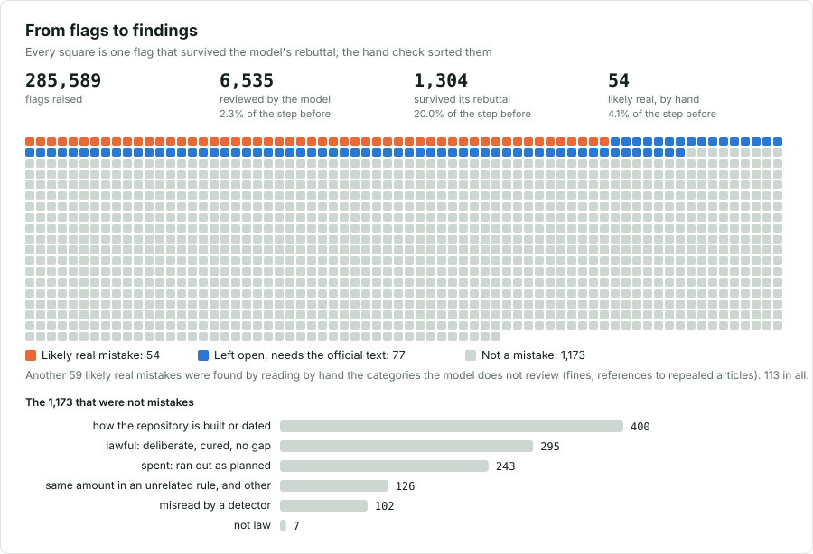
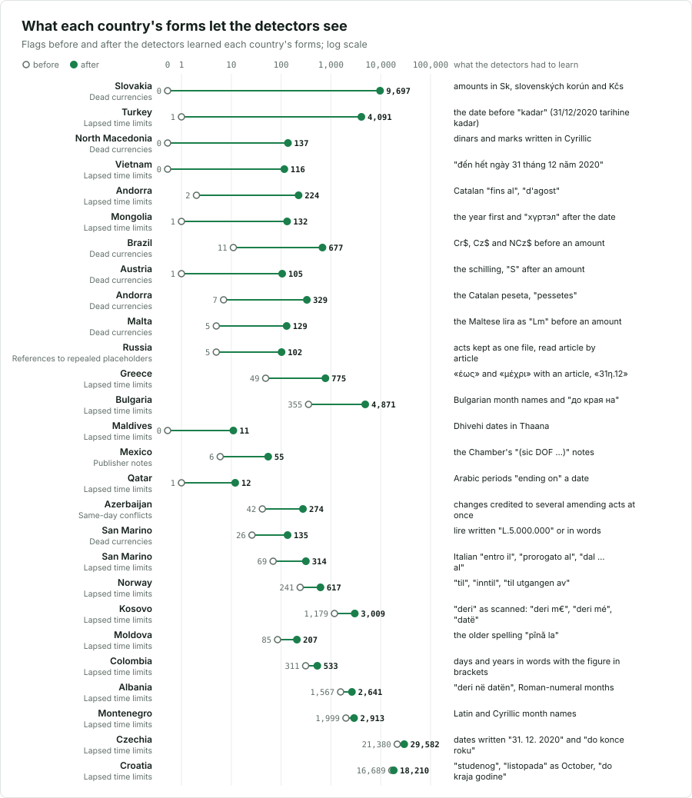
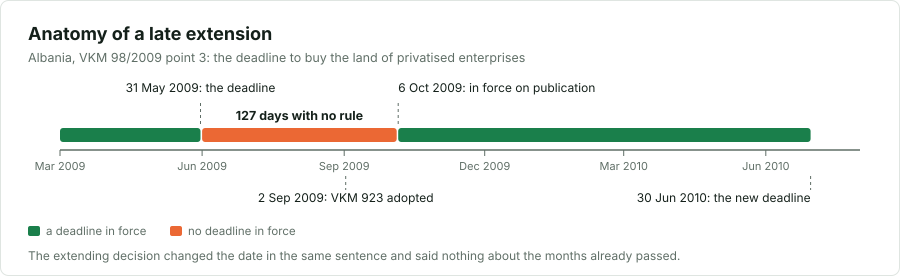

# Country by country

Global-law's [vulnerability detectors](scripts/) were also run on **50 country repositories one at a time**: each country's own commits as the history, its own language taught to the date and reference readers, a language model's review with a rebuttal pass, and every surviving flag read by hand in the repository's texts and, where it mattered, against the official gazette. Each country's results are in its own `vulnerabilities/` folder, in its language and in English, linked in the table below. This page puts together what those 50 runs found and what running them taught us. Counts are as of 16 November 2026.

## In numbers

| | |
| --- | ---: |
| Jurisdictions run one at a time | 50 |
| Languages of the READMEs | 30 |
| Flags raised | 285,589 |
| ... of them in law texts (not court decisions, drafts or notes) | 250,212 |
| Reviewed by a language model, arguing for and against | 6,535 |
| Survived the model's own rebuttal | 1,304 |
| Likely real mistakes, checked by hand | **113** |
| Cases left open, needing an official source | 60 |
| Problems found in the repositories themselves | 144 |
| Bugs found in the detectors and the pipeline | 179 (143 fixed) |
| Language and layout patches added to the detectors | 39 |

## What we learned

### 1. A flag is not a finding

The detectors raised 285,589 flags. A language model reviewed 6,535 of them, argued for each and then against it, and 1,304 survived its rebuttal. Every one of those was then read by hand in the repository's text and history, and only 54 held up as likely real mistakes; 77 more need the official gazette to decide.

What the other 1,173 were matters as much as the 54. The largest group, 400, came from how a repository is built or dated, not from the law (see point 7). Then 295 were lawful: a cut-off date the legislature meant, a gap it cured with retroactive wording. 243 were spent rules that ran out as planned, such as transitional periods and one-off programmes. 102 were detector misreadings, and 126 were mostly the same amount turning up in an unrelated rule. A model can argue its way past a mistake as easily as into one, so it filters the flags and the hand check decides.

The model also does not see everything. Another 59 likely real mistakes came from the categories it does not review: fines that punish breaches of repealed articles, and references to provisions that no longer exist. These were found by reading the flags by hand, which brings the total to 113.

<picture>
<source media="(prefers-color-scheme: dark)" srcset="data/countries/funnel-dark.svg">

</picture>

### 2. Each country's forms had to be taught before anything could be seen

A detector reads text through patterns: how a date is written, what a deadline sounds like, how a currency is named. Out of the box, they read the forms of the languages they were written for. Run on one country at a time, they first found almost nothing in many places. That was not because those countries' law had no lapsed time limits or dead currencies. The detectors could not yet read the way those were written.

The chart shows 27 such cases, each the count in one category before and after the detectors learned that country's forms. Together they added 35,866 flags that had been invisible. Slovakia's dead currencies went from none to 9,697 once "Sk" and "slovenských korún" were read; Turkey's lapsed time limits went from 1 to 4,091 once the date before "kadar" was. Vietnam and the Maldives went from none to their first, in Vietnamese and in Thaana.

<picture>
<source media="(prefers-color-scheme: dark)" srcset="data/countries/depth-dark.svg">

</picture>

Each country needed at least one thing no other did:

<details><summary><b>What only each jurisdiction needed</b></summary>

| Jurisdiction | What only it needed |
| --- | --- |
| Albania | Dates written with spaces or Roman-numeral months; decrees and court rulings counted as changes to the law. |
| Algeria | The Algerian dinar is current, so it is not a dead currency; the French noun "abrogation" is not a repeal mark. |
| Andorra | Every law held as enacted, with later changes only listed; Catalan dates ("fins al", "d'agost") and the Catalan peseta. |
| Austria | The months "Jänner" and "Feber"; sections cited with another act's abbreviation after them ("§ 221 Abs. 1 Z 2 UGB"); the schilling. |
| Azerbaijan | "Until" written as a suffix on the date ("31-dək", "tarixinədək"); 1,041 changes credited to several amending acts at once. |
| Belgium | Article numbers such as 259bis-9; the Belgian franc. |
| Bhutan | Acts held as enacted, in English; "null and void" and "vacate" are not repeal marks. |
| Bosnia and Herzegovina | The months "januara" and "jula", dates written with spaces, "do dana"; 3,633 decrees counted as law. |
| Brazil | Ordinal days ("1º de janeiro"), articles such as 3º-A, § 2º as a paragraph; cruzeiros written Cr$, Cz$ and NCz$. |
| Bulgaria | Bulgarian months and "до края на"; about 350,000 files, more than one detector could hold in memory at once. |
| Colombia | Days and years written in words with the figure in brackets; Constitutional Court rulings that strike out text count as changes to the law. |
| Croatia | "Listopada" is October here but November in Polish; "studenog"; articles in clanak-N files. |
| Czechia | One file per act; "a" between section numbers means "and", not a range; dates written "31. 12. 2020". |
| El Salvador | Dates written wholly in words; the colón, dead in El Salvador but current in Costa Rica. |
| Ethiopia | Proclamations held as first published; a proclamation that "is hereby repealed" is not a placeholder. |
| France | 187,161 commits; notices and circulars alongside law; CFP francs still in use; the verb "lire" is not the lira. |
| Germany | Changes dated by In-Kraft trailers; Germany-only checks for fines and missing paragraphs; an "S" after an amount is not a schilling. |
| Greece | «έως» and «μέχρι» with an article before the date; ordinal days such as «31η.12.2020». |
| Japan | Era-year dates in kanji (令和二年三月三十一日まで) and fiscal years; earlier versions appended out of order, so the history was rebuilt in date order. |
| Kosovo | Scanning errors in "deri" ("deri m€"); 179 international agreements counted as law. |
| Kyrgyzstan | Russian legal text with statya-N files and numbers such as 131-1; "за исключением" is not "excluded". |
| Liechtenstein | "Franken" is the Swiss franc, legal tender there (2,192 false flags before the fix); "Bst." cited like Austria's "lit.". |
| Luxembourg | Francs written "fr.", "frs" or "LUF"; 486 file names with accents. |
| Macau | European Portuguese "até ao dia"; the Portuguese "do" (of) is not the Slavic "do" (until); the Basic Law in Chinese. |
| Maldives | Dhivehi in Thaana, right to left, with several spellings of each month; charts drawn mirrored. |
| Malta | The Maltese lira as "Lm" before an amount (but not Lm as a length); "Cabernet Franc" is a grape. |
| Mexico | The Chamber of Deputies' "(sic DOF ...)" notes; Supreme Court invalidations counted as changes to the law. |
| Moldova | The older Romanian spelling "pînă la"; Constitutional Court changes counted as law. |
| Mongolia | Dates written year first with "хүртэл" after; zuil-N files; "хүчингүй болсонд тооцсон" (deemed repealed). |
| Montenegro | Latin and Cyrillic month names; clan-N files; "brisan" in a deletion clause is not a repeal mark. |
| Nauru | RONLAW history notes ("formerly section 15"); dates such as "1st January 1978". |
| Nepal | Bikram Sambat dates (15 "until" phrases left unread); "date expired" is not a repeal mark. |
| Netherlands | Hyphenated dates read day first ("t/m 31-12-2025"); "terugwerkende kracht tot" is not a time limit; Antillean guilders are current. |
| New Zealand | Section letters such as 312O; schedules of consequential amendments; "$10 million". |
| North Macedonia | The months јануари, мај, јуни and јули; "по" means "after", not "until"; dinars and marks in Cyrillic. |
| Norway | Sections numbered by chapter (§ 14-9, § 1a-1); "til utgangen av 2027". |
| Oman | Arabic "حتى" and "لغاية", Arabic-Indic digits, rials and baisas; charts drawn right to left. |
| Panama | Dates with the figure in brackets ("treinta (30) de junio"); treaty lines that open with a reference. |
| Paraguay | "Marco penal" (sentencing range) is not the Deutsche Mark; a constitutional amendment adopted by referendum. |
| Peru | "Sin efecto suspensivo" is not a repeal; the sol de oro; references at the end of a line. |
| Philippines | 18,417 commits of acts held as made; 1986 executive orders in force on approval; amending Acts that "hereby delete" sections. |
| Poland | Superscript articles (art. 4¹) and art. 47o; § as a paragraph inside a code's article; "do końca 2035 r.". |
| Qatar | Periods "ending on" a date (تنتهي في); rupees written after amounts in words. |
| Russia | 1,785 of 1,790 acts kept as one file; inserted articles (статья 12¹, 12.1). |
| San Marino | Italian "entro il" and "prorogato al"; lire written "L.5.000.000" or in words. |
| Slovakia | "Do konca roka"; Slovak and Czechoslovak korunas; the histories of 1,432 acts written twice. |
| Slovenia | "(črtan)" and "(prenehal veljati)" as repeal marks; "463.a člena"; articles lettered č, š and ž. |
| Spain | "Hasta el día"; restatement commits credited to the act they restate; a Spain-only check of citations of acts no longer in force. |
| Turkey | Dates written before "kadar" ("31/12/2020 tarihine kadar"); the lira with Turkish endings; folders renamed mid-history. |
| Vietnam | Dates and references (Điều, khoản, điểm) taught from scratch; amounts in đồng; folders renamed mid-history. |

</details>

### 3. Real mistakes come in a few shapes

The 113 likely real mistakes are spread over 27 jurisdictions. Read by hand, almost all of them are one of a few mechanical slips (sorted from each case's one-line description, so the counts are approximate):

- **A reference left pointing at a repealed or moved provision**: 51
- **A time limit extended only after it had run out**: 35
- **A fine or penalty pointing at a repealed or missing provision**: 16
- **A gap left by a political choice (a decree-law not validated, a veto)**: 6
- **Other slips (a placeholder never filled in, a provision printed twice)**: 4
- **A rule in force before it was published**: 1

<picture>
<source media="(prefers-color-scheme: dark)" srcset="data/countries/shapes-dark.svg">

</picture>

One example of each:

- **Leftover reference.** Brazil's Law 4,595/1964 still makes controllers subject to Article 44(8), but Law 13,506/2017 repealed all of Article 44 from 14 November 2017, and nothing redirects the reference.
- **Late extension.** Spain's 21% corporate withholding rate ran until 31 December 2013. Royal Decree-law 1/2014 extended it only from 26 January 2014, with no retroactive wording, so from 1 to 25 January the rate was back at 19%.
- **Fine without a basis.** Turkey's Law 1219 on medical practice, Article 68, was rewritten in 2008 and still fines nurses who go beyond the scope of practice in Article 64, which was repealed in 1954.
- **Political gap.** After Spain's Congress declined to validate Royal Decree-laws 9/2024 and 16/2025, no new suspension of evictions could be ordered from 23 to 29 January 2025 or from 28 January to 4 February 2026. This gap was chosen, not overlooked.
- **In force before publication.** A Dutch order in council raised the maximum fines in art. 23(4) of the Penal Code from 1 January 2022. It was published on 5 January 2022, and the Constitution does not let it take effect before publication.
- **Other slips.** Austria's Green Electricity Act, § 57g, still cites the amending act as "BGBl. I Nr. x/y", a drafting placeholder that was never filled in, four times in two paragraphs.

The late extension is the easiest to miss. Each act is correct when read alone. Only the dates side by side show that the old deadline had passed before the new one was made. Albania's has the usual timeline:

<picture>
<source media="(prefers-color-scheme: dark)" srcset="data/countries/late-extension-dark.svg">

</picture>

### 4. Each legal system leaves its own fingerprint

The same detectors produce a different mix of flags in every country. Lapsed time limits are the largest category in 32 of the 50, because every legal system sets deadlines and extends them. The other 18 each lead with something that says where their law comes from:

- **Retroactive or pre-publication dates** (Ethiopia, Montenegro, Philippines, Qatar): repositories that hold acts as published, where an act dated by the day it was signed seems to take effect before it was published.
- **Dead currencies** (Andorra, El Salvador, Luxembourg): El Salvador's colón, replaced by the dollar in 2001, and the francs and pesetas still named in acts that were never amended.
- **References to repealed placeholders** (Belgium, Malta, New Zealand, Spain): systems that keep a repealed article as a numbered placeholder ("[Repealed]", "derogado") rather than deleting it, so later text can still point at it.
- **Duplicate numbering** (Bhutan, Brazil, Panama): the same number used twice, often where articles were inserted between others (art. 4-A, 4¹) or a provision was printed twice.
- **References to deleted provisions** (Algeria, Paraguay), **repeal gaps** (France) and **same-day conflicts** (Vietnam): where the history itself is the main source of flags.

Some of these differences come from the repository, not the law. A repository that dates acts by signature produces retroactive flags, and one that keeps a whole act in one file produces reference flags. Point 7 covers those.

<picture>
<source media="(prefers-color-scheme: dark)" srcset="data/countries/mix-dark.svg">

</picture>

### 5. Every new language broke something, and every fix helped the next

Running the detectors country by country turned up 179 bugs; 143 are fixed and 36 are still open (each country's README states the ones that affect its numbers). Read one by one, they split almost evenly: 57 blind spots, where real text was not read; 57 false matches, where text was read as something it is not; and 65 in the machinery of running, building and re-running.

<picture>
<source media="(prefers-color-scheme: dark)" srcset="data/countries/bugs-dark.svg">

</picture>

The false matches matter as much as the blind spots. Unfixed, they filled the results with noise. In 15 cases, teaching the detectors what a country's words do *not* mean removed 7,818 false flags. Liechtenstein's "Franken" is the Swiss franc, still legal tender, and that one fix took its dead-currency count from 2,259 to 12. Every Belgian "dead currency" was the word "intitulé" read as the Peruvian inti. "Lira" matched inside "liraglutid", and Poland's "§ 2¹" looked like a second "§ 2".

<picture>
<source media="(prefers-color-scheme: dark)" srcset="data/countries/false-matches-dark.svg">

</picture>

Each fix is a small patch to the detectors, and there are now 39, applied in order. Each one also applies to every country run after it.

### 6. History decides what can be found

Five of the detector categories compare versions rather than read one text: an article repealed while others still cite it, two changes on the same day, an amount left behind by an update. Those need a history. Of the 50 repositories, 16 hold every act with its dated versions, 22 hold versions for some acts, and 12 hold each act once, as enacted.

Where the history is full, the version-comparing detectors raise a median of 32% of a run's flags (and 93% in Paraguay). Where it is partial, they raise none at all in 12 of the 22. Where each act is held once, they have nothing to compare and none raise anything. Those runs can only find what is visible in a single text. Their READMEs say so, and a country with few flags may simply have a short record.

<picture>
<source media="(prefers-color-scheme: dark)" srcset="data/countries/history-dark.svg">

</picture>

### 7. The repositories need checking as much as the law

The hand check found 144 problems in the repositories themselves. They explain a large share of the flags that looked like mistakes: 400 of the survivors in point 1. By kind: 60 are files and layout (text in the wrong file, a whole act in one article's file, stray files read as law), 49 are dating (acts dated by signature instead of entry into force, changes credited to the wrong amending act), 19 are text missing or held twice, and 16 are damaged text (HTML entities, replacement characters, quotation marks turned into letters).

<picture>
<source media="(prefers-color-scheme: dark)" srcset="data/countries/repositories-dark.svg">

</picture>

How these are being handled:

- **Listed where they were found.** Each problem is in that country's README, under the problems found in the repository, with the files and dates it affects.
- **Gathered into one worklist.** All 144 are in [data/countries/repository_problems.csv](data/countries/repository_problems.csv), one row per problem with its jurisdiction and a status; each is a fix for that repository's builder, and its status changes to fixed once the corrected history is published.
- **Worked around in the detectors meanwhile**, where a fix on the reading side was safe, so the findings are not distorted while the repositories wait: act folders renamed in the middle of a history are mapped back to one folder per act; identical rows from histories written twice are counted once; file names with accents are read as written; Japan's versions, appended out of order, are put back in date order before the detectors read them.
- **Re-run after each fix.** When a repository's builder publishes a corrected history, that country's detectors are run again with the same scripts (`redo.py`, which keeps the reviews already made) and its README is updated.

## From findings to proofs: a formal model of each country

Everything above is empirical. Detectors find candidates by matching patterns, a model argues about them, and a person decides by reading the text. The next step is a formal model of each country in [Lean 4](../lean-proofs/README.md). It would state the legal rules a finding rests on and prove that the mistake follows from the dated record. Global-law already has the start of this for the global run, in [lean-proofs/](../lean-proofs/), and the Dutch fine ceilings in point 3 are already one of its cases ([NLFines.lean](../lean-proofs/LegalProofs/Cases/NLFines.lean)). This section sets out what the country runs give that model, what the model adds, and how each country's findings would be encoded.

### What each approach can and cannot do

| | Country runs (this page) | A Lean model per country |
| --- | --- | --- |
| Finds candidates | Yes, in any of 30 languages, once its forms are taught (point 2) | No: it checks facts it is given and finds none itself |
| Decides whether a flag is a mistake | By hand, one flag at a time; the reasons are written in prose | By proof, once for every flag of a kind, under rules written out as definitions |
| Shows its reasoning | In each README's notes | As a theorem anyone can re-check with `lake build` |
| Handles legal judgment (was the gap chosen? does analogy apply?) | By reading, with the reason written down | Only as an explicit premise, with the counterargument proved too |
| Depends on the repository being right | Yes; point 7 lists where it was not | Yes, just as much: a certificate is about the record, not the law |

Neither replaces the other. The runs supply the facts and the judgment calls. The model turns them into statements that can be checked, and keeps them checked as the repositories change. In the global run, Lean already certifies 14,689 of the 14,900 flags it is given; its [README](../lean-proofs/README.md) lists them by kind.

### How each finding would be encoded

Each of the seven points above becomes a distinct part of a country's model:

| What the country runs learned | Where it goes in the model | There today |
| --- | --- | --- |
| **The shapes of real mistakes** (point 3) | A schema theorem for each shape, instantiated once per likely mistake with the official text quoted in the file: a leftover reference or a fine without a basis is `dead_reference`; a late extension or a political gap is `empty_period`; a rule in force before publication is `prepublication_window`; a placeholder never filled in ("BGBl. I Nr. x/y") is `phantom_reference` | All four schemas, in [Basic.lean](../lean-proofs/LegalProofs/Basic.lean); six worked cases in [Cases/](../lean-proofs/LegalProofs/Cases/) |
| **Why a survivor is not a mistake** (point 1) | Each reason for rejecting a flag becomes a hypothesis the theorem has to rule out, with the reason proved as well. A retroactive extension closes the gap; a gap the legislature chose is still a gap, but the case is labelled as chosen, not overlooked | `GMOGap.retroactive_closes_gap` and `AWaffV.analogy_would_rescue` in [Cases/](../lean-proofs/LegalProofs/Cases/) |
| **Each country's forms** (point 2): dates, currencies, numbering | Data that the fact generator reads: the date forms and calendars (Japanese era years, Bikram Sambat), each currency with the day it stopped being legal tender, and the numbering scheme (art. 4¹, § 3-1). A calendar conversion comes with a proof that it keeps dates in order | Real calendar dates in [Calendar.lean](../lean-proofs/LegalProofs/Calendar.lean); the forms are in the detectors' patches, not yet in Lean |
| **Each legal system's fingerprint** (point 4) | The country's own rules, each one a definition citing its source: when a rule binds (publication, or a set number of days after it), whether an extension can reach back, and how a repeal is recorded (a numbered placeholder or deletion) | One shared rule set for all countries, in Basic.lean |
| **What the history allows** (point 6) | Which certificates a country can have at all. Reference and repeal certificates need dated versions; a repository that holds each act once can only certify facts visible in a single text (pre-publication dates, references to provisions that never existed) | Certificates for references in [History.lean](../lean-proofs/LegalProofs/History.lean); for empty periods, pre-publication dates and missing paragraphs in [Certificates.lean](../lean-proofs/LegalProofs/Certificates.lean) |
| **How the record is built** (points 5 and 7) | A model of amending acts: a day's instructions, applied in order. It says when two changes on one day conflict and when an instruction aimed at a missing provision does nothing. Each repository problem becomes a record excluded or corrected before facts are generated; its row in repository_problems.csv is the switch | [Amendments.lean](../lean-proofs/LegalProofs/Amendments.lean) (`same_key_conflict`, `replace_missing_noop`); exclusions not yet |
| **What the detectors got wrong** (point 5) | Not provable: Lean checks that the facts imply the mistake, not that a detector read the facts correctly. The bug log stays the record of that, and a certificate rebuilt from the history (rather than from the flag) catches part of it | Reference certificates already rebuild each provision's history instead of trusting the flag |

### A folder for each country

The plan is one folder per country beside the shared model, built from that country's repository and the data published here:

```
lean-proofs/LegalProofs/Countries/<Country>/
  Forms.lean       date forms, calendars, currencies and their end dates, numbering (point 2)
  Rules.lean       the country's own rules of commencement, publication, retroactivity and repeal, each with its source (point 4)
  Cases/           one file per likely real mistake, quoting the official text, with its counterargument where there is one (points 1 and 3)
  Generated/       certificates for the country's flags, written from its history and checked on every build (point 6)
  Exclusions.lean  records left out until the repository is fixed, one per row of repository_problems.csv (point 7)
```

The shared schemas stay in one place, so a theorem proved once covers every country. What differs between countries is data and rules, and each of those carries its source. A natural order is to start with the 16 countries whose repositories hold full histories, where the most can be certified. The data files below ([likely_mistakes.csv](data/countries/likely_mistakes.csv), [repository_problems.csv](data/countries/repository_problems.csv)) are the inputs they start from.

## The 50 jurisdictions

| Jurisdiction | Flags | Reviewed | Survived | Likely real | Open | Folder |
| --- | ---: | ---: | ---: | ---: | ---: | --- |
| Albania | 2,953 | 267 | 31 | 3 | 4 | [albania-law](https://github.com/lexifina/albania-law/tree/main/vulnerabilities) |
| Algeria | 20 | 16 | 1 | 0 | 3 | [algeria-law](https://github.com/lexifina/algeria-law/tree/main/vulnerabilities) |
| Andorra | 588 | 47 | 3 | 0 | 0 | [andorra-law](https://github.com/lexifina/andorra-law/tree/main/vulnerabilities) |
| Austria | 2,181 | 200 | 32 | 5 | 0 | [austria-law](https://github.com/lexifina/austria-law/tree/main/vulnerabilities) |
| Azerbaijan | 934 | 165 | 25 | 0 | 0 | [azerbaijan-law](https://github.com/lexifina/azerbaijan-law/tree/main/vulnerabilities) |
| Belgium | 994 | 57 | 6 | 1 | 0 | [belgium-law](https://github.com/lexifina/belgium-law/tree/main/vulnerabilities) |
| Bhutan | 1 | 0 | 0 | 0 | 0 | [bhutan-law](https://github.com/lexifina/bhutan-law/tree/main/vulnerabilities) |
| Bosnia and Herzegovina | 2,766 | 180 | 14 | 0 | 1 | [bosnia-and-herzegovina-law](https://github.com/lexifina/bosnia-and-herzegovina-law/tree/main/vulnerabilities) |
| Brazil | 4,900 | 238 | 44 | 5 | 0 | [brazil-law](https://github.com/lexifina/brazil-law/tree/main/vulnerabilities) |
| Bulgaria | 6,475 | 196 | 13 | 1 | 0 | [bulgaria-law](https://github.com/lexifina/bulgaria-law/tree/main/vulnerabilities) |
| Colombia | 1,811 | 226 | 44 | 2 | 0 | [colombia-law](https://github.com/lexifina/colombia-law/tree/main/vulnerabilities) |
| Croatia | 31,047 | 184 | 7 | 1 | 2 | [croatia-law](https://github.com/lexifina/croatia-law/tree/main/vulnerabilities) |
| Czechia | 33,557 | 212 | 61 | 4 | 0 | [czechia-law](https://github.com/lexifina/czechia-law/tree/main/vulnerabilities) |
| El Salvador | 450 | 40 | 0 | 3 | 7 | [el-salvador-law](https://github.com/lexifina/el-salvador-law/tree/main/vulnerabilities) |
| Ethiopia | 6 | 5 | 1 | 0 | 0 | [ethiopia-law](https://github.com/lexifina/ethiopia-law/tree/main/vulnerabilities) |
| France | 35,971 | 612 | 254 | 6 | 0 | [france-law](https://github.com/lexifina/france-law/tree/main/vulnerabilities) |
| Germany | 15,737 | 391 | 160 | 12 | 3 | [germany-law](https://github.com/lexifina/germany-law/tree/main/vulnerabilities) |
| Greece | 933 | 129 | 29 | 0 | 0 | [greece-law](https://github.com/lexifina/greece-law/tree/main/vulnerabilities) |
| Japan | 17,940 | 358 | 126 | 3 | 10 | [japan-law](https://github.com/lexifina/japan-law/tree/main/vulnerabilities) |
| Kosovo | 3,359 | 111 | 22 | 0 | 0 | [kosovo-law](https://github.com/lexifina/kosovo-law/tree/main/vulnerabilities) |
| Kyrgyzstan | 362 | 80 | 5 | 0 | 0 | [kyrgyzstan-law](https://github.com/lexifina/kyrgyzstan-law/tree/main/vulnerabilities) |
| Liechtenstein | 1,313 | 43 | 2 | 9 | 0 | [liechtenstein-law](https://github.com/lexifina/liechtenstein-law/tree/main/vulnerabilities) |
| Luxembourg | 4,389 | 104 | 14 | 1 | 0 | [luxembourg-law](https://github.com/lexifina/luxembourg-law/tree/main/vulnerabilities) |
| Macau | 4 | 4 | 0 | 0 | 0 | [macau-law](https://github.com/lexifina/macau-law/tree/main/vulnerabilities) |
| Maldives | 11 | 11 | 2 | 0 | 0 | [maldives-law](https://github.com/lexifina/maldives-law/tree/main/vulnerabilities) |
| Malta | 1,309 | 223 | 76 | 3 | 2 | [malta-law](https://github.com/lexifina/malta-law/tree/main/vulnerabilities) |
| Mexico | 1,177 | 132 | 13 | 2 | 0 | [mexico-law](https://github.com/lexifina/mexico-law/tree/main/vulnerabilities) |
| Moldova | 222 | 52 | 0 | 0 | 0 | [moldova-law](https://github.com/lexifina/moldova-law/tree/main/vulnerabilities) |
| Mongolia | 140 | 56 | 2 | 0 | 1 | [mongolia-law](https://github.com/lexifina/mongolia-law/tree/main/vulnerabilities) |
| Montenegro | 9,956 | 187 | 7 | 0 | 3 | [montenegro-law](https://github.com/lexifina/montenegro-law/tree/main/vulnerabilities) |
| Nauru | 11 | 10 | 0 | 0 | 1 | [nauru-law](https://github.com/lexifina/nauru-law/tree/main/vulnerabilities) |
| Nepal | 6 | 6 | 1 | 0 | 0 | [nepal-law](https://github.com/lexifina/nepal-law/tree/main/vulnerabilities) |
| Netherlands | 16,772 | 265 | 46 | 3 | 2 | [netherlands-law](https://github.com/lexifina/netherlands-law/tree/main/vulnerabilities) |
| New Zealand | 312 | 111 | 11 | 15 | 1 | [new-zealand-law](https://github.com/lexifina/new-zealand-law/tree/main/vulnerabilities) |
| North Macedonia | 2,476 | 80 | 15 | 0 | 5 | [north-macedonia-law](https://github.com/lexifina/north-macedonia-law/tree/main/vulnerabilities) |
| Norway | 945 | 101 | 5 | 0 | 0 | [norway-law](https://github.com/lexifina/norway-law/tree/main/vulnerabilities) |
| Oman | 4 | 4 | 0 | 1 | 0 | [oman-law](https://github.com/lexifina/oman-law/tree/main/vulnerabilities) |
| Panama | 168 | 40 | 4 | 0 | 0 | [panama-law](https://github.com/lexifina/panama-law/tree/main/vulnerabilities) |
| Paraguay | 14 | 14 | 0 | 4 | 0 | [paraguay-law](https://github.com/lexifina/paraguay-law/tree/main/vulnerabilities) |
| Peru | 66 | 49 | 1 | 4 | 0 | [peru-law](https://github.com/lexifina/peru-law/tree/main/vulnerabilities) |
| Philippines | 5,734 | 80 | 13 | 0 | 0 | [philippines-law](https://github.com/lexifina/philippines-law/tree/main/vulnerabilities) |
| Poland | 1,028 | 116 | 18 | 1 | 1 | [poland-law](https://github.com/lexifina/poland-law/tree/main/vulnerabilities) |
| Qatar | 809 | 52 | 7 | 0 | 0 | [qatar-law](https://github.com/lexifina/qatar-law/tree/main/vulnerabilities) |
| Russia | 2,437 | 46 | 2 | 1 | 2 | [russia-law](https://github.com/lexifina/russia-law/tree/main/vulnerabilities) |
| San Marino | 461 | 40 | 6 | 1 | 1 | [san-marino-law](https://github.com/lexifina/san-marino-law/tree/main/vulnerabilities) |
| Slovakia | 38,744 | 203 | 63 | 7 | 3 | [slovakia-law](https://github.com/lexifina/slovakia-law/tree/main/vulnerabilities) |
| Slovenia | 4,774 | 132 | 13 | 0 | 4 | [slovenia-law](https://github.com/lexifina/slovenia-law/tree/main/vulnerabilities) |
| Spain | 19,957 | 249 | 71 | 7 | 0 | [spain-law](https://github.com/lexifina/spain-law/tree/main/vulnerabilities) |
| Turkey | 8,998 | 319 | 28 | 8 | 1 | [turkey-law](https://github.com/lexifina/turkey-law/tree/main/vulnerabilities) |
| Vietnam | 367 | 92 | 6 | 0 | 3 | [vietnam-law](https://github.com/lexifina/vietnam-law/tree/main/vulnerabilities) |

## Every country repository

Every country repository has a `vulnerabilities/` folder. 51 hold results: the 50 above, and [Serbia](https://github.com/lexifina/serbia-law/tree/main/vulnerabilities), whose folder was made before these runs. The other 162 are placeholders, each saying the detectors have not been run on it yet:

[Afghanistan](https://github.com/lexifina/afghanistan-law/tree/main/vulnerabilities), [Åland](https://github.com/lexifina/aland-law/tree/main/vulnerabilities), [Angola](https://github.com/lexifina/angola-law/tree/main/vulnerabilities), [Antigua and Barbuda](https://github.com/lexifina/antigua-and-barbuda-law/tree/main/vulnerabilities), [Argentina](https://github.com/lexifina/argentina-law/tree/main/vulnerabilities), [Armenia](https://github.com/lexifina/armenia-law/tree/main/vulnerabilities), [Australia](https://github.com/lexifina/australia-law/tree/main/vulnerabilities), [Bahamas](https://github.com/lexifina/bahamas-law/tree/main/vulnerabilities), [Bahrain](https://github.com/lexifina/bahrain-law/tree/main/vulnerabilities), [Bangladesh](https://github.com/lexifina/bangladesh-law/tree/main/vulnerabilities), [Barbados](https://github.com/lexifina/barbados-law/tree/main/vulnerabilities), [Belarus](https://github.com/lexifina/belarus-law/tree/main/vulnerabilities), [Belize](https://github.com/lexifina/belize-law/tree/main/vulnerabilities), [Benin](https://github.com/lexifina/benin-law/tree/main/vulnerabilities), [Bermuda](https://github.com/lexifina/bermuda-law/tree/main/vulnerabilities), [Bolivia](https://github.com/lexifina/bolivia-law/tree/main/vulnerabilities), [Botswana](https://github.com/lexifina/botswana-law/tree/main/vulnerabilities), [British Virgin Islands](https://github.com/lexifina/british-virgin-islands-law/tree/main/vulnerabilities), [Brunei](https://github.com/lexifina/brunei-law/tree/main/vulnerabilities), [Burkina Faso](https://github.com/lexifina/burkina-faso-law/tree/main/vulnerabilities), [Burundi](https://github.com/lexifina/burundi-law/tree/main/vulnerabilities), [Cabo Verde](https://github.com/lexifina/cabo-verde-law/tree/main/vulnerabilities), [Cambodia](https://github.com/lexifina/cambodia-law/tree/main/vulnerabilities), [Cameroon](https://github.com/lexifina/cameroon-law/tree/main/vulnerabilities), [Canada](https://github.com/lexifina/canada-law/tree/main/vulnerabilities), [Cayman Islands](https://github.com/lexifina/cayman-islands-law/tree/main/vulnerabilities), [Central African Republic](https://github.com/lexifina/central-african-republic-law/tree/main/vulnerabilities), [Chad](https://github.com/lexifina/chad-law/tree/main/vulnerabilities), [Chile](https://github.com/lexifina/chile-law/tree/main/vulnerabilities), [China](https://github.com/lexifina/china-law/tree/main/vulnerabilities), [Comoros](https://github.com/lexifina/comoros-law/tree/main/vulnerabilities), [Cook Islands](https://github.com/lexifina/cook-islands-law/tree/main/vulnerabilities), [Costa Rica](https://github.com/lexifina/costa-rica-law/tree/main/vulnerabilities), [Côte d'Ivoire](https://github.com/lexifina/cote-divoire-law/tree/main/vulnerabilities), [Cuba](https://github.com/lexifina/cuba-law/tree/main/vulnerabilities), [Cyprus](https://github.com/lexifina/cyprus-law/tree/main/vulnerabilities), [Denmark](https://github.com/lexifina/denmark-law/tree/main/vulnerabilities), [Djibouti](https://github.com/lexifina/djibouti-law/tree/main/vulnerabilities), [Dominica](https://github.com/lexifina/dominica-law/tree/main/vulnerabilities), [Dominican Republic](https://github.com/lexifina/dominican-republic-law/tree/main/vulnerabilities), [DR Congo](https://github.com/lexifina/dr-congo-law/tree/main/vulnerabilities), [Ecuador](https://github.com/lexifina/ecuador-law/tree/main/vulnerabilities), [Egypt](https://github.com/lexifina/egypt-law/tree/main/vulnerabilities), [Equatorial Guinea](https://github.com/lexifina/equatorial-guinea-law/tree/main/vulnerabilities), [Eritrea](https://github.com/lexifina/eritrea-law/tree/main/vulnerabilities), [Estonia](https://github.com/lexifina/estonia-law/tree/main/vulnerabilities), [Eswatini](https://github.com/lexifina/eswatini-law/tree/main/vulnerabilities), [Eurasian Economic Union](https://github.com/lexifina/eurasian-economic-union-law/tree/main/vulnerabilities), [European Union](https://github.com/lexifina/european-union-law/tree/main/vulnerabilities), [Faroe Islands](https://github.com/lexifina/faroe-islands-law/tree/main/vulnerabilities), [Fiji](https://github.com/lexifina/fiji-law/tree/main/vulnerabilities), [Finland](https://github.com/lexifina/finland-law/tree/main/vulnerabilities), [Gabon](https://github.com/lexifina/gabon-law/tree/main/vulnerabilities), [Gambia](https://github.com/lexifina/gambia-law/tree/main/vulnerabilities), [Georgia](https://github.com/lexifina/georgia-law/tree/main/vulnerabilities), [Ghana](https://github.com/lexifina/ghana-law/tree/main/vulnerabilities), [Gibraltar](https://github.com/lexifina/gibraltar-law/tree/main/vulnerabilities), [Greenland](https://github.com/lexifina/greenland-law/tree/main/vulnerabilities), [Grenada](https://github.com/lexifina/grenada-law/tree/main/vulnerabilities), [Guatemala](https://github.com/lexifina/guatemala-law/tree/main/vulnerabilities), [Guernsey](https://github.com/lexifina/guernsey-law/tree/main/vulnerabilities), [Guinea](https://github.com/lexifina/guinea-law/tree/main/vulnerabilities), [Guinea-Bissau](https://github.com/lexifina/guinea-bissau-law/tree/main/vulnerabilities), [Guyana](https://github.com/lexifina/guyana-law/tree/main/vulnerabilities), [Haiti](https://github.com/lexifina/haiti-law/tree/main/vulnerabilities), [Honduras](https://github.com/lexifina/honduras-law/tree/main/vulnerabilities), [Hong Kong](https://github.com/lexifina/hong-kong-law/tree/main/vulnerabilities), [Hungary](https://github.com/lexifina/hungary-law/tree/main/vulnerabilities), [Iceland](https://github.com/lexifina/iceland-law/tree/main/vulnerabilities), [India](https://github.com/lexifina/india-law/tree/main/vulnerabilities), [Indonesia](https://github.com/lexifina/indonesia-law/tree/main/vulnerabilities), [Iran](https://github.com/lexifina/iran-law/tree/main/vulnerabilities), [Iraq](https://github.com/lexifina/iraq-law/tree/main/vulnerabilities), [Ireland](https://github.com/lexifina/ireland-law/tree/main/vulnerabilities), [Isle of Man](https://github.com/lexifina/isle-of-man-law/tree/main/vulnerabilities), [Israel](https://github.com/lexifina/israel-law/tree/main/vulnerabilities), [Italy](https://github.com/lexifina/italy-law/tree/main/vulnerabilities), [Jamaica](https://github.com/lexifina/jamaica-law/tree/main/vulnerabilities), [Jersey](https://github.com/lexifina/jersey-law/tree/main/vulnerabilities), [Jordan](https://github.com/lexifina/jordan-law/tree/main/vulnerabilities), [Kazakhstan](https://github.com/lexifina/kazakhstan-law/tree/main/vulnerabilities), [Kenya](https://github.com/lexifina/kenya-law/tree/main/vulnerabilities), [Kiribati](https://github.com/lexifina/kiribati-law/tree/main/vulnerabilities), [Kuwait](https://github.com/lexifina/kuwait-law/tree/main/vulnerabilities), [Laos](https://github.com/lexifina/laos-law/tree/main/vulnerabilities), [Latvia](https://github.com/lexifina/latvia-law/tree/main/vulnerabilities), [Lebanon](https://github.com/lexifina/lebanon-law/tree/main/vulnerabilities), [Lesotho](https://github.com/lexifina/lesotho-law/tree/main/vulnerabilities), [Liberia](https://github.com/lexifina/liberia-law/tree/main/vulnerabilities), [Libya](https://github.com/lexifina/libya-law/tree/main/vulnerabilities), [Lithuania](https://github.com/lexifina/lithuania-law/tree/main/vulnerabilities), [Madagascar](https://github.com/lexifina/madagascar-law/tree/main/vulnerabilities), [Malawi](https://github.com/lexifina/malawi-law/tree/main/vulnerabilities), [Malaysia](https://github.com/lexifina/malaysia-law/tree/main/vulnerabilities), [Mali](https://github.com/lexifina/mali-law/tree/main/vulnerabilities), [Marshall Islands](https://github.com/lexifina/marshall-islands-law/tree/main/vulnerabilities), [Mauritania](https://github.com/lexifina/mauritania-law/tree/main/vulnerabilities), [Mauritius](https://github.com/lexifina/mauritius-law/tree/main/vulnerabilities), [Micronesia](https://github.com/lexifina/micronesia-law/tree/main/vulnerabilities), [Monaco](https://github.com/lexifina/monaco-law/tree/main/vulnerabilities), [Morocco](https://github.com/lexifina/morocco-law/tree/main/vulnerabilities), [Mozambique](https://github.com/lexifina/mozambique-law/tree/main/vulnerabilities), [Myanmar](https://github.com/lexifina/myanmar-law/tree/main/vulnerabilities), [Namibia](https://github.com/lexifina/namibia-law/tree/main/vulnerabilities), [Nicaragua](https://github.com/lexifina/nicaragua-law/tree/main/vulnerabilities), [Niger](https://github.com/lexifina/niger-law/tree/main/vulnerabilities), [Nigeria](https://github.com/lexifina/nigeria-law/tree/main/vulnerabilities), [North Korea](https://github.com/lexifina/north-korea-law/tree/main/vulnerabilities), [Pakistan](https://github.com/lexifina/pakistan-law/tree/main/vulnerabilities), [Palau](https://github.com/lexifina/palau-law/tree/main/vulnerabilities), [Palestine](https://github.com/lexifina/palestine-law/tree/main/vulnerabilities), [Papua New Guinea](https://github.com/lexifina/papua-new-guinea-law/tree/main/vulnerabilities), [Portugal](https://github.com/lexifina/portugal-law/tree/main/vulnerabilities), [Puerto Rico](https://github.com/lexifina/puerto-rico-law/tree/main/vulnerabilities), [Republic of the Congo](https://github.com/lexifina/republic-of-congo-law/tree/main/vulnerabilities), [Romania](https://github.com/lexifina/romania-law/tree/main/vulnerabilities), [Rwanda](https://github.com/lexifina/rwanda-law/tree/main/vulnerabilities), [Saint Kitts and Nevis](https://github.com/lexifina/saint-kitts-and-nevis-law/tree/main/vulnerabilities), [Saint Lucia](https://github.com/lexifina/saint-lucia-law/tree/main/vulnerabilities), [Saint Vincent and the Grenadines](https://github.com/lexifina/saint-vincent-and-the-grenadines-law/tree/main/vulnerabilities), [Samoa](https://github.com/lexifina/samoa-law/tree/main/vulnerabilities), [São Tomé and Príncipe](https://github.com/lexifina/sao-tome-and-principe-law/tree/main/vulnerabilities), [Saudi Arabia](https://github.com/lexifina/saudi-arabia-law/tree/main/vulnerabilities), [Senegal](https://github.com/lexifina/senegal-law/tree/main/vulnerabilities), [Seychelles](https://github.com/lexifina/seychelles-law/tree/main/vulnerabilities), [Sierra Leone](https://github.com/lexifina/sierra-leone-law/tree/main/vulnerabilities), [Singapore](https://github.com/lexifina/singapore-law/tree/main/vulnerabilities), [Solomon Islands](https://github.com/lexifina/solomon-islands-law/tree/main/vulnerabilities), [Somalia](https://github.com/lexifina/somalia-law/tree/main/vulnerabilities), [South Africa](https://github.com/lexifina/south-africa-law/tree/main/vulnerabilities), [South Korea](https://github.com/lexifina/south-korea-law/tree/main/vulnerabilities), [South Sudan](https://github.com/lexifina/south-sudan-law/tree/main/vulnerabilities), [Sri Lanka](https://github.com/lexifina/sri-lanka-law/tree/main/vulnerabilities), [Sudan](https://github.com/lexifina/sudan-law/tree/main/vulnerabilities), [Suriname](https://github.com/lexifina/suriname-law/tree/main/vulnerabilities), [Sweden](https://github.com/lexifina/sweden-law/tree/main/vulnerabilities), [Switzerland](https://github.com/lexifina/switzerland-law/tree/main/vulnerabilities), [Syria](https://github.com/lexifina/syria-law/tree/main/vulnerabilities), [Taiwan](https://github.com/lexifina/taiwan-law/tree/main/vulnerabilities), [Tajikistan](https://github.com/lexifina/tajikistan-law/tree/main/vulnerabilities), [Tanzania](https://github.com/lexifina/tanzania-law/tree/main/vulnerabilities), [Thailand](https://github.com/lexifina/thailand-law/tree/main/vulnerabilities), [Timor-Leste](https://github.com/lexifina/timor-leste-law/tree/main/vulnerabilities), [Togo](https://github.com/lexifina/togo-law/tree/main/vulnerabilities), [Tonga](https://github.com/lexifina/tonga-law/tree/main/vulnerabilities), [Trinidad and Tobago](https://github.com/lexifina/trinidad-and-tobago-law/tree/main/vulnerabilities), [Tunisia](https://github.com/lexifina/tunisia-law/tree/main/vulnerabilities), [Turkmenistan](https://github.com/lexifina/turkmenistan-law/tree/main/vulnerabilities), [Tuvalu](https://github.com/lexifina/tuvalu-law/tree/main/vulnerabilities), [Uganda](https://github.com/lexifina/uganda-law/tree/main/vulnerabilities), [Ukraine](https://github.com/lexifina/ukraine-law/tree/main/vulnerabilities), [United Arab Emirates](https://github.com/lexifina/united-arab-emirates-law/tree/main/vulnerabilities), [United Kingdom](https://github.com/lexifina/united-kingdom-law/tree/main/vulnerabilities), [United States](https://github.com/lexifina/united-states-law/tree/main/vulnerabilities), [Uruguay](https://github.com/lexifina/uruguay-law/tree/main/vulnerabilities), [Uzbekistan](https://github.com/lexifina/uzbekistan-law/tree/main/vulnerabilities), [Vanuatu](https://github.com/lexifina/vanuatu-law/tree/main/vulnerabilities), [Vatican City](https://github.com/lexifina/vatican-city-law/tree/main/vulnerabilities), [Venezuela](https://github.com/lexifina/venezuela-law/tree/main/vulnerabilities), [Yemen](https://github.com/lexifina/yemen-law/tree/main/vulnerabilities), [Zambia](https://github.com/lexifina/zambia-law/tree/main/vulnerabilities), [Zimbabwe](https://github.com/lexifina/zimbabwe-law/tree/main/vulnerabilities)

## Data

- [data/countries/countries.csv](data/countries/countries.csv): one row per jurisdiction, with the counts above and the link to its folder
- [data/countries/likely_mistakes.csv](data/countries/likely_mistakes.csv): every likely real mistake, where it is and what it is
- [data/countries/repository_problems.csv](data/countries/repository_problems.csv): every problem found in the repositories themselves, with its status
- [data/countries/bugs.csv](data/countries/bugs.csv): every bug found in the detectors and the pipeline while running them country by country, and its fix

None of this is legal advice. A likely mistake is a reading of the text and its history; each needs the official text to confirm. Corrections are welcome as issues in the country's repository or in this one.
