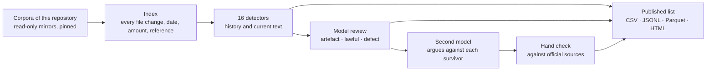
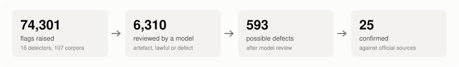
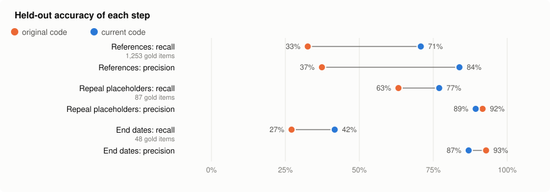
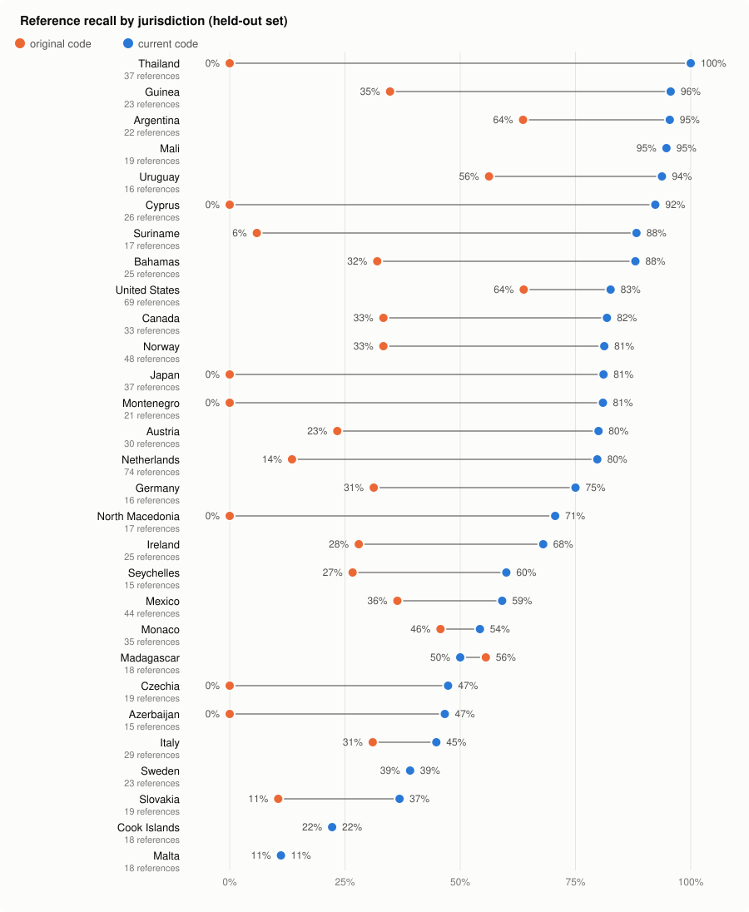

# Scripts

The code that produced the vulnerability list: it reads the law corpora of this repository at pinned commits, never writes to
them, runs detectors over their git histories and current texts, has a language model sort the candidates, and builds the
published list. Python 3.11+, git, and `pip install duckdb pyarrow psutil` (psutil optional).



<picture><source media="(prefers-color-scheme: dark)" srcset="img/funnel-dark.svg"></picture>

## Run it

```sh
export GLOBAL_LAW=/path/to/a/global-law/clone      # optional; without it, sync.py clones from GitHub
python ingest/sync.py                               # bare mirrors of global-law and every corpus, pins.json
python ingest/extract.py && python ingest/trailers.py
python ingest/textscan.py && python ingest/refscan.py && python ingest/refscan.py --fileact czechia-law
python ingest/headings.py
python detectors/trailer_only.py run && python detectors/rank.py run && python detectors/text_detectors.py run
python detectors/ref_detectors.py run && python detectors/placeholder_ref.py run && python detectors/late_extension.py run
python detectors/owi_de.py run && python detectors/dead_fine.py run && python detectors/subref_de.py run && python detectors/notes_scan.py run
python detectors/currency_scan.py run && python detectors/dup_labels.py run && python detectors/es_crossref.py run
python release/build_release.py out                 # the list, in every format
```

The model steps (`triage/`) need an OpenAI-compatible Responses API: set `LLM_BASE_URL`, `LLM_API_KEY` and `LLM_MODEL`
(`LLM_AUTH=azure` for Azure). On a shared machine set `LE_PRIORITY=idle`, `LE_WORKERS` and `LE_GREP_THREADS`.

| Folder | What it does |
|---|---|
| ingest/ | mirrors the corpora read-only; indexes every file change, every date limit, amount and reference |
| detectors/ | one script per kind of defect (see the table in [../README.md](../README.md)) |
| triage/ | model review: artefact, lawful or candidate defect; a second model argues against each survivor; case files |
| bench/ | the accuracy benchmark below, with its samples and labels |
| release/ | builds the published list and the confirmed cases |

## Dead fines in every language (dead_fine)

`detectors/dead_fine.py` generalises `owi_de.py` (Germany only) to every corpus: it finds penalty provisions (an offence, a
fine, an administrative infraction, in any language) and flags each reference in them to a provision of the same act that
is now only a repeal placeholder or was deleted. A penalty needs an existing statutory basis, so that part cannot be
enforced. Before a full run, check it in three ways:

| Check | Command | Result now |
|---|---|---|
| Unit tests: small acts in German, Spanish, Portuguese, French and English, including the false positives seen on real corpora | `python -m unittest discover -s tests` | 17/17 pass |
| Live check on the real acts behind the confirmed dead fines, and on acts that produced false positives before (another act's section with the same number) | `python bench/dead_fine_bench.py` | 9/9 found, 6/6 false positives avoided |
| Recognising penalty provisions, against model-labelled gold (about 1,070 provisions per set, half with a penalty word, half at random, from every corpus) | `python bench/penal_bench.py score --set holdout` | precision 94%, recall 74% (tuning set before the work: recall 52%) |

To redraw or relabel the penalty sets: `python bench/penal_bench.py sample --set tuning` and `label --set tuning` (needs the
model settings above); the held-out set (`--set holdout`) was scored once, after tuning on the other set.

Known limits:
- Recognition is weakest in Brazil, Malta, Thailand and Guinea on the held-out set, where penalties are often stated in a
  separate article or a closing 'Pena' line beyond the provision's text.
- Two bugs found while building this, fixed here but not yet in the shared code: `ingest/refscan.refs()` skips a file's
  first line as a heading, so corpora without heading lines (Brazil: 'Art. 347 - ...') lose references in a provision's
  first sentence; and `placeholder_ref.py` finds the text before a reference with `ctx.split(key)`, which cuts at the
  key's first occurrence ('1831/2003' for 'Artikel 3'). Fixing them in the shared code will change other detectors'
  counts, so they should go in with the next full run and a fresh benchmark score.

## How accurate the detectors are

The false negatives (defects the detectors miss) start in a few core steps: finding references in a line of law, recognising
a repealed provision, and reading an end date. `bench/stage_bench.py` measures each step on lines drawn at random from every
corpus (about 40 per corpus and stage), labelled by a language model as gold. Two sets were drawn: a tuning set (seed 7), used
while improving the code, and a held-out set (seed 11), used only to score. Held-out results, original code against current:

| Step | Original: precision / recall | Current: precision / recall | Gold items |
|---|---|---|---|
| References to numbered provisions of the same act | 37% / 33% | **84% / 71%** | 1253 |
| Repeal placeholders (provision is only 'Repealed', '(weggefallen)', ...) | 92% / 63% | **89% / 77%** | 87 |
| End dates of a rule ('until 31 December 2025') | 93% / 27% | **87% / 42%** | 48 |

<picture><source media="(prefers-color-scheme: dark)" srcset="img/accuracy-dark.svg"></picture>

The reference step by jurisdiction (held-out set, jurisdictions with at least 15 gold references):

<picture><source media="(prefers-color-scheme: dark)" srcset="img/languages-dark.svg"></picture>

What changed, in short:
- **References.** Separate words were read as suffixes ('section 10 of' as `10of`, 'artículo 458 y' as `458y`). Lists and
  ranges ('arts. 3, 5 and 7', 'artikelen 297 tot en met 299') were not expanded. Number-before-unit forms ('65. člena',
  '83 üncü maddenin', '1 straipsnio'), inflections ('člana', 'άρθρου', 'artikelen') and scripts (Arabic, Thai, Chinese,
  Japanese numerals) were missing. Headings and amendment notes were counted as references, and other acts named before the
  number ('ekteskapsloven § 8', 'Art. 34 DSGVO') were not recognised as other acts.
- **Placeholders.** Long source notes after 'Repealed.' hid the marker, label lines hid '((ARTICOLO ABROGATO))', and
  Georgian, Greek, Thai and several other markers were missing; 'Repeal of ...' headings counted as repealed.
- **End dates.** Month names and 'until' words existed for seven languages; deadlines ('not later than') were mixed with
  rule end dates; Swedish 'Upphör att gälla U:2027-03-01' and US 'shall cease to be effective after' were missing.

Limits of the benchmark: the gold labels are model judgements. A hand check of 30 held-out reference labels found one wrong
(another act's section counted as the same act's) and some sub-unit references ('subsection (1)'), which the scorer
filters out; read the figures as roughly ±5 points. The languages to fix were chosen after seeing the held-out scores, but
every fix was made from tuning-set examples. End-date recall is still low: many end dates are written in ways no fixed
pattern covers, which is why the empty-period candidates also go through model review.

Recall on the 25 cases confirmed by hand against official sources: 25/25
(`bench/known_positives.py`). Most of them were found by these detectors, so this checks that changes do not lose them
rather than measuring recall.

Reproduce: `python bench/stage_bench.py score --set holdout` (current code), and with `--code DIR` for an older copy of
`refscan.py`, `textscan.py` and `placeholder_ref.py`.
